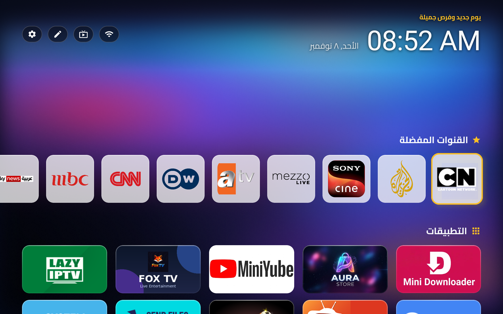
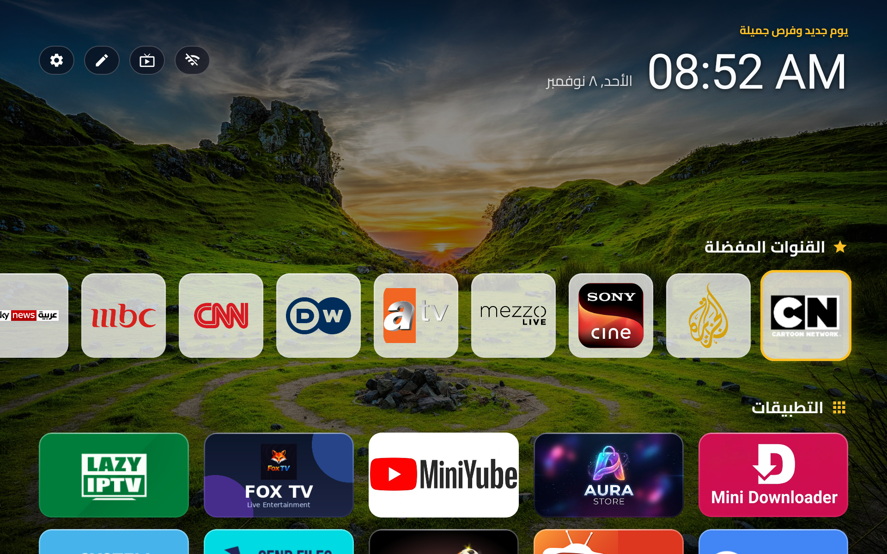
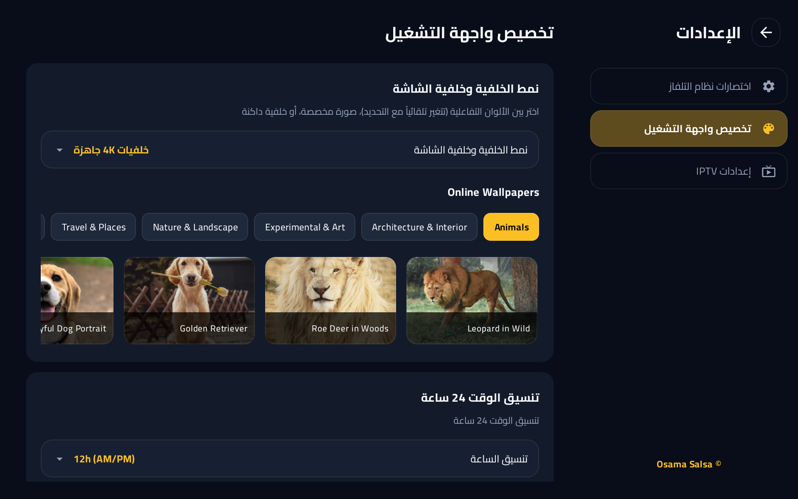
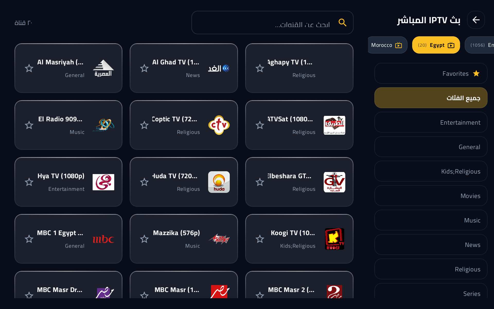
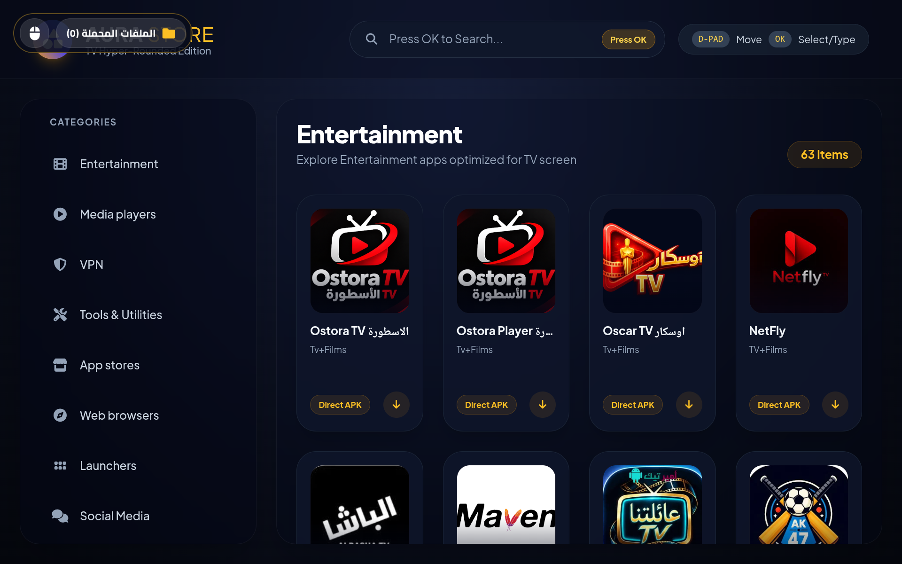
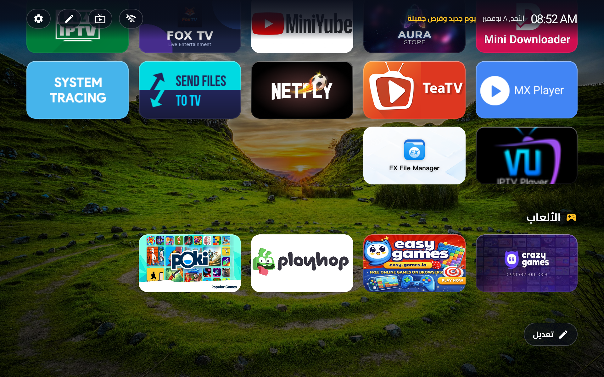
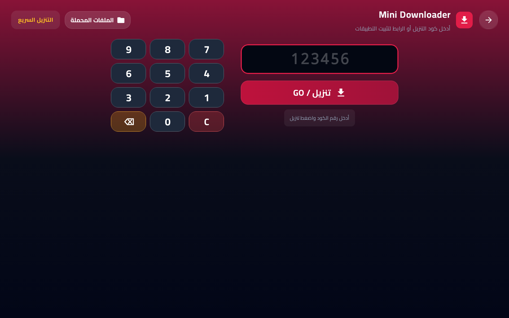

[English](README.md) | **العربية** | [Deutsch](README_de.md) | [Français](README_fr.md) | [Italiano](README_it.md) | [Русский](README_ru.md) | [Español](README_es.md) | [Português](README_pt.md) | [Türkçe](README_tr.md) | [Polski](README_pl.md) | [Nederlands](README_nl.md) | [Ελληνικά](README_el.md) | [Bahasa Indonesia](README_id.md) | [Tiếng Việt](README_vi.md) | [ไทย](README_th.md) | [中文](README_zh.md) | [日本語](README_ja.md) | [한국어](README_ko.md) | [हिन्दी](README_hi.md) | [اردو](README_ur.md) | [فارسی](README_fa.md)

<div align="center">

# 📺 Salsa TV Launcher v3.0



**لانشر ومركز وسائط حديث، فائق السرعة، خفيف، وقابل للتخصيص بالكامل، وخالٍ من الإعلانات بنسبة 100% لأجهزة Android TV مبني بواسطة Jetpack Compose.**  
*الحل الشامل الذي يغنيك عن عشرات التطبيقات المنفصلة على تلفازك الذكي.*

[](https://developer.android.com/tv)
[](https://github.com/OsamaSalsa/Salsa-TV-Launcher)
[](https://github.com/OsamaSalsa/Salsa-TV-Launcher)
[](https://github.com/OsamaSalsa/Salsa-TV-Launcher)
[](https://kotlinlang.org/)
[](https://developer.android.com/jetpack/compose)

---

</div>

<div dir="rtl">

## 🚀 الحل الشامل لأجهزة التلفاز

معظم واجهات التلفاز الذكي الحالية مليئة بالإعلانات الإجبارية، ومقاطع الفيديو الترويجية الثقيلة، والتوصيات غير المرغوبة، والاستجابة البطيئة.

**Salsa TV Launcher** صُمم ليكون البديل المثالي: واجهة نظيفة وفائقة السرعة وخفيفة جداً تجمع كافة احتياجات الترفيه المنزلي في تطبيق واحد بدون أي إعلانات أو برمجيات خفية.

### ✨ 7 وحدات أساسية متكاملة
1. **🚀 لانشر فائق السرعة وخفيف**: إقلاع فوري، وتوليد مسبق للرموز بالتوازي عبر أنوية المعالج، وتنقل سريع ومريح بمعدل 60 إطاراً في الثانية.
2. **📺 مشغّل IPTV مدمج مع شريط المفضلة**: دعم تشغيل روابط M3U مع إمكانية الوصول لقنواتك المفضلة وتشغيلها بنقرة واحدة مباشرة من الشاشة الرئيسية.
3. **🎥 MiniTube**: بوابة YouTube Leanback المخصصة للتلفاز للتشغيل السريع كضيف بدون تسجيل دخول أو تعقيدات.
4. **📥 Mini Downloader**: أداة تحميل عالية السرعة للملفات وحزم APK مع مثبّت ذكي تلقائي بنقرة واحدة.
5. **🛒 Salsa Store**: سوق تطبيقات ويب خفيف ومباشر لتثبيت وتحديث برامج وأدوات التلفاز.
6. **🕹️ 4 بوابات ألعاب مدمجة**: آلاف ألعاب الويب الخفيفة تعمل فوراً بدون تنزيل (**CrazyGames** و **Poki** و **Playhop** و **EasyGames**).
7. **🛡️ حاجب إعلانات وتتبع على مستوى الجهاز**: حماية AdGuard DNS المدمجة لحظر النوافذ الإعلانية وأدوات التتبع عبر كامل النظام.

---

## 🌟 أحدث الميزات والإضافات المطوّرة

### 🆕 أبرز إضافات وتحديثات الإصدار 3.0
* **🏠 مدير اللانشر المدمج `Launcher Manager` (التعيين كلانشر افتراضي عبر ADB المحلي بدون كمبيوتر أو هاتف خارجي)**: قسّم خاص داخل **الإعدادات > النظام واختصارات التلفاز > Launcher Manager** يتيح للتطبيق تعيين نفسه كلانشر `HOME` افتراضي ودائم بعد إعادة التشغيل مباشرة من داخل التلفاز نفسه عبر اتصال ADB المحلي (`127.0.0.1:5555`) مع توليد وحفظ مفتاح RSA محلياً للموافقة مرة واحدة فقط، وعرض الأمر الدقيق (`cmd package set-home-activity`)، والتحقق الفوري، وخيار تعطيل/استعادة اللانشر الأصلي للجهاز بضغطة زر.
* **👤 نظام المستخدمين واللون المميز الديناميكي لكل مستخدم (`Profiles / Users`)**: إنشاء عدة ملفات شخصية مستقلة، بحيث يمتلك كل مستخدم **لونه المميز الخاص (`Dynamic Theme Accent Color`)** من بين 8 درجات لونية متناسقة عالية التباين تحل ديناميكياً محل اللون الأصفر/الذهبي في كامل التطبيق (الرسالة الترحيبية، وأيقونات أقسام الشاشة الرئيسية [التطبيقات، الألعاب، الويب، الـ IPTV]، والإعدادات، والـ IPTV، وإطارات التركيز والأزرار)، بالإضافة إلى إعداداته المستقلة من **المظهر والخلفيات**، و**شاشة التوقف**، و**اللغة (بأسماء مقترحة مكتوبة بلغة التطبيق الحالية)**، و**قنوات وترتيب IPTV**، و**ترتيب التطبيقات والمواقع والألعاب**، و**رمز PIN اختياري من 4 أرقام**، والتحكم الكامل بكل قسم (**إظهار** أو **قفل بـ PIN** أو **إخفاء كامل**).
* **🔢 التنقل السريع بالأرقام (`0–9`) وشارات أرقام القنوات عالية التباين**: اضغط على أرقام الريموت (`0–9`) مباشرة من الشاشة الرئيسية أو قائمة قنوات IPTV أو أثناء المشاهدة للقفز الفوري لأي قناة برقمها، مع شارات رقمية واضحة وعالية التباين (أرقام سوداء على شارة بيضاء شفافة).
* **🎞️ تشغيل فيديو محلي من الجهاز أو فلاشة USB كشاشة توقف (`Media3 / ExoPlayer`)**: بالإضافة إلى فيديوهات `m.youtube.com` النقية بملء الشاشة بدون أي نصوص أو عناصر متراكبة، يمكنك اختيار أي ملف فيديو مخزن على التلفاز أو فلاشة USB عبر منتقي النظام الآمن (`SAF`) ليعمل بتكرار سلس بملء الشاشة.
* **📡 شاشة التوقف النصية الإعلامية (12 ثيماً متحركاً + خلفيات داكنة ديناميكية + قارئ صوتي)**: 12 ثيم استوديو مختلفاً كلياً (6 كلاسيكية + 6 ثيمات إبداعية متحركة جديدة: **شفق قطبي**، **ريترو 80s**، **مدار كوني**، **أرابيسك ذهبي**، **استوديو إيقاعي**، و**منشور زجاجي**) مع **خلفية ديناميكية داكنة مخصصة لكل ثيم** تتضمن ظلالاً متحركة بألوان متباينة، ومعاينات حية مصغّرة داخل الإعدادات، وإمكانية تعديل الأسطر وضبط المدة (`3–15 ثانية`)، بالإضافة إلى **القارئ الصوتي الذكي (TTS)** الذي ينتظر انتهاء قراءة السطر قبل الانتقال للتالي، مع موسيقى خلفية أو ملف MP3 محلي.
* **📺 معالجة ذكية لأخطاء قنوات IPTV (`القناة التالية` + إعادة محاولة تلقائية بعد 15 ثانية) + هدية 3× OK السرية**: عند تعذّر تشغيل أي قناة IPTV، تظهر نافذة نظيفة بخيار واحد فقط مركّز على **القناة التالية** مع **عدّاد تنازلي حي لمدة 15 ثانية** يعيد محاولة تشغيل نفس القناة تلقائياً إذا لم يتم اختيار القناة التالية. كما أن الضغط على `OK` 3 مرات على بطاقة IPTV عند عدم وجود قوائم يفتح **قوائم IPTV المدمجة المختارة** باحتفالية صندوق هدايا متحرك.
* **🛒 صدارة المتصفحات والتواصل في Salsa Store + فيديو شاشة توقف نقي عبر `m.youtube.com`**: يعرض **Salsa Store** قسمي **متصفحات الويب (Web Browsers)** و**التواصل الاجتماعي (Social Media)** في صدارة أقسامه الـ 9 لأدوات ومشغلات التلفاز الرسمية والموثوقة (مع وضع عدم الاتصال)، وتعمل شاشة التوقف المرئية دائماً بملء الشاشة عبر `m.youtube.com` بنقاء تام دون أي نصوص أو أزرار أو عناصر متراكبة على الفيديو.
* **🎨 الإعدادات الحية للواجهة (`Live UI Settings`) — تبديل مباشر لنمط الساعة**: أُضيف قسم مستقل ومباشر لتغيير **نمط الساعة** بين نظام **24 ساعة (`22:00`)** ونظام **12 ساعة (`AM/PM`)** بجوار حجم الساعة وصيغ التاريخ، مع معاينة فورية لخلفيات 4K والسطوع وموضع التطبيقات وكثافة الشبكة وشفافية الزجاج والتحية المخصصة والطقس وراحة العين الليلية والألوان الديناميكية والوضع الخفيف.
* **🖥️ شاشة توقف اللوحات التفاعلية مع القارئ الصوتي والموسيقى الموحدة النقية**: عرض **الطقس**، **الأخبار**، **الاقتصاد**، **كرة القدم**، أو **التناوب التلقائي بين الكل**؛ مع دعم **القارئ الصوتي للأخبار (TTS)** الذي يُنهي قراءة الأخبار الـ 6 كاملة قبل الانتقال للوحة التالية، ومشاركة نفس مقاطع الموسيقى الهادئة الواضحة المعتمدة في عرض الصور والنصوص (**بوسا نوفا**، **جاز هادئ**، **أمواج البحر**، **استرخاء كلاسيكي**، أصوات محيطية وملف MP3) مع خفض تلقائي للصوت أثناء القراءة.
* **🌙 المدة الافتراضية لشاشة التوقف 10 دقائق**: أصبحت المدة الافتراضية لتشغيل شاشة التوقف **10 دقائق** من عدم النشاط (مع إمكانية تعديلها إلى 2، 5، 10، 15، 30 دقيقة، أو تعطيلها لصالح شاشة توقف النظام).
* **🖱️ مؤشر الماوس الافتراضي، التخصيص الذكي لزر الثلاث خطوط (`☰`) وشاشة البداية**: وصول كامل لمؤشر الماوس الافتراضي إلى أعلى وأسفل الشاشة في بوابات الويب والألعاب؛ كما يعمل زر **القائمة (`☰` ثلاث خطوط)** حسب السياق: يفتح **الإعدادات** في الشاشة الرئيسية، ويفتح **إعدادات IPTV** داخل IPTV، ويبدّل **وضع الماوس الافتراضي** في شاشات الويب والألعاب؛ مع إصلاح الضغط المطوّل على `OK`، وتحديث أيقونة **Salsa Store**، وإضافة رقم الإصدار `v3.0` أسفل شاشة البداية، و**تحديث تلقائي عبر GitHub OTA** مع التحقق من بصمة `SHA-256` وشهادة توقيع الحزمة قبل التثبيت.
* **🌐 مركز اللوحات الـ 4 الحية ومحرك v3.0 لـ 21 لغة**: وصول مباشر من الشريط العلوي إلى لوحات **الطقس**، **الأخبار (21 لغة و 5 أقسام بدون تكرار)**، **الاقتصاد والأسواق**، و**كرة القدم (365Scores)**، مع بوابات الويب والألعاب الافتراضية (**YouTube TV** و **Google** و **4 بوابات ألعاب**) ومحرك v3.0 خفيف وسلس بمعدل 60 إطاراً.

### ⚡ سرعة فائقة وتجاوب فوري بين التطبيقات
* **ظهور فوري لجميع الأيقونات والشعارات**: معالجة وفك تشفير أيقونات التطبيقات مسبقاً في الخلفية بالتوازي عبر جميع أنوية المعالج، لتظهر جميع الرموز في اللحظة الأولى لتشغيل اللانشر بدون أي انتظار.
* **تنقل خاطف بالريموت (110ms)**: تسريع حركة التركيز والتكبير والانتقال بين التطبيقات بالكامل عبر معالج الرسوميات (`graphicsLayer`) بزمن استجابة قياسي يبلغ 110 ملي ثانية فقط.
* **إضاءة محيطية خفيفة على المعالج**: استبدال فلاتر الضبابية المزدوجة الثقيلة بتدرجات شعاعية انسيابية مدمجة، مما خفّض استهلاك معالج التلفاز وضمن حركة ناعمة وثابتة.
* **واجهة نظيفة (حذف زر Edit السفلي)**: تم الاستغناء عن زر Edit السفلي لجعل الشاشة الرئيسية واسعة ومريحة، مع إمكانية التعديل وترتيب البرامج بكل سهولة عبر **الضغط المطول على زر `OK`**.

### 🌙 ذكاء شاشة التوقف وتفويض شاشات التوقف الخارجية
* **التفويض الكامل لشاشة توقف النظام أو الخارجية (`معطل / Disabled`)**: عند اختيار تعطيل شاشة التوقف الداخلية، يقوم التطبيق تلقائياً بإلغاء حظر السبات (`FLAG_KEEP_SCREEN_ON`)، مما يتيح لشاشة التوقف التابعة لنظام التلفاز أو أي تطبيق خارجي العمل في موعدها الطبيعي.
* **شاشة التوقف الداخلية الذكية (`مفعل`)**: تعمل افتراضياً بعد **10 دقائق** من عدم النشاط (قابلة للتعديل: 2، 5، 10، 15، أو 30 دقيقة)، وتبقي التلفاز نشطاً لعرض نمط التوقف الذي تفضله:
  * **نمط الساعة والتاريخ**: ساعة رقمية مضيئة كبيرة مع حماية الشاشة من الاحتراق (Drift Protection).
  * **نمط خلفية 4K مع معلومات أسفل الشاشة**: خلفية طبيعية بجودة 4K مع تدرج زاوي أنيق (45 درجة) يبرز الساعة والتحية والتاريخ بوضوح.
  * **فيديو سينمائي ملء الشاشة عبر `m.youtube.com` أو فيديو مخزن على الجهاز**: تشغيل مباشر ونقي لفيديوهات المدفأة أو الأكواخ الثلجية أو الشلالات بملء الشاشة عبر `m.youtube.com` بدون أي نصوص أو أزرار على الفيديو، مع إمكانية **إضافة أي فيديو يوتيوب أو اختيار ملف فيديو مخزن على الجهاز**، أو حذف/استعادة الفيديوهات الافتراضية، وزر **معاينة فورية لشاشة التوقف (`Preview`)** من داخل الإعدادات.
  * **عرض شرائح الصور المتحرّك (`Slideshow`)**: حوّل شاشة تلفازك إلى معرض فني حي يعرض صورك من مجلد مخصص في ذاكرة الجهاز أو فلاشة USB، أو صور مختارة، أو معارض 4K جاهزة:
    * **زمن كل صورة والعشوائية**: التحكم بزمن بقاء كل صورة (`5 ثوانٍ`، `10 ثوانٍ`، `15 ثانية`، `30 ثانية`، `دقيقة`، `5 دقائق`) مع خيار العرض العشوائي.
    * **طريقة عرض وحركة الصورة**: الاختيار بين **حركة سينمائية ناعمة (Ken Burns)**، أو **تقريب هادئ (Gentle Zoom)**، أو **صورة ثابتة (Static)**.
    * **تأثيرات دخول الصور**: **تلاشي ناعم (Crossfade)**، **انزلاق جانبي (Slide)**، **تقريب وتلاشي (Zoom & Fade)**، **ظهور تدريجي (Soft Scale)**، **قلب ثلاثي الأبعاد (3D Flip)**، أو **تأثير عشوائي متجدد**.
    * **تأثيرات جوية خارجية ساحرة**: **تساقط الثلوج ❄️**، **يراعات مضيئة ✨**، **مطر هادئ 🌧️**، **أوراق الخريف 🍂**، **بتلات الكرز 🌸**، **نجوم متلألئة ⭐**، أو **أضواء بوكيه 🔮**.
    * **الساعة الزاوية والموسيقى الخلفية**: عرض الساعة والتاريخ والتحية في زاوية الشاشة بتدرج 45° تماماً مثل الخلفية الثابتة، مع باقة موسيقى مدمجة واضحة ونقية (**بوسا نوفا**، **جاز هادئ**، **أمواج البحر**، **استرخاء كلاسيكي** ومعزوفات هادئة) أو ملفات MP3 من جهازك والتحكم بمستوى الصوت والتعتيم الليلي.

### 🕒 تخصيص متكامل للساعة والتاريخ والتحية الترحيبية
* **دعم شامل لـ 21 لغة عالمية**: تعريب وترجمة كاملة ومتقنة باللغة **العربية (بخط Cairo الرائع)** و **الإنجليزية** و **الألمانية** و **الإسبانية** و **الفرنسية** و **الإيطالية** و **الروسية** و **البرتغالية** و **التركية** و **البولندية** و **الهولندية** و **اليونانية** و **الإندونيسية** و **الفيتنامية** و **التايلاندية** و **الصينية** و **اليابانية** و **الكورية** و **الهندية** و **الأردية (RTL)** و **الفارسية (RTL)**.
* **التحكم بالساعة**: الاختيار بين تنسيق 12 ساعة أو 24 ساعة، مع إمكانية إظهار الثواني الحية، واختيار حجم الساعة (صغير، متوسط، كبير).
* **صيغ التاريخ الأمريكية والعالمية**: اختر الصيغة الأمريكية الرقمية (`MM/dd/yyyy`)، أو الأمريكية الطويلة (`MMMM d, yyyy`)، أو الأمريكية الكاملة مع اليوم (`EEEE, MMMM d, yyyy`)، أو المختصرة (`EEE, MMM d`)، أو العالمية (`dd/MM/yyyy`)، أو القياسية (`yyyy-MM-dd`)، أو الأوروبية (`dd.MM.yyyy`)، أو الكاملة، أو إخفاء التاريخ.
* **أنماط العبارة الترحيبية**: تحيات شعرية ساعية، أو ترحيب دافئ، أو ترحيب موجز، أو كتابة نص ترحيبي مخصص باسمك، أو إخفاؤها.

### 🎛️ تخصيص الواجهة وشاشة البداية
* **تخطي مركز التحكم أو إظهار أيقونة الإعدادات مباشرة**: خيار جديد في الإعدادات يتيح لك اختيار شكل الأزرار في الشريط العلوي للشاشة الرئيسية: إظهار **أيقونة مركز التحكم السريع**، أو **تخطي مركز التحكم ووضع إشارة الإعدادات مباشرة**، أو **عرض الاثنين معاً (مركز التحكم + الإعدادات)** جنباً إلى جنب.
* **التركيز الافتراضي على الإعدادات**: عند فتح اللانشر يوضع المؤشر تلقائياً على أيقونة الإعدادات/مركز التحكم العلوية للوصول السريع إلى التخصيص.
* **بداية ظهور التطبيقات للأسفل**: إمكانية خفض صفوف التطبيقات (6 مستويات بالاسم فقط بدون أرقام، والافتراضي 450) لإعطاء مساحة أكبر لظهور خلفيات 4K وتأثيرات الإضاءة.
* **التحكم بعدد التطبيقات في الصف**: اختر بين 4، 5، 6، أو 7 تطبيقات في الصف الواحد بما يتناسب مع حجم شاشة تلفازك.
* **التحكم بشفافية الزجاج والألوان الديناميكية (`Material You`)**: تخصيص شفافية البطاقات الزجاجية من 10% إلى 100%، مع خيار تفعيل **الألوان الديناميكية** لتتكيف ألوان الواجهة مع طابع النظام.
* **إظهار تطبيقات الهواتف المثبتة خارجياً (`Sideloaded Apps`)**: خيار التبديل بين إظهار تطبيقات التلفاز فقط أو **إظهار جميع تطبيقات الأندرويد المثبتة** (بما فيها تطبيقات الهواتف المثبتة عبر APK)، مع أزرار لاستعادة كافة التطبيقات المخفية أو إعادة ضبط الترتيب بضغطة واحدة.

### 🎙️ البحث الصوتي الشامل ومشغّل IPTV المتقدم
* **البحث الصوتي والنصي الشامل (`🎤 Voice Search`)**: ابحث فوراً بالصوت عبر مايكروفون الريموت أو بلوحة المفاتيح في جميع التطبيقات المثبتة وقنوات الـ IPTV الحية والبحث المباشر في الويب ويوتيوب من نافذة واحدة.
* **مركز التحكم السريع (`Quick Control Center`)**: لوحة زجاجية سريعة لتبديل نظام الوقت (12/24 ساعة)، وتفعيل/إيقاف الخلفية الديناميكية، وتشغيل شاشة التوقف فوراً، وفتح البحث الصوتي، والوصول لإعدادات الواي فاي والإعدادات الكاملة (مع خيار تخطي مركز التحكم للذهاب للإعدادات مباشرة أو عرض الأيقونتين معاً).
* **إدارة قوائم IPTV المتعددة وشريط المعلومات والمعالجة الذكية للأخطاء**: إمكانية إضافة وحفظ **عدة قوائم تشغيل M3U** والتبديل بينها أو تحديثها وحذفها مع دعم روابط دليل البرامج `XMLTV EPG`. وأثناء المشاهدة، بمجرد الضغط على زر `OK` بالريموت يظهر شريط المعلومات السينمائي وبداخله **شريط تنقل أفقي سريع بين القنوات (`◀ / ▶`)**، ودليل البرامج الحي، ومؤقت النوم، وتغيير أبعاد الشاشة، وقفل الفئات برمز PIN، واستئناف آخر قناة تلقائياً، ومعالجة ذكية عند تعذّر تشغيل القناة بخيار **القناة التالية** فقط مع **إعادة محاولة تلقائية بعد 15 ثانية**.
* **عرض ابتدائي نظيف بأسفل الشاشة وتصغير ذكي للساعة عند مسافة `240`**: يبدأ التشغيل بوجود البرامج والقنوات في أسفل الشاشة (6 مستويات بالاسم من *مرتفع* إلى *منخفض جداً*، والافتراضي `450`) مع بقاء الساعة بحجمها الكبير وعدم وقوف المؤشر على أي مكان حتى تضغط على الريموت، وتصغر الساعة تلقائياً بمجرد وصول أعلى أيقونة برامج أو قنوات إلى مسافة `240` من الأعلى.
* **المواقع المفضلة الذكية (جلب تلقائي للأيقونات + واجهة YouTube TV)**: استخراج وحفظ شعارات المواقع عالية الدقة تلقائياً عند إضافة أي موقع ويب، مع فتح روابط يوتيوب المضافة في المفضلة بواجهة **YouTube TV Leanback** الكاملة المتوافقة مع الريموت.
* **شريط التطبيقات الأخيرة والتحديث التلقائي (`GitHub OTA`)**: خيار إظهار صف التطبيقات المفتوحة مؤخراً، وفحص وتثبيت التحديثات مباشرة من GitHub مع التحقق الآمن من بصمة `SHA-256` وشهادة التوقيع.

### 🔒 الخصوصية، مدير التخزين، الحماية العائلية (محمية بـ PIN) وتنظيم التطبيقات
* **مدير التخزين والتطبيقات المدمج (`App Storage Manager`)**: استعراض جميع التطبيقات المثبتة مرتبة حسب حجمها بالميغابايت (`MB`)، مع إمكانية فتح معلومات التطبيق في النظام أو **إلغاء تثبيت أي تطبيق مباشرة** لتفريغ مساحة التخزين.
* **شبكة اختصارات النظام الـ 10 السريعة (مع `Launcher Manager`)**: وصول فوري بنقرة واحدة إلى **Launcher Manager (تعيين اللانشر الأساسي عبر ADB المحلي)**، و**خيارات المطور (`Developer Options`)**، وإعدادات **الواي فاي**، **الإيثرنت (`Ethernet`)**، **العرض والشاشة**، **الصوت**، **التاريخ والوقت**، **إعدادات النظام الكاملة**، **معلومات التطبيق**، و**مدير التخزين**.
* **درع الحماية المزدوج (`AdBlock` + `وضع الحماية العائلية والأطفال المحمي بـ PIN`)**: الاختيار بين **حجب الإعلانات والتتبع** أو **وضع الحماية العائلية (`Family Shield`)** الذي يحجب الإعلانات وأدوات التتبع والمواقع الإباحية على مستوى الجهاز بالكامل. **لا يمكن الخروج من وضع الحماية العائلية أو تغيير رمز الـ PIN أثناء تفعيله إلا بعد إدخال رمز الـ PIN السري المكون من 4 أرقام.**
* **قفل التطبيقات وفئات القنوات برمز PIN**: حماية التطبيقات الحساسة وفئات قنوات الـ IPTV برمز سري مكون من 4 أرقام.
* **إخفاء وترتيب التطبيقات**: إمكانية نقل أو تصنيف التطبيقات (تطبيقات مقابل ألعاب) أو إخفاء برامج النظام غير المرغوبة.
* **أمان زر الرجوع**: منع الخروج غير المقصود إلى نظام التلفاز عند الضغط على زر Back في الشاشة الرئيسية.

> ⚠️ **تنبيه مهم حول وضع الأطفال والحماية العائلية**: الخروج من وضع الحماية العائلية داخل الإعدادات محمي برمز **PIN** فقط. ومع ذلك، تجدر الإشارة إلى أن **اللانشر وحده لا يمنع الطفل من الخروج عبر تطبيق آخر أو عبر زر `Home` في الريموت** ما لم يتم تعيين **Salsa TV Launcher** كلانشر افتراضي للنظام (`Default Home Launcher`) مع قفل تطبيق **إعدادات النظام** (أو أي لانشر/متصفح آخر) برمز الـ PIN من داخل اللانشر.

---

## 🛡️ الأمان وتوضيح الصلاحيات المستخدمة

صُمم Salsa TV Launcher وفق معايير أمان وخصوصية صارمة دون أي تتبع أو جمع بيانات:
* **تشفير الاتصالات (`network_security_config.xml`)**: تم تعطيل الاتصالات غير المشفرة افتراضياً (`usesCleartextTraffic="false"`) مع حصر الاستثناءات في النطاقات الضرورية التي لا تدعم HTTPS فقط.
* **تفعيل التصفح الآمن (`WebView Safe Browsing`)**: تم تفعيل `EnableSafeBrowsing=true` في جميع نوافذ الويب المدمجة لحماية المستخدم من المواقع الضارة، مع تعطيل إرسال إحصائيات الاستخدام (`MetricsOptOut=true`).
* **التحقق المزدوج من التحديث التلقائي (`SHA-256 + Signature Verification`)**: قبل تثبيت أي تحديث يتم تحميله من GitHub، يتحقق `AppUpdateManager` من تطابق بصمة الملف **`SHA-256`** (الموجودة في `version.json`)، وتطابق **اسم الحزمة (`packageName`)**، وتطابق **شهادة التوقيع الرقمي (`Signing Certificate`)** مع النسخة المثبتة على الجهاز.
* **بدون صلاحية الوصول الشامل للملفات (`No MANAGE_EXTERNAL_STORAGE`)**: تم الاستغناء تماماً عن صلاحيات التخزين الواسعة (`MANAGE_EXTERNAL_STORAGE` و `READ/WRITE_EXTERNAL_STORAGE`) والاعتماد على منتقي ملفات النظام الآمن (`Storage Access Framework / SAF`) لاختيار الخلفيات أو الفيديوهات أو ملفات MP3 أو النسخ الاحتياطية.

| الصلاحية | سبب الاستخدام في التطبيق |
| :--- | :--- |
| `INTERNET` و `ACCESS_NETWORK_STATE` | تشغيل قنوات الـ IPTV، جلب بيانات لوحات الطقس والأخبار والاقتصاد وكرة القدم، متجر Salsa Store، وفحص التحديثات عبر GitHub. |
| `ACCESS_COARSE_LOCATION` | صلاحية اختيارية للموقع التقريبي (على مستوى المدينة فقط بدون GPS دقيق) لتحديد طقس منطقتك تلقائياً في ويدجت ولوحة الطقس. |
| `RECORD_AUDIO` | صلاحية اختيارية تُستخدم حصرياً عند فتح نافذة **البحث الصوتي المدمج (`🎤 Voice Search`)** للبحث بالصوت عن البرامج أو القنوات أو الويب. |
| `REQUEST_INSTALL_PACKAGES` | تُستخدم فقط عندما يختار المستخدم بنفسه تحميل وتثبيت حزمة APK عبر **Mini Downloader** أو **Salsa Store** أو **التحديث التلقائي**. |
| `REQUEST_DELETE_PACKAGES` | تُستخدم فقط عندما يختار المستخدم بنفسه **إلغاء تثبيت (`Uninstall`)** أحد التطبيقات من داخل **مدير التخزين (`App Storage Manager`)** أو قائمة إدارة التطبيق. |
| `FOREGROUND_SERVICE` و `BIND_VPN_SERVICE` | تُستخدم حصرياً عند تفعيل **حاجب الإعلانات / وضع الحماية العائلية (`AdGuard DNS`)** لتمرير استعلامات الـ DNS محلياً بدون خوادم خارجية. |
| `RECEIVE_BOOT_COMPLETED` | تشغيل اللانشر واستعادة خدمة فلتر الـ DNS تلقائياً عند إقلاع التلفاز. |

---

## 📱 لقطات الشاشة

</div>

<div align="center">

| الشاشة الرئيسية والإضاءة المحيطية | خلفيات 4K الفائقة |
| :---: | :---: |
| ** | ** |

| مشغّل IPTV المدمج | سوق Salsa Store |
| :---: | :---: |
| ** | ** |

| بوابات الألعاب الفورية | أداة التحميل Mini Downloader |
| :---: | :---: |
| ** | ** |

</div>

<div dir="rtl">

---

## 📥 تحميل وتثبيت التطبيق

> ℹ️ **ملاحظة حول المنصات المدعومة**: صُمم التطبيق بشكل أساسي لأجهزة **التلفاز الذكي (`Android TV` / `Google TV` / `TV Boxes`)** التي تعمل بالريموت كنترول. *(ميزة التوافق مع الهواتف وشاشات اللمس الصغيرة لا تزال **ميزة تجريبية قيد التطوير**)*.

### الخيار 1: التحميل المباشر
حمّل ملف APK الجاهز مباشرة على جهاز التلفاز الذكي (`Android TV`):

👉 **[تحميل أحدث نسخة APK من Salsa TV Launcher](https://github.com/OsamaSalsa/Salsa-TV-Launcher/raw/refs/heads/main/salsa-tv-launcher.apk)**  
👉 **[كود تطبيق Downloader المباشر: aftv.news/5157967](http://aftv.news/5157967)**

### الخيار 2: التثبيت عبر ADB
</div>

```bash
# الاتصال بالتلفاز عبر عنوان IP
adb connect <IP_ADDRESS>:5555

# تثبيت الحزمة
adb install -r salsa-tv-launcher.apk
```

<div dir="rtl">

### الخيار 3: تعيينه كلانشر افتراضي (عبر `Launcher Manager` المدمج بالـ ADB المحلي بدون كمبيوتر)
1. افتح **الإعدادات > النظام واختصارات التلفاز** داخل لانشر Salsa TV واختر **Launcher Manager**.
2. اتبع الخطوات الـ 3: فعّل **خيارات المطور وتصحيح USB/الشبكة**، ثم اضغط **اتصال (Connect)** ووافق على نافذة التلفاز مع تفعيل *"السماح دائماً"*، ثم اضغط **تعيين كـ HOME** ليصبح Salsa TV اللانشر الأساسي الدائم لجهازك دون الحاجة لأي جهاز خارجي (مع زر **استعادة اللانشر الأصلي** في أي وقت أو خيار منتقي النظام البديل).

---

## 🎮 اختصارات ريموت التلفاز

| زر الريموت | الوظيفة |
| :--- | :--- |
| **أسهم الاتجاهات (D-Pad)** | تنقل فائق السرعة والسلاسة بين البرامج والقنوات والإعدادات. |
| **زر الاختيار (OK / Center)** | فتح التطبيق المحدد أو تشغيل القناة المفضلة. |
| **الضغط المطول على زر OK** | يفتح قائمة إدارة التطبيق أو القناة (إعادة الترتيب، القفل بـ PIN، الإخفاء، نقله للألعاب، معلومات/إلغاء التثبيت). |
| **أزرار الأرقام (`0–9`)** | **التنقل السريع بين القنوات**: اكتب رقم القناة من الشاشة الرئيسية أو قائمة IPTV أو أثناء المشاهدة للانتقال إليها فوراً (`OK` للتأكيد، `Back` للتعديل). |
| **زر الثلاث خطوط (`☰ Menu`)** | ذكي حسب الشاشة: في **الشاشة الرئيسية** يذهب مباشرة إلى **الإعدادات**، وفي **شاشات IPTV** (القنوات والمشغّل) يفتح **إعدادات IPTV** (بينما `INFO`/`GUIDE` لشريط معلومات القناة)، وفي **شاشات الويب والألعاب** يبدّل **وضع الماوس الافتراضي**. |
| **زر الأوامر الصوتية (`🎤 Google Assistant`)** | فتح البحث الصوتي المدمج للبحث الفوري عن التطبيقات والقنوات أو البحث في الإنترنت. |
| **زر الإعدادات في الريموت (`Settings`)** | يفتح مركز التحكم السريع أو يذهب للإعدادات مباشرة (حسب اختيارك في إعدادات أيقونة الشريط العلوي). |
| **زر الرجوع (Back)** | العودة للشاشة السابقة أو الرجوع للشاشة الرئيسية بأمان دون إغلاق اللانشر. |

---

## 🛠️ التقنيات المستخدمة

* **لغة البرمجة**: [Kotlin](https://kotlinlang.org/)
* **واجهة المستخدم**: [Jetpack Compose (Material 3)](https://developer.android.com/jetpack/compose)
* **المعمارية**: MVVM + Coroutines & StateFlow
* **معالجة الصور**: [Coil](https://coil-kt.github.io/coil/)
* **مشغّل الوسائط**: [Media3 / ExoPlayer](https://developer.android.com/media/media3)

---

## 📄 حقوق النشر والملكية

تصميم وتطوير: **© أسامة صلصة (Osama Salsa)**.  
يحتوي هذا المستودع على النسخة النهائية الجاهزة للتثبيت (`APK`)، ملفات التوثيق، لقطات الشاشة، وملف التحديث التلقائي الموثّق (`version.json`).

</div>

<div align="center">
  <sub>صُنع بكل ❤️ لتقديم تجربة تلفزيونية سريعة ونقية وخالية تماماً من الإعلانات حول العالم.</sub>
</div>
