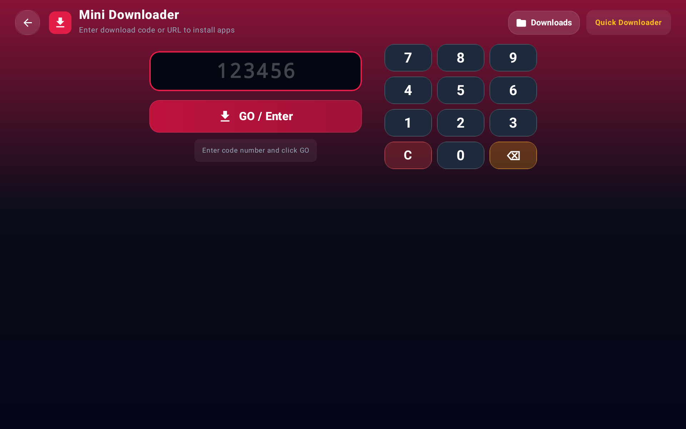

[English](README.md) | [العربية](README_ar.md) | **Deutsch** | [Français](README_fr.md) | [Italiano](README_it.md) | [Русский](README_ru.md) | [Español](README_es.md) | [Português](README_pt.md) | [Türkçe](README_tr.md) | [Polski](README_pl.md) | [Nederlands](README_nl.md) | [Ελληνικά](README_el.md) | [Bahasa Indonesia](README_id.md) | [Tiếng Việt](README_vi.md) | [ไทย](README_th.md) | [中文](README_zh.md) | [日本語](README_ja.md) | [한국어](README_ko.md) | [हिन्दी](README_hi.md) | [اردو](README_ur.md) | [فارسی](README_fa.md)

<div align="center">

# 📺 Salsa TV Launcher v3.1


**Ein moderner, anpassbarer, ultraschneller und zu 100 % werbefreier Android TV Launcher & Media Center auf Basis von Jetpack Compose.**  
*Die All-in-One-TV-Lösung, die Dutzende einzelner Apps auf Ihrem Gerät ersetzt.*

[](https://developer.android.com/tv)
[](https://github.com/OsamaSalsa/Salsa-TV-Launcher)
[](https://github.com/OsamaSalsa/Salsa-TV-Launcher)
[](https://github.com/OsamaSalsa/Salsa-TV-Launcher)
[](https://kotlinlang.org/)
[](https://developer.android.com/jetpack/compose)

---

</div>

## 🚀 Die All-in-One-Lösung

Die meisten Smart-TV-Launcher sind heute mit erzwungener Werbung, schweren Videovorschauen, unerwünschten Empfehlungen und trägen Benutzeroberflächen überladen.

**Salsa TV Launcher** wurde als das genaue Gegenteil entwickelt. Er ist nicht nur ein Startbildschirm, sondern ein All-in-One-Medienzentrum, das zahlreiche separate TV-Apps in einer übersichtlichen, schnellen und komplett werbefreien Zentrale vereint.

### ✨ Integrierte Kernmodule
1. **🚀 Ultraschneller & schlanker Launcher**: Blitzschneller App-Start, GPU-beschleunigte Fokusbewegung, paralleles Vorladen von Icons und 0 % CPU-Ballast.
2. **📺 Integrierter IPTV-Player & Favoritenleiste**: M3U-Playlist-Player mit sofortiger 1-Klick-Wiedergabe Ihrer Lieblingssender direkt auf dem Startbildschirm.
3. **🎥 MiniTube**: Schlankes YouTube TV Leanback-Erlebnis mit schneller Gastwiedergabe und voller TV-Fernbedienungssteuerung.
4. **📥 Mini Downloader**: Hochgeschwindigkeits-Datei- und APK-Downloader mit intelligentem 1-Klick-Paketinstaller.
5. **🛒 Salsa Store**: Übersichtlicher Web-App-Marktplatz zum Durchsuchen und Installieren von Android-TV-Tools und Dienstprogrammen.
6. **🕹️ 4 Spieleportale**: Tausende sofort spielbare HTML5-Online-Spiele ohne Downloads (**CrazyGames**, **Poki**, **Playhop**, **EasyGames**).
7. **🛡️ Systemweiter Werbe- & Tracker-Blocker**: Integrierter AdGuard-DNS-Schutz schirmt Ihren gesamten Fernseher vor Popups, Bannern und Telemetrie ab.

---

## 🌟 Neue Funktionen & aktuelle Verbesserungen

### 🆕 Neu in Version 3.1
* **🧸 Kindermodus (`Kids Mode`) & 4 auf GitHub gehostete Kinder-Designs (`Regenbogen-Einhorn`, `Zaubergarten`, `Weltraum-Abenteuer`, `Dino-Dschungel`)**: Erstellen Sie eigene Kinderprofile mit **obligatorischer 4-stelliger PIN** (beim Anlegen festgelegt) zum Schutz der Einstellungen und Bearbeitungsmenüs. Der Kindermodus bietet eine verspielte Oberfläche mit **Nur-Einstellungen-Topbar** (nur Uhr, Wetter, Datum und Einstellungen-Button), **Playpen Sans Arabic** / **Comic Relief**-Schriftarten, unveränderten Original-App-Icons & TV-Bannern, automatisch aktiviertem **Familienschutz-DNS** sowie **4 Kinder-Designs**, deren `1920×1080`-Hintergründe automatisch von GitHub (`/kids_themes/`) geladen werden.
* **🛒 100 % Live-Datenbank im `Salsa Store` (`https://auratv.freedev.app/index.html`) & Native TV-Kategorien**: Keine App-Namen oder Kataloge mehr lokal in der App gespeichert — bei jedem Öffnen lädt der **Salsa Store** alle App-Namen und Informationen live von `https://auratv.freedev.app/index.html` in der nativen TV-Kategorienansicht, beginnend mit **Webbrowser** als erster Kategorie, gefolgt von **Soziale Medien** und den übrigen Kategorien.
* **⌨️ Automatische Bildschirmtastatur für Text- & Suchfelder in Webseiten (außer YouTube)**: Beim Anklicken eines Such- oder Eingabefelds in Webportalen oder im Browser öffnet sich sofort die Standard-Bildschirmtastatur zum Tippen (ausgenommen **YouTube TV**, das seine eigene TV-Tastatur nutzt).
* **🔐 Profil-PIN-System, verdeckte Doppel-Eingabe, Profil-Zugangssperre & Admin `Master PIN`**: Kein voreingestellter Standard-PIN (`1234`) mehr — vor dem Sperren von Apps, Bereichen oder IPTV-Kategorien muss zuerst eine 4-stellige PIN durch **zweimalige Eingabe** festgelegt werden. PINs werden in den Einstellungen nie im Klartext angezeigt (`••••`), Änderungen/Entfernen erfordern die alte PIN. Jedes Profil besitzt eine eigene PIN samt optionaler **Profil-Zugangssperre beim Wechsel**. Das **`Main`-Profil ist der nicht löschbare Administrator (`Admin`)**, dessen PIN als **`Master PIN Code`** jedes Profil entsperren oder bearbeiten kann, falls eine PIN vergessen wurde.
* **🎙️ Verbesserte Android-TV-Sprachsuche**: Direkte Anbindung an den Android-TV-Sprachdienst (`katniss` / Google Speech Services) mit längerer Bluetooth-Mikrofon-Toleranz und automatischer Sofort-Wiederholung.
* **🏠 Integrierter `Launcher Manager` (Standard-HOME per lokalem ADB — ohne PC oder Smartphone)**: Legen Sie Salsa TV Launcher direkt aus der App heraus über lokales ADB (`127.0.0.1:5555`) dauerhaft als Ihren Standard-HOME-Launcher fest — mit lokal gespeichertem RSA-Schlüsselpaar, 3-Schritte-Assistent (`cmd package set-home-activity` mit `pm`-Fallback), Sofort-Verifizierung, optionaler Deaktivierung des Werks-Launchers, 1-Klick-Wiederherstellung des Werks-Launchers und Android-Startbildschirm-Auswahl als Fallback (**Einstellungen > System & TV-Kurzbefehle > Launcher Manager**).
* **👤 Mehrbenutzer-Profile, Dynamische Benutzer-Akzentfarbe & Benutzer-Isolation (`Profiles / Users`)**: Erstellen Sie mehrere unabhängige Familienprofile — jedes mit eigener **Dynamischer Design-Akzentfarbe** (8 speziell für TV abgestimmte, kontrastreiche Farbtöne, die das klassische Gold/Gelb in der Begrüßung, den Startbildschirm-Symbolen [Apps, Spiele, Web, IPTV], den Einstellungen, IPTV und allen Fokus-Rahmen dynamisch ersetzen), eigenem **Design & Hintergrundbild**, **Bildschirmschoner**, **Sprache**, **IPTV-Favoriten & Senderreihenfolge**, **Apps-/Web-/Spiele-Reihenfolge**, optionaler **4-stelliger Profil-PIN** und individueller **Bereichssteuerung pro Benutzer** (**IPTV**, **Apps**, **Web** oder **Spiele** anzeigen, mit PIN sperren oder ausblenden).
* **🔢 Schnelle Senderwahl per Zifferntasten (`0–9`) & kontrastreiche Sendernummern**: Geben Sie auf dem Startbildschirm, in der IPTV-Senderliste oder im Live-Player einfach eine Sendernummer über die Fernbedienung ein, um direkt dorthin zu springen — kombiniert mit kontrastreichen Sendernummern-Abzeichen (schwarze Ziffern auf halbtransparentem weißem Hintergrund).
* **🎞️ Lokaler Video-Bildschirmschoner vom Gerät / USB (`Media3 / ExoPlayer`)**: Wählen Sie neben den reinen Vollbild-Streams über `m.youtube.com` ohne Texteinblendungen beliebige lokale Videodateien vom TV-Speicher oder USB-Stick über den sicheren System-Dateiauswahldialog (`SAF`) für nahtlose Vollbild-Endlosschleifen.
* **📡 Broadcast Text Showcase (12 animierte Themen, dunkle dynamische Hintergründe & Sprachausgabe)**: 12 eigenständige Studio-Themes — 6 Klassiker plus 6 kreative neue Themen (**Aurora Silk**, **Synthwave 80s**, **Cosmic Orbit**, **Royal Arabesque**, **Audio Studio Equalizer**, **Crystal Prism Hologram**) — jeweils mit eigenem dunklem, dynamischem Hintergrund samt wechselnden Farbschatten + Live-Vorschau in den Einstellungen, editierbaren Textzeilen (`3–15s`), **Vorlesefunktion (TTS)** (wartet bis zum Ende des Vorlesens) sowie optionaler Hintergrundmusik oder lokalem MP3.
* **📺 IPTV Intelligente Fehlerbehebung (`Nächster Sender` + 15s Auto-Wiederholung) & Geheimes 3× OK IPTV-Geschenk**: Wenn ein IPTV-Sender nicht lädt, erscheint ein fokussierter Bildschirm mit nur einer Schaltfläche (**Nächster Sender**) und einem **15-Sekunden-Countdown**, der denselben Sender automatisch erneut versucht, falls nichts gewählt wird. Zudem schaltet 3× `OK` auf der leeren IPTV-Kachel integrierte IPTV-Playlists mit einer Geschenk-Animation frei.
* **🛒 Salsa Store Top-Kategorien & Reiner `m.youtube.com`-Video-Bildschirmschoner**: Der **Salsa Store** priorisiert **Webbrowser** und **Social Media** ganz oben in seinem 9-Kategorien-Katalog kuratierter Android-TV-Dienstprogramme und Player (inkl. Offline-Fallback); der Video-Bildschirmschoner streamt stets sauber im Vollbild über `m.youtube.com` ganz ohne Text-, HUD- oder Player-Einblendungen.
* **🎨 Live-UI-Einstellungen HUD — Direkte Uhrformat-Umschaltung**: Schwebendes Einstellungsmenü direkt auf dem Startbildschirm jetzt mit eigenem **Uhrformat**-Umschalter (**`24h • 22:00`** vs. **`12h • AM/PM`**) direkt neben Uhrgröße und Datumsformat sowie Live-Vorschau für 4K-Hintergründe, Helligkeit, App-Abstand, Rasterdichte, Glas-Transparenz, Begrüßung, Wetter, Nachtfilter, Material You und Lite-Modus.
* **🖥️ Dashboard-Bildschirmschoner, Nachrichten-Sprachausgabe & Einheitliche Klar-Musik**: Zeigen Sie **Wetter**, **Nachrichten**, **Wirtschaft**, **Fußball** oder **Alle im Wechsel** an; der Nachrichten-Bildschirmschoner unterstützt **Vorlesen (TTS)** für alle 6 Meldungen vor dem Wechsel, und alle Info-Dashboards nutzen dieselben kristallklaren Musiktitel wie Diashow & Broadcast Text (**Bossa Nova**, **Smooth Jazz**, **Calm Ocean Waves**, **Classic Chillout**, Ambient-Klänge & eigenes MP3) mit automatischer Absenkung beim Vorlesen.
* **🌙 Standard-Timeout für Bildschirmschoner auf 10 Minuten erhöht**: Der Standardwert für Inaktivität beträgt nun **10 Minuten** (anpassbar: 2, 5, 10, 15, 30 Min. oder Deaktiviert für Systemübergabe).
* **🖱️ Randlose virtuelle Maus, Kontext-Menütaste (`☰`), Fernbedienungs-Fixes & Start-Version**: Die virtuelle Maus in Webportalen & HTML5-Spielen erreicht sauber den oberen und unteren Bildschirmrand; die Drei-Linien-**Menü-Taste (`☰`)** öffnet **Einstellungen** auf dem Startbildschirm, **IPTV-Einstellungen** in IPTV und schaltet die **Virtuelle Maus** in Webportalen/Spielen um; zuverlässiges langes Drücken von `OK` ohne versehentlichen App-Start; kompaktes **Salsa Store**-Symbol; `v3.0`-Hinweis auf dem Startbildschirm sowie **GitHub-OTA-Auto-Updates**.
* **🌐 Live 4-Dashboard-Zentrum, Webportale & v3.0-Engine in 21 Sprachen**: Vollbild-Dashboards für **Wetter**, **Nachrichten** (21 Sprachen, 5 Ressorts), **Wirtschaft & Märkte** und **Fußball (365Scores)**, Standard-Webportale (**YouTube TV**, **Google**, **CrazyGames**, **Poki**, **Playhop**, **EasyGames**), nicht abgeschnittene obere Leiste und leichte 60-FPS-v3.0-Engine.

### ⚡ Extreme Leistung & sofortiger App-Start
* **Paralleles Vorladen von Icons & Bannern**: App-Pakete, Symbole und Banner werden gleichzeitig im Hintergrund über alle CPU-Kerne dekodiert und erscheinen ohne Verzögerung beim Start.
* **Sofortige 110ms-D-Pad-Navigation**: Überarbeitetes hardwarebeschleunigtes `graphicsLayer`-Rendering und knackige 110ms-Übergänge beseitigen jede Cursor-Verzögerung beim Navigieren.
* **GPU-optimiertes dynamisches Umgebungsleuchten**: Schwere Echtzeit-Unschärfefilter wurden durch flüssige hardware-gerenderte Radialverläufe für butterweiche 60 FPS auf jeder TV-Hardware ersetzt.
* **Aufgeräumter Startbildschirm (Untere Edit-Taste entfernt)**: Der Fokus bleibt vollständig auf Apps und Sendern, während schnelles Umsortieren bequem per langem Druck auf `OK` möglich ist.

### 🌙 Intelligenter Bildschirmschoner & System-Übergabe
* **Intelligente Übergabe an externe Bildschirmschoner (`Deaktiviert`)**: Beim Deaktivieren des internen Bildschirmschoners werden Wachsperren (`FLAG_KEEP_SCREEN_ON`) automatisch aufgehoben, sodass der Android-TV-Systembildschirmschoner frei starten kann.
* **Integrierter Ambient-Ruhemodus (`Aktiviert`)**: Bei Aktivierung (2, 5, 10, 15 oder 30 Min.) hält der Launcher das Display wach und startet den integrierten Bildschirmschoner:
  * **Uhr & Datum**: Leuchtende Zeitanzeige und Datum mit Einbrennschutz (Drift-Protection).
  * **4K-Hintergrundbild & Info-Modus**: 45-Grad-Eckenverlauf mit Uhr, Datum und dynamischer Begrüßung.
  * **Kinoreifer Video-Bildschirmschoner & Eigene Streams (`m.youtube.com`)**: Vollbild-Kaminfeuer, Winterhütte oder tropische Wasserfälle direkt über `m.youtube.com` ganz ohne störende Text-, HUD- oder Player-Einblendungen, plus die Möglichkeit, **eigene YouTube-Video-IDs/URLs hinzuzufügen**, Vorlagen zu löschen/wiederherstellen und eine **Live-Vorschau** direkt in den Einstellungen zu starten.
  * **Foto-Diashow-Bildschirmschoner (`Slideshow`)**: Verwandeln Sie Ihren Fernseher in eine lebendige Fotogalerie aus einem eigenen Ordner (Gerät/USB), ausgewählten Fotos oder kuratierten 4K-Galerien:
    * **Anzeigedauer & Zufallswiedergabe**: Einstellbares Intervall pro Foto (`5s`, `10s`, `15s`, `30s`, `1m`, `5m`) und optionaler Zufallsmodus.
    * **Fotobewegung**: **Ken Burns (Schwenken & Zoomen)**, **Sanfter Zoom** oder **Statisch**.
    * **Übergangseffekte**: **Überblenden**, **Horizontal schieben**, **Zoom & Ausblenden**, **Sanfte Skalierung**, **3D-Perspektivwechsel** oder **Zufällig**.
    * **Atmosphärische Effekte**: **Schneefall ❄️**, **Glühwürmchen ✨**, **Sanfter Regen 🌧️**, **Herbstlaub 🍂**, **Kirschblüten 🌸**, **Funkelnde Sterne ⭐** oder **Bokeh-Lichter 🔮**.
    * **Eck-Uhr & Hintergrundmusik**: 45°-Eck-Uhr mit Datum und Begrüßung sowie kristallklare integrierte Musiktitel (**Bossa Nova**, **Smooth Jazz**, **Calm Ocean Waves**, **Classic Chillout**, Ambient-Klänge) oder eigene MP3-Musik mit Lautstärke- und Nachtdimmungs-Steuerung.

### 🕒 Umfassende Anpassung von Uhr, Datum & Begrüßung
* **Mehrsprachige Typografie (21 Sprachen)**: Vollständige Lokalisierung in **Deutsch**, **Arabisch (Cairo-Schrift)**, **Englisch**, **Spanisch**, **Französisch**, **Italienisch**, **Russisch**, **Portugiesisch**, **Türkisch**, **Polnisch**, **Niederländisch**, **Griechisch**, **Indonesisch**, **Vietnamesisch**, **Thailändisch**, **Chinesisch**, **Japanisch**, **Koreanisch**, **Hindi**, **Urdu** und **Persisch**.
* **Uhr-Optionen**: 12-/24-Stunden-Umschaltung, optionale Live-Sekundenanzeige und 3 Schriftgrößen (Kompakt, Mittel, Groß).
* **Amerikanische & Internationale Datumsformate**: US-Numerisch (`MM/dd/yyyy`), US-Lang (`MMMM d, yyyy`), US-Vollständig (`EEEE, MMMM d, yyyy`), US-Kompakt (`EEE, MMM d`), International (`dd/MM/yyyy`), ISO (`yyyy-MM-dd`), Europäisch (`dd.MM.yyyy`), Vollständig oder Ausgeblendet.
* **Begrüßungsstile**: Poetische stündliche Grüße, herzliche Grüße, kurze Begrüßung, persönlicher Wunschtext oder ausgeblendet.

### 🎛️ Anpassung von Launcher & Startbildschirm-Layout
* **Kopfzeilen-Modus (Kontrollzentrum / Direkte Einstellungen / Beide)**: Wählen Sie, ob oben auf dem Startbildschirm das **Schnell-Kontrollzentrum**, direkt das **Einstellungen-Symbol** (Kontrollzentrum überspringen) oder **beide Symbole gleichzeitig** angezeigt werden.
* **Standardfokus auf Einstellungen**: Der Launcher startet mit dem Cursor direkt auf dem Symbol oben rechts für eine schnelle Einrichtung.
* **Vertikaler App-Versatz nach unten**: Verschieben Sie App-Reihen nach unten (6 benannte Stufen, Standard 450), um hochauflösende 4K-Hintergründe und Aurora-Lichteffekte optimal zur Geltung zu bringen.
* **Benutzerdefinierte Rasterdichte**: Wählen Sie zwischen 4, 5, 6 oder 7 Apps pro Zeile passend zu Ihrem Fernseher.
* **Glasmorphismus-Transparenz & Dynamische Material-You-Farben**: Passen Sie die Durchsichtigkeit der Kacheln von 10 % bis 100 % an und aktivieren Sie optional **Dynamische Material-You-Farben**.
* **Sideload- / Nicht-TV-Apps umschalten**: Wechseln Sie zwischen **Nur TV-Apps** oder **Alle installierten Android-Apps** (einschließlich per APK installierter Mobil-Apps), inklusive 1-Klick-Optionen zum Wiederherstellen ausgeblendeter Apps oder Zurücksetzen der Sortierung.

### 🎙️ Universelle Sprachsuche, System-Sprachassistent & Interaktives IPTV
* **Universelle Sprach- & Sofortsuche (`🎤`)**: Durchsuchen Sie alle installierten TV-Apps, Live-IPTV-Kanäle und Web-/YouTube-Anfragen gleichzeitig per Sprachbefehl über das Fernbedienungsmikrofon oder die Bildschirmtastatur.
* **Standard-Sprachassistent auf Systemebene**: Integrierter `SalsaVoiceInteractionService` und `SalsaRecognitionService` ermöglichen es, **Salsa TV** als Standard-Sprachassistenten des Android-TVs festzulegen, sodass die Mikrofontaste der Fernbedienung nativ funktioniert.
* **Schnelles Kontrollzentrum (`Control Center`)**: Glasmorphe Schnellzugriffsleiste zum Umschalten des 12h/24h-Formats, des dynamischen Hintergrunds, zum sofortigen Starten des Bildschirmschoners, der Sprachsuche sowie der WLAN- und Systemeinstellungen.
* **Multi-Playlist IPTV-Manager & Interaktive Infoleiste**: Mehrere **M3U-Wiedergabelisten** und eigene XMLTV-EPG-URLs verwalten, wechseln oder aktualisieren. Beim IPTV-Schauen öffnet ein Tippen auf den Touchscreen oder die `OK`-Taste die Infoleiste inklusive horizontaler **Kanalleiste (`◀ / ▶`)**, Live-EPG, Sleep-Timer, Seitenverhältnis, Kategorie-PIN-Sperre und automatischer Fortsetzung des letzten Kanals.
* **Sauberer Startbildschirm & Intelligente 240dp-Uhr-Verkleinerung**: Apps und Kanäle starten unten am Bildschirmrand (6 benannte Stufen, Standard `450`) ohne störende Cursor-Markierung beim Start; die große Uhr verkleinert sich automatisch, sobald die App-Reihen `240dp` vom oberen Rand erreichen.
* **Intelligente Web-Lesezeichen (HD-Icons & YouTube-TV-Modus)**: Eigene Webseiten-Kacheln laden automatisch hochauflösende Favicons/Touch-Icons, und YouTube-Lesezeichen öffnen sich direkt in der fernbedienungsfreundlichen **YouTube-TV-Leanback**-Oberfläche.
* **Zuletzt verwendete Apps & GitHub OTA-Updater**: Optionale Leiste für zuletzt geöffnete Apps sowie 1-Klick-OTA-Updates direkt über GitHub.

### 🔒 Datenschutz, App-Speichermanager, Familien-DNS & Organisation
* **Integrierter App-Speichermanager**: Zeigt alle installierten Apps sortiert nach Größe (`MB`) an, öffnet die System-App-Infos oder **deinstalliert Apps direkt** zur Speicherfreigabe.
* **10 Schnellzugriffe auf Systemeinstellungen (inkl. `Launcher Manager`)**: Direkter Zugriff auf **Launcher Manager (Standard-HOME per lokalem ADB)**, **Entwickleroptionen**, **WLAN**, **Ethernet**, **Anzeige**, **Ton**, **Datum & Uhrzeit**, **Alle Systemeinstellungen**, **App-Info** und **Speichermanager**.
* **Dual-Modus DNS-Schutz (Werbeblocker & PIN-geschützter Familienschutz)**: Wählen Sie zwischen **Werbung & Tracker blockieren** oder dem **Familienschutz-Modus** (blockiert zusätzlich jugendgefährdende Webseiten systemweit). **Das Beenden des Familienschutzes oder Ändern der PIN erfordert zwingend die 4-stellige PIN.**
* **PIN-geschützte App-Sperre**: Schützen Sie sensible Apps und IPTV-Kategorien mit einem 4-stelligen PIN-Code.
* **Apps neu anordnen & ausblenden**: Verschieben, kategorisieren (Apps vs. Spiele) oder verstecken Sie unerwünschte System-Apps.
* **Sichere Zurück-Navigation**: Verhindert versehentliches Beenden auf den System-Desktop beim Drücken der Zurück-Taste auf dem Startbildschirm.

> ⚠️ **Wichtiger Hinweis zum Kinder- / Familienschutz-Modus**: Das Beenden des Familienschutzes innerhalb des Launchers ist durch Ihre 4-stellige PIN geschützt. Bitte beachten Sie jedoch, dass **ein Launcher allein ein Kind nicht daran hindern kann, über eine andere installierte App oder die System-Taste `Home` auszuweichen**, sofern **Salsa TV Launcher** nicht als **Standard-Start-App** festgelegt ist und **Systemeinstellungen** (sowie andere Launcher/Browser) zusätzlich per App-PIN gesperrt wurden.

---

## 🛡️ Sicherheit & Transparenz der Berechtigungen

* **HTTPS standardmäßig (`network_security_config.xml`)**: Unverschlüsselter HTTP-Verkehr ist global deaktiviert (`cleartextTrafficPermitted="false"`), mit gezielten Ausnahmen nur für Dienste ohne HTTPS.
* **WebView Safe Browsing aktiv**: Google Safe Browsing ist für alle eingebetteten WebViews aktiviert (`EnableSafeBrowsing=true`) bei deaktivierter Telemetrie (`MetricsOptOut=true`).
* **Verifizierte OTA-Updates**: Vor der Installation überprüft `AppUpdateManager` die **SHA-256-Prüfsumme** (`version.json`), den **Paketnamen** sowie das **APK-Signaturzertifikat**.
* **Keine breiten Speicherberechtigungen (`Kein MANAGE_EXTERNAL_STORAGE`)**: Alle Hintergründe, lokalen Videos, MP3s, Fotoordner und Backups nutzen Androids berechtigungsfreies **Storage Access Framework (SAF)**.
* **Erklärte Berechtigungen**: `INTERNET`/`ACCESS_NETWORK_STATE` (IPTV, Dashboards, Store, OTA), optional `ACCESS_COARSE_LOCATION` (grobe Stadt-Wetterdaten), optional `RECORD_AUDIO` (nur bei Sprachsuche `🎤`), `REQUEST_INSTALL_PACKAGES`/`REQUEST_DELETE_PACKAGES` (nur bei expliziter App-Installation/Deinstallation), `BIND_VPN_SERVICE` (lokaler AdGuard-DNS-Schutz) und `RECEIVE_BOOT_COMPLETED` (Autostart).

---

## 📱 Screenshots

<div align="center">

| Startbildschirm & Umgebungslicht | 4K-Hintergründe & Eigene Fotos |
| :---: | :---: |
| ** | ** |

| Integrierter IPTV-Player | Salsa Store |
| :---: | :---: |
| ** | ** |

| Spieleportale | Mini Downloader |
| :---: | :---: |
| ** | ** |

</div>

---

## 📥 APK-Download & Installation

> ℹ️ **Plattform-Hinweis**: Salsa TV Launcher wurde primär für **Android TV, Google TV und TV-Boxen** mit Fernbedienung (`D-Pad`) entwickelt. *(Die Unterstützung für kleine Mobil-/Touchscreens befindet sich derzeit im **experimentellen Entwicklungsstadium**).*

### Option 1: Direkter APK-Download
Laden Sie das aktuell kompilierte Release-APK direkt auf Ihr Android-TV-Gerät herunter:

👉 **[Neuestes Salsa TV Launcher APK herunterladen](https://github.com/OsamaSalsa/Salsa-TV-Launcher/raw/refs/heads/main/salsa-tv-launcher.apk)**  
👉 **[Downloader-Kurzcode / Direktlink: aftv.news/5157967](http://aftv.news/5157967)**

### Option 2: Installation über ADB
```bash
# Mit der IP-Adresse Ihres Android TV verbinden
adb connect <IHRE_TV_IP_ADRESSE>:5555

# APK installieren
adb install -r salsa-tv-launcher.apk
```

### Option 3: Als Standard-Launcher festlegen (Integrierter `Launcher Manager` per lokalem ADB)
1. Öffnen Sie **Einstellungen > System & TV-Kurzbefehle** im Salsa TV Launcher und wählen Sie **Launcher Manager**.
2. Folgen Sie dem 3-Schritte-Assistenten: Aktivieren Sie **Entwickleroptionen & USB-/Netzwerk-Debugging**, drücken Sie auf **Verbinden** (bestätigen Sie einmalig *„Immer zulassen“* am TV) und wählen Sie **Als HOME festlegen**, um Salsa TV ohne externen PC dauerhaft als Standard-HOME-Launcher einzurichten (inkl. 1-Klick-**Werks-Launcher wiederherstellen**).

---

## 🎮 Fernbedienungs-Kurzbefehle

| Fernbedienungstaste | Aktion |
| :--- | :--- |
| **Steuerkreuz (D-Pad)** | Flüssige Hochgeschwindigkeits-Navigation durch Apps, Sender und Einstellungen. |
| **OK / D-Pad-Mitte** | Ausgewählte App starten oder IPTV-Sender abspielen. |
| **OK gedrückt halten** | App-/Sender-Verwaltungsmenü öffnen (Sortieren, PIN-Sperre, Ausblenden, Spiele-Kategorie, App-Info/Deinstallieren). |
| **Zifferntasten (`0–9`)** | **Schnelle Senderwahl**: Sendernummer auf dem Startbildschirm, in der IPTV-Liste oder im Player eingeben, um direkt zum Sender zu springen (`OK` zum Bestätigen, `Zurück` zum Bearbeiten). |
| **Menü (`☰` Drei Linien)** | Kontextabhängig: Öffnet **Einstellungen** auf dem Startbildschirm, **IPTV-Einstellungen** im IPTV-Bereich (Senderliste & Player; `INFO`/`GUIDE` schalten die Infoleiste um) und schaltet die **Virtuelle Maus** in Webportalen & Spielen um. |
| **Sprach- / Google Assistant-Taste (`🎤`)** | Öffnet die integrierte Sprachsuche für Apps, IPTV-Sender oder Websuchen. |
| **Einstellungen-Taste (`KEYCODE_SETTINGS`)** | Öffnet das Kontrollzentrum oder direkt die Einstellungen (je nach gewähltem Kopfzeilen-Modus). |
| **Zurück-Taste** | Kehrt zum vorherigen Bildschirm oder sicher zum Startbildschirm zurück. |

---

## 🛠️ Tech-Stack

* **Sprache**: [Kotlin](https://kotlinlang.org/)
* **UI-Framework**: [Jetpack Compose (Material 3)](https://developer.android.com/jetpack/compose)
* **Architektur**: MVVM + Coroutines & StateFlow
* **Bild-Engine**: [Coil](https://coil-kt.github.io/coil/)
* **Medienwiedergabe**: [Media3 / ExoPlayer](https://developer.android.com/media/media3)

---

## 📄 Lizenz & Urheberrecht

Entworfen und entwickelt von **© Osama Salsa**.  
Dieses Repository enthält die offiziell kompilierte Release-APK, mehrsprachige Dokumentation, Screenshots und verifizierte OTA-Update-Manifeste (`version.json`).

<div align="center">
  <sub>Mit ❤️ entwickelt für ein sauberes, schnelles und werbefreies Android-TV-Erlebnis weltweit.</sub>
</div>
