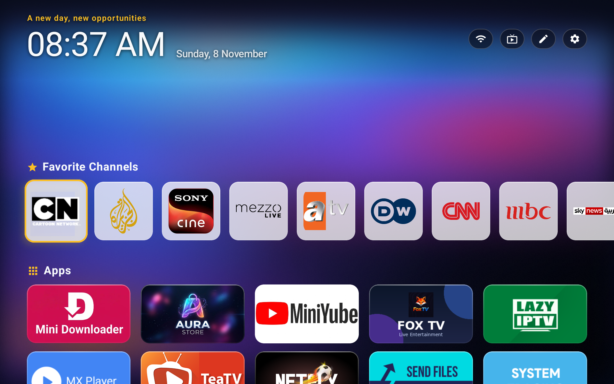

[English](README.md) | [العربية](README_ar.md) | [Deutsch](README_de.md) | [Français](README_fr.md) | [Italiano](README_it.md) | [Русский](README_ru.md) | [Español](README_es.md) | [Português](README_pt.md) | [Türkçe](README_tr.md) | [Polski](README_pl.md) | [Nederlands](README_nl.md) | **Ελληνικά** | [Bahasa Indonesia](README_id.md) | [Tiếng Việt](README_vi.md) | [ไทย](README_th.md) | [中文](README_zh.md) | [日本語](README_ja.md) | [한국어](README_ko.md) | [हिन्दी](README_hi.md) | [اردو](README_ur.md) | [فارسی](README_fa.md)

<div align="center">

# 🌌 Salsa TV Launcher

**Ζήστε το μέλλον της οικιακής ψυχαγωγίας με ένα σύγχρονο, εξαιρετικά γρήγορο και κινηματογραφικό περιβάλλον τηλεόρασης.**

[](https://developer.android.com/tv)
[](https://github.com/OsamaSalsa/Salsa-TV-Launcher)
[](https://kotlinlang.org/)
[](https://developer.android.com/jetpack/compose)
[](https://opensource.org/licenses/MIT)
[](https://github.com/OsamaSalsa/Salsa-TV-Launcher/raw/refs/heads/main/salsa-tv-launcher.apk)

<br>

### 📥 [Πατήστε εδώ για λήψη της τελευταίας έκδοσης APK (Έτοιμο για εγκατάσταση)](https://github.com/OsamaSalsa/Salsa-TV-Launcher/raw/refs/heads/main/salsa-tv-launcher.apk)

<br>



</div>

---

## ✨ Επισκόπηση

Το **Salsa TV Launcher** δεν είναι απλώς μια ακόμη αρχική οθόνη· είναι ένα ολοκληρωμένο οικοσύστημα ψυχαγωγίας σχεδιασμένο από την αρχή για **Android TV και Smart TV Boxes**. Κατασκευασμένο 100% με **Kotlin** και **Jetpack Compose**, το Salsa συνδυάζει μια ομαλή, κινηματογραφική αισθητική "Glassmorphism" με ισχυρά ενσωματωμένα εργαλεία, όπως εγγενές πρόγραμμα αναπαραγωγής **IPTV / Ζωντανής Τηλεόρασης**, **Κέντρο Παιχνιδιών Cloud**, το **Κατάστημα Εφαρμογών Salsa Store** και ένα **Mini Downloader** για άμεση εγκατάσταση αρχείων APK.

Σχεδιασμένο ειδικά για τηλεχειριστήρια τηλεόρασης (πλοήγηση D-Pad), κάθε κίνηση, εστίαση και μετάβαση έχει ρυθμιστεί για απόλυτα ομαλή εμπειρία 60 FPS χωρίς καθυστερήσεις.

---

## 🚀 Κύρια Χαρακτηριστικά

### 🆕 Νέα στην Έκδοση 3.0
* **📡 Προφύλαξη Κειμένου Broadcast (6 Κινούμενα Θέματα, Σκούρα Δυναμικά Φόντα & Φωνητικός Αναγνώστης)**: 6 ξεχωριστά θέματα στούντιο με μοναδική κίνηση, διάταξη και **σκούρο δυναμικό φόντο ειδικά για κάθε θέμα** με χρωματιστές σκιές σε αντίθεση + ζωντανή προεπισκόπηση στις Ρυθμίσεις, επεξεργάσιμες γραμμές (`3–15δ`), **Φωνητική Ανάγνωση (TTS)** που περιμένει να ολοκληρωθεί πριν προχωρήσει και προαιρετική μουσική υπόκρουση ή τοπικό MP3.
* **📺 Έξυπνη Ανάκαμψη Σφαλμάτων IPTV (`Επόμενο Κανάλι` + Αυτόματη Επανάληψη σε 15δ)**: Όταν ένα κανάλι IPTV δεν φορτώνει, εμφανίζεται καθαρή οθόνη με μία μόνο επιλογή (**Επόμενο Κανάλι**) και **αντίστροφη μέτρηση 15 δευτερολέπτων** που δοκιμάζει ξανά αυτόματα το ίδιο κανάλι αν δεν επιλεγεί κάτι άλλο.
* **🎨 Ζωντανές Ρυθμίσεις UI (`Live UI Settings`) — Άμεση Μορφή Ώρας**: Ο αιωρούμενος πίνακας στην αρχική οθόνη περιλαμβάνει πλέον άμεσο διακόπτη **Μορφής Ώρας** (**`24ω • 22:00`** / **`12ω • AM/PM`**) δίπλα στο μέγεθος ρολογιού και τη μορφή ημερομηνίας, μαζί με ζωντανή προεπισκόπηση ταπετσαριών 4K, φωτεινότητας, ύψους εφαρμογών, πλέγματος, διαφάνειας, χαιρετισμού, καιρού, νυχτερινού φίλτρου, Material You και ελαφριάς λειτουργίας.
* **🖥️ Προφύλαξη Πινάκων & Φωνητική Ανάγνωση Ειδήσεων**: Προβάλετε **Καιρό**, **Ειδήσεις**, **Οικονομία**, **Ποδόσφαιρο** ή **Αυτόματη εναλλαγή όλων**· η λειτουργία Ειδήσεων υποστηρίζει **Φωνητική Ανάγνωση (TTS)** και των 6 ειδήσεων πριν την εναλλαγή, με επιλέξιμη απαλή μουσική.
* **🌙 Προεπιλεγμένος Χρόνος Προφύλαξης Οθόνης στα 10 Λεπτά**: Ο προεπιλεγμένος χρόνος αδράνειας ορίστηκε στα **10 λεπτά** (ρυθμιζόμενος: 2, 5, 10, 15, 30 λεπτά ή Απενεργοποιημένος).
* **🖱️ Εικονικό Ποντίκι Από Άκρη σε Άκρη, Βελτιώσεις Τηλεχειριστηρίου & Έκδοση Εκκίνησης**: Ο εικονικός δείκτης σε web πύλες και παιχνίδια HTML5 φτάνει πλήρως στο επάνω και κάτω άκρο· αξιόπιστο παρατεταμένο πάτημα στο τηλεχειριστήριο χωρίς τυχαίο άνοιγμα· ανανεωμένο εικονίδιο **Salsa Store**· διακριτική ένδειξη `v3.0` στην οθόνη εκκίνησης και **αυτόματες ενημερώσεις GitHub OTA**.
* **🌐 Κέντρο 4 Ζωντανών Πινάκων, Πύλες Web & Μηχανή v3.0 σε 21 Γλώσσες**: **Καιρός**, **Ειδήσεις** (21 γλώσσες, 5 ενότητες), **Οικονομία & Αγορές**, **Ποδόσφαιρο (365Scores)**, προεπιλεγμένες πύλες (**YouTube TV**, **Google**, **CrazyGames**, **Poki**, **Playhop**, **EasyGames**), ευέλικτη επάνω μπάρα και μηχανή v3.0 60 FPS.

### 🖥️ 1. Κινηματογραφική & Δυναμική Αρχική Οθόνη
* **Έξυπνη Εστίαση με Μεγέθυνση:** Οι κάρτες ζωντανεύουν όταν επιλέγονται με φωτεινά περιγράμματα, απαλές σκιές και δυναμική κλιμάκωση.
* **Έξυπνη Κεφαλίδα & Ζωντανός Καιρός:** Εμφανίζει ποιητικούς χαιρετισμούς ανάλογα με την ώρα της ημέρας, ρολόι πραγματικού χρόνου (12ω/24ω), κατάσταση δικτύου (Wi-Fi / Ethernet) και ζωντανές τοπικές καιρικές συνθήκες.
* **Αγαπημένα & Γρήγορο Καρφίτσωμα:** Καρφιτσώστε τις αγαπημένες σας εφαρμογές στη γραμμή γρήγορης πρόσβασης ή αλλάξτε τη σειρά τους στη στιγμή.
* **Υποστήριξη 21 Γλωσσών (LTR & RTL):** Πλήρως μεταφρασμένο σε **21 γλώσσες**, όπως Ελληνικά, Αγγλικά, Αραβικά, Γερμανικά, Γαλλικά, Ιταλικά, Ρωσικά, Ισπανικά, Πορτογαλικά, Τουρκικά, Πολωνικά, Ολλανδικά, Ινδονησιακά, Βιετναμέζικα, Ταϊλανδικά, Κινεζικά, Ιαπωνικά, Κορεατικά, Χίντι, Ούρντου και Περσικά.

<div align="center">
  
  
</div>

---

### 📺 2. Ενσωματωμένο Πρόγραμμα Αναπαραγωγής IPTV & Ζωντανής TV
* **Υποστήριξη Λιστών M3U / M3U8:** Προσθέστε τις δικές σας λίστες αναπαραγωγής ή εξερευνήστε τα προεγκατεστημένα διεθνή κανάλια.
* **Εγγενής Μηχανή ExoPlayer (Media3):** Ταχύτατη εναλλαγή καναλιών με υποστήριξη ροών HLS και DASH.
* **Φίλτρο Κατηγοριών & Αναζήτηση:** Φιλτράρετε κανάλια ανά Αθλητικά, Ειδήσεις, Ταινίες, Παιδικά ή αναζητήστε άμεσα.
* **Αγαπημένα Κανάλια:** Αποθηκεύστε τα κανάλια που παρακολουθείτε περισσότερο για πρόσβαση με ένα κλικ από την αρχική οθόνη.

<div align="center">
  
</div>

---

### 🛍️ 3. Salsa Store (Κατάστημα Εφαρμογών TV)
* **Επιλεγμένος Κατάλογος για Android TV:** Κατεβάστε και εγκαταστήστε τις καλύτερες εφαρμογές streaming, media players, browsers και εργαλεία βελτιστοποιημένα για τηλεόραση χωρίς να απαιτείται λογαριασμός Google.
* **Άμεση Λήψη & Εγκατάσταση:** Μπάρες προόδου σε πραγματικό χρόνο με αυτόματη εκκίνηση του προγράμματος εγκατάστασης πακέτων.

<div align="center">
  
</div>

---

### 🎮 4. Πύλες Cloud Gaming & Web Εφαρμογές
* **Παιχνίδι Χωρίς Κονσόλα:** Άμεση πρόσβαση με ένα κλικ στα **Xbox Cloud Gaming**, **NVIDIA GeForce NOW**, **Amazon Luna** και πύλες ρετρό παιχνιδιών.
* **Υποστήριξη Χειριστηρίων (Gamepad):** Συνδέστε το Bluetooth χειριστήριό σας και μετατρέψτε την τηλεόρασή σας σε πλήρη κονσόλα παιχνιδιών.

<div align="center">
  
</div>

---

### 📥 5. Mini Downloader & Εγκατάσταση APK μέσω URL/Κωδικού
* **Λήψη μέσω URL ή Σύντομου Κωδικού:** Πληκτρολογήστε οποιονδήποτε άμεσο σύνδεσμο `.apk` ή σύντομο αριθμητικό κωδικό χρησιμοποιώντας το φιλικό προς το τηλεχειριστήριο πληκτρολόγιο οθόνης.
* **Ιστορικό Λήψεων:** Διαχειριστείτε, επανεγκαταστήστε ή διαγράψτε εύκολα αρχεία APK που έχετε κατεβάσει.

<div align="center">
  
</div>

---

### 🎨 6. Πλήρης Εξατομίκευση & Γονικός Έλεγχος
* **Ταπετσαρίες 4K & Θέματα:** Επιλέξτε ανάμεσα σε δεκάδες ταπετσαρίες υψηλής ευκρίνειας (Φύση, Διάστημα, Αφηρημένα, Cyberpunk, Μίνιμαλ) ή ορίστε τη δική σας εικόνα από την εσωτερική μνήμη/USB.
* **Λειτουργία Εικονιδίου Άνω Μπάρας:** Επιλέξτε την εμφάνιση του **Κέντρου Ελέγχου**, την παράκαμψη του Κέντρου Ελέγχου για **Άμεσες Ρυθμίσεις**, ή την **Εμφάνιση και των Δύο Εικονιδίων Μαζί** στην Αρχική Οθόνη.
* **Αμερικανικές & Διεθνείς Μορφές Ημερομηνίας:** Μορφή ΗΠΑ (`MM/dd/yyyy`, `MMMM d, yyyy`, `EEEE, MMMM d, yyyy`, `EEE, MMM d`), Διεθνής (`dd/MM/yyyy`), ISO (`yyyy-MM-dd`), Ευρωπαϊκή (`dd.MM.yyyy`) ή κρυφή.
* **Κλίμακα UI, Δυναμικά Χρώματα (Material You) & Όλες οι Εφαρμογές Android (Sideloaded APKs):** Προσαρμόστε τον αριθμό στηλών, τη διαφάνεια καρτών (10%–100%), ενεργοποιήστε τα **Δυναμικά Χρώματα Material You**, και επιλέξτε ανάμεσα σε εμφάνιση μόνο εφαρμογών TV ή **όλων των εγκατεστημένων εφαρμογών Android (συμπεριλαμβανομένων APK κινητών)**.
* **Κινηματογραφική Προφύλαξη Οθόνης, Προσαρμοσμένα Βίντεο YouTube & Παρουσίαση Φωτογραφιών (`Slideshow`):** Προσθέστε δικά σας βίντεο YouTube στην προφύλαξη οθόνης με **άμεση προεπισκόπηση**, ή προβάλετε φωτογραφίες από φάκελο συσκευής/USB, επιλεγμένες φωτογραφίες ή συλλογές 4K με ρυθμιζόμενη διάρκεια (`5s`–`5m`), κίνηση **Ken Burns / Απαλό Ζουμ / Στατική**, 6 εφέ μετάβασης, 7 ατμοσφαιρικά εφέ (**Χιόνι ❄️**, **Πυγολαμπίδες ✨**, **Βροχή 🌧️**, **Φθινοπωρινά Φύλλα 🍂**, **Άνθη Κερασιάς 🌸**, **Αστέρια ⭐**, **Bokeh 🔮**), γωνιακό ρολόι και χαλαρωτική μουσική ή δικό σας MP3.
* **Ενσωματωμένη Διαχείριση Αποθήκευσης Εφαρμογών & 8 Συντομεύσεις Συστήματος:** Δείτε όλες τις εγκατεστημένες εφαρμογές ταξινομημένες κατά μέγεθος (`MB`), ανοίξτε τις πληροφορίες συστήματος ή **απεγκαταστήστε εφαρμογές απευθείας** για εξοικονόμηση χώρου, μαζί με 8 γρήγορες συντομεύσεις (Wi-Fi, Ethernet, Οθόνη, Ήχος, Ημερομηνία/Ώρα, Ρυθμίσεις, Πληροφορίες Εφαρμογής, Αποθήκευση).
* **Ασπίδα DNS Διπλής Λειτουργίας (AdBlock + Οικογενειακή Προστασία) & Κλείδωμα PIN:** Επιλέξτε ανάμεσα σε **Φραγή Διαφημίσεων & Ιχνηλατών** ή **Λειτουργία Οικογενειακής Προστασίας** (μπλοκάρει ιστότοπους ενηλίκων σε όλο το σύστημα), και προστατέψτε εφαρμογές ή κατηγορίες IPTV με 4ψήφιο PIN.
* **Φωνητική Αναζήτηση (`🎤`), Προεπιλεγμένος Φωνητικός Βοηθός Συστήματος, Έξυπνοι Σελιδοδείκτες Web & Πολλαπλές Λίστες IPTV:** Ορίστε το **Salsa TV** ως προεπιλεγμένο φωνητικό βοηθό της τηλεόρασης ώστε το κουμπί μικροφώνου του τηλεχειριστηρίου να λειτουργεί εγγενώς· διαχειριστείτε **πολλαπλές λίστες M3U**· έξυπνοι σελιδοδείκτες web με αυτόματη λήψη HD εικονιδίων και λειτουργία **YouTube TV Leanback**· γραμμή πρόσφατων εφαρμογών και ενημερώσεις OTA μέσω GitHub.

---

## 🎮 Οδηγός Συντομεύσεων Τηλεχειριστηρίου

Το Salsa TV Launcher έχει σχεδιαστεί για άνετο χειρισμό με οποιοδήποτε τυπικό τηλεχειριστήριο Android TV:

| Κουμπί Τηλεχειριστηρίου | Πού Χρησιμοποιείται | Ενέργεια |
| :--- | :--- | :--- |
| **Κουμπί OK / Επιλογή (Απλό πάτημα)** | Οποιαδήποτε εφαρμογή ή κάρτα | Ανοίγει την επιλεγμένη εφαρμογή, κανάλι ή πύλη. |
| **Κουμπί OK / Επιλογή (Παρατεταμένο πάτημα)** | Πάνω σε εικονίδιο εφαρμογής | Ανοίγει το **Μενού Γρήγορων Επιλογών** (Καρφίτσωμα, Μετακίνηση, Απόκρυψη, Κλείδωμα PIN, Πληροφορίες, Απεγκατάσταση). |
| **Κουμπί Μενού (☰ Τρεις Γραμμές)** | Σε εφαρμογή ή στην Αρχική Οθόνη | Ανοίγει το μενού επιλογών της εφαρμογής ή τον πίνακα γρήγορων ρυθμίσεων. |
| **Κουμπί Φωνής / Google Assistant (🎤)** | Οπουδήποτε στον Launcher | Ανοίγει την **Καθολική Φωνητική Αναζήτηση** για εύρεση εφαρμογών, καναλιών IPTV ή εκτέλεση φωνητικών εντολών. |
| **Πλήκτρα Κατεύθυνσης (D-Pad)** | Σε όλη την εφαρμογή | Ομαλή πλοήγηση μεταξύ κατηγοριών, εφαρμογών, καναλιών και χειριστηρίων αναπαραγωγής. |
| **Κουμπί Πίσω (Back)** | Μέσα σε παράθυρα / player | Κλείνει ανοιχτά μενού, βγαίνει από την πλήρη οθόνη ή επιστρέφει στην κορυφή της αρχικής οθόνης. |

> 💡 **Συμβουλή:** Μπορείτε επίσης να δείτε αυτόν τον πλήρη οδηγό κουμπιών απευθείας μέσα στην εφαρμογή από τις **Ρυθμίσεις > Οδηγός Τηλεχειριστηρίου**.

---

## 🛠️ Αρχιτεκτονική & Τεχνολογίες

* **Γλώσσα:** 100% [Kotlin](https://kotlinlang.org/) με Coroutines και StateFlow.
* **Περιβάλλον (UI):** 100% [Jetpack Compose](https://developer.android.com/jetpack/compose) + Material Design 3 για TV.
* **Αρχιτεκτονική:** MVVM (Model-View-ViewModel) με καθαρή διαχείριση κατάστασης (`UiState`).
* **Αναπαραγωγή Πολυμέσων:** [AndroidX Media3 / ExoPlayer](https://developer.android.com/guide/topics/media/media3) για ροές HLS/M3U8.
* **Φόρτωση Εικόνων:** [Coil](https://coil-kt.github.io/coil/) με βελτιστοποιημένη προσωρινή μνήμη.
* **Δίκτυο & Καιρός:** OkHttp + Open-Meteo API για ακριβή δεδομένα καιρού χωρίς απαίτηση κλειδιού API.

---

## 📦 Εγκατάσταση

### Μέθοδος 1: Άμεση Λήψη APK (Συνιστάται)
1. Κατεβάστε το αρχείο [`salsa-tv-launcher.apk`](https://github.com/OsamaSalsa/Salsa-TV-Launcher/raw/refs/heads/main/salsa-tv-launcher.apk) από την ενότητα Releases.
   👉 **[Σύντομος κωδικός Downloader / Άμεσος σύνδεσμος: aftv.news/5157967](http://aftv.news/5157967)**
2. Μεταφέρετέ το στην Android TV σας μέσω USB flash, της εφαρμογής *Send Files to TV* ή του *Downloader*.
3. Εγκαταστήστε το APK και δώστε τα απαιτούμενα δικαιώματα.
4. Πατήστε το κουμπί **Home** στο τηλεχειριστήριό σας και επιλέξτε το **Salsa TV Launcher** ως προεπιλεγμένη αρχική οθόνη (**«Πάντα»**).

### Μέθοδος 2: Μεταγλώττιση από τον Πηγαίο Κώδικα
```bash
git clone https://github.com/OsamaSalsa/Salsa-TV-Launcher.git
cd Salsa-TV-Launcher
./gradlew assembleDebug
```
Το παραγόμενο αρχείο APK θα βρίσκεται στη διαδρομή `app/build/outputs/apk/debug/app-debug.apk`.

---

## 🤝 Συνεισφορά & Άδεια Χρήσης

Οι συνεισφορές, οι αναφορές σφαλμάτων και οι προτάσεις νέων λειτουργιών είναι πάντα ευπρόσδεκτες!

Διανέμεται υπό την άδεια **MIT**. Δείτε το αρχείο `LICENSE` για περισσότερες πληροφορίες.
