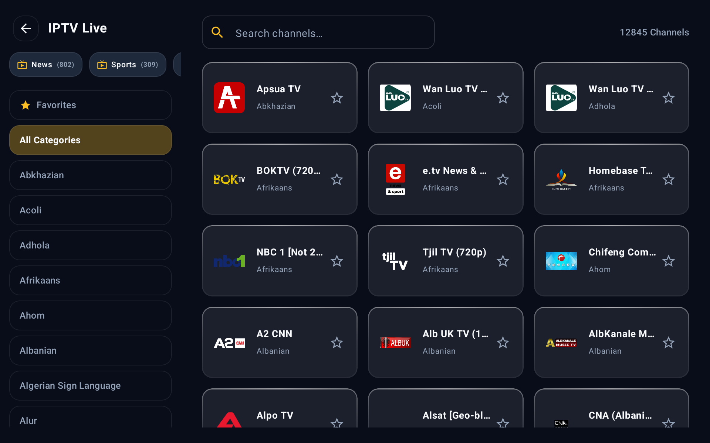

[English](README.md) | [العربية](README_ar.md) | [Deutsch](README_de.md) | [Français](README_fr.md) | [Italiano](README_it.md) | [Русский](README_ru.md) | [Español](README_es.md) | [Português](README_pt.md) | [Türkçe](README_tr.md) | [Polski](README_pl.md) | [Nederlands](README_nl.md) | [Ελληνικά](README_el.md) | [Bahasa Indonesia](README_id.md) | [Tiếng Việt](README_vi.md) | [ไทย](README_th.md) | [中文](README_zh.md) | [日本語](README_ja.md) | [한국어](README_ko.md) | [हिन्दी](README_hi.md) | [اردو](README_ur.md) | **فارسی**

<div dir="rtl">

<div align="center">

# 🌌 Salsa TV Launcher

**آینده سرگرمی‌های خانگی را با یک رابط کاربری مدرن، فوق‌سریع و سینمایی برای تلویزیون تجربه کنید.**

[](https://developer.android.com/tv)
[](https://github.com/OsamaSalsa/Salsa-TV-Launcher)
[](https://kotlinlang.org/)
[](https://developer.android.com/jetpack/compose)
[](https://github.com/OsamaSalsa/Salsa-TV-Launcher)
[](https://github.com/OsamaSalsa/Salsa-TV-Launcher/raw/refs/heads/main/salsa-tv-launcher.apk)

<br>

### 📥 [برای دانلود آخرین نسخه فایل APK اینجا کلیک کنید (آماده نصب)](https://github.com/OsamaSalsa/Salsa-TV-Launcher/raw/refs/heads/main/salsa-tv-launcher.apk)

<br>


</div>

---

## ✨ معرفی کلی

**Salsa TV Launcher** تنها یک صفحه اصلی ساده نیست؛ بلکه یک اکوسیستم سرگرمی کامل است که از پایه برای **اندروید تی‌وی (Android TV) و تی‌وی باکس‌های هوشمند** طراحی شده است. این برنامه که ۱۰۰٪ با زبان **Kotlin** و فناوری **Jetpack Compose** ساخته شده، زیبایی بصری و سینمایی به سبک «Glassmorphism» را با ابزارهای قدرتمند داخلی مانند پخش‌کننده بومی **IPTV / تلویزیون زنده**، **مرکز بازی‌های ابری (Cloud Gaming)**، **فروشگاه برنامه Salsa Store** و **مینی دانلودر (Mini Downloader)** برای نصب مستقیم فایل‌های APK ترکیب می‌کند.

این لانچر به طور ویژه برای ریموت کنترل تلویزیون (ناوبری D-Pad) بهینه‌سازی شده و تمامی انیمیشن‌ها، افکت‌های فوکوس و جابه‌جایی‌ها با نرخ ۶۰ فریم بر ثانیه کاملاً روان اجرا می‌شوند.

---

## 🚀 ویژگی‌های کلیدی

### 🆕 ویژگی‌های جدید در نسخه 3.01
* **🔐 سیستم پین مستقل برای هر پروفایل، تأیید دوبار ورود، قفل ورود به پروفایل و `Master PIN` مدیر (`Main`)**: هیچ کد پیش‌فرضی مانند `1234` وجود ندارد؛ پیش از قفل کردن برنامه‌ها یا بخش‌ها ابتدا باید یک کد ۴ رقمی با **دوبار وارد کردن برای تأیید** ساخته شود. کد پین هرگز به‌صورت آشکار در تنظیمات نمایش داده نمی‌شود (`••••`) و تغییر یا حذف آن نیازمند وارد کردن کد قبلی است. هر پروفایل دارای گزینه **قفل ورود به پروفایل با پین** است و پروفایل **`Main` به‌عنوان مدیر (`Admin`)** غیرقابل حذف بوده و کد آن به‌عنوان **`Master PIN Code`** برای ورود و ویرایش هر پروفایل در صورت فراموشی رمز عمل می‌کند.
* **🎙️ بهبود دقت و پایداری جستجوی صوتی در Android TV**: اتصال مستقیم به سرویس تشخیص گفتار اندروید تی‌وی (`katniss`) با مهلت شنود بیشتر برای میکروفون ریموت بلوتوث و تلاش مجدد خودکار.
* **🛠️ مدیریت لانچر (`تنظیمات > میانبرهای سریع سیستم > Launcher Manager` — تنظیم به‌عنوان لانچر پیش‌فرض با ADB داخلی)**: جادوگر ۳ مرحله‌ای داخل برنامه برای تنظیم دائمی **Salsa TV Launcher** به‌عنوان برنامه صفحه اصلی (`HOME`) از طریق اتصال ADB داخلی خود تلویزیون (`127.0.0.1:5555`) و دستور `cmd package set-home-activity --user 0` بدون نیاز به کامپیوتر یا گوشی خارجی (مقاوم در برابر ری‌استارت، همراه با گزینه غیرفعال‌سازی لانچر کارخانه و بازگردانی با یک کلیک).
* **🎨 رنگ متمایز تم پویا برای هر کاربر**: رنگ تم انتخابی هر پروفایل کاربر به‌صورت پویا جایگزین رنگ زرد/طلایی پیش‌فرض در سراسر برنامه می‌شود — از جمله پیام خوش‌آمدگویی، متن‌های برجسته، آیکون‌ها و عناوین بخش‌های برنامه‌ها/بازی‌ها/وب، تنظیمات، IPTV، فروشگاه Salsa Store و کادرهای فوکوس.
* **👤 پروفایل‌های چندکاربره و جداسازی تنظیمات (`Profiles / Users`)**: ساخت چندین پروفایل مستقل برای اعضای خانواده — هر کاربر دارای **ظاهر، رنگ متمایز و تصویر پس‌زمینه**، **محافظ صفحه**، **زبان**، **علاقه‌مندی‌ها و ترتیب کانال‌های IPTV**، **ترتیب برنامه‌ها/وب/بازی‌ها**، **کد PIN اختیاری ۴ رقمی** و **کنترل بخش‌ها به تفکیک کاربر** (نمایش، قفل با PIN یا مخفی‌سازی کامل **IPTV**، **برنامه‌ها**، **وب** یا **بازی‌ها**). دسترسی آسان از طریق یک آیکون دایره‌ای تخت و بدون حاشیه در خارجی‌ترین گوشه نوار بالا (**منتهای چپ در RTL و منتهای راست در LTR**).
* **🔢 تعویض سریع کانال با کلیدهای عددی (`0–9`) و نشانگرهای شماره کانال با کنتراست بالا**: با فشردن کلیدهای عدد (`0–9`) روی ریموت از صفحه اصلی، لیست IPTV یا پخش‌کننده زنده، مستقیماً به شماره کانال دلخواه بروید؛ همراه با نشانگرهای عددی خوانا (اعداد مشکی روی پس‌زمینه سفید نیمه‌شفاف).
* **🎞️ محافظ صفحه ویدیویی محلی از دستگاه / USB (`Media3 / ExoPlayer`)**: علاوه بر پخش خالص تمام‌صفحه از طریق `m.youtube.com` بدون هیچ متن یا دکمه‌ای، می‌توانید هر فایل ویدیویی محلی را از حافظه تلویزیون یا فلش USB با انتخابگر ایمن سیستم (`SAF`) برای پخش تکرارشونده تمام‌صفحه انتخاب کنید.
* **📡 محافظ صفحه متنی خبری (12 تم متحرک، پس‌زمینه‌های تیره پویا و گوینده صوتی)**: 12 تم استودیویی متمایز — 6 تم کلاسیک + 6 تم خلاقانه متحرک جدید (**Aurora Silk**، **Synthwave 80s**، **Cosmic Orbit**، **Royal Arabesque**، **Audio Studio Equalizer** و **Crystal Prism Hologram**) — همراه با **پس‌زمینه تیره پویا مخصوص هر تم** با سایه‌های رنگی متضاد و متحرک + پیش‌نمایش زنده در تنظیمات، ویرایش خطوط و مدت نمایش (`3–15ث`)، **خوانش صوتی (TTS)** که تا پایان قرائت منتظر می‌ماند، و موسیقی پس‌زمینه یا MP3 محلی.
* **📺 بازیابی هوشمند خطای IPTV (`کانال بعدی` + تلاش مجدد 15 ثانیه‌ای) و هدیه مخفی 3× OK**: هنگام خطا در پخش کانال IPTV، پنجره‌ای ساده با تنها یک گزینه (**کانال بعدی**) و **شمارش معکوس 15 ثانیه‌ای** نمایش داده می‌شود که به‌صورت خودکار دوباره امتحان می‌کند. همچنین با 3 بار فشردن `OK` روی کارت خالی IPTV، لیست‌های پخش آماده با انیمیشن جعبه هدیه باز می‌شوند.
* **🛒 دسته‌های برتر Salsa Store و ویدیوی خالص `m.youtube.com`**: فروشگاه **Salsa Store** دسته‌های **مرورگرهای وب (Web Browsers)** و **شبکه‌های اجتماعی (Social Media)** را در صدر 9 دسته ابزارها و پخش‌کننده‌های رسمی Android TV (با پشتیبانی آفلاین) قرار می‌دهد و محافظ صفحه ویدیویی همیشه به‌صورت تمام‌صفحه و کاملاً تمیز از طریق `m.youtube.com` بدون هیچ متن یا دکمه‌ای روی تصویر پخش می‌شود.
* **🎨 تنظیمات زنده رابط کاربری (`Live UI Settings`) — انتخاب مستقیم قالب ساعت**: منوی شناور روی صفحه اصلی اکنون در کنار اندازه ساعت و قالب تاریخ، گزینه مستقیم **قالب ساعت (`24 ساعته • 22:00` / `12 ساعته • AM/PM`)** را نیز ارائه می‌دهد؛ همراه با پیش‌نمایش زنده تصاویر 4K، روشنایی، فاصله برنامه‌ها، شبکه، شفافیت، خوش‌آمدگویی، آب‌وهوا، فیلتر شب، Material You و حالت سبک.
* **🖥️ محافظ صفحه پنل‌های زنده، خوانش صوتی اخبار و موسیقی یکپارچه شفاف**: نمایش **آب‌وهوا**، **اخبار**، **اقتصاد**، **فوتبال** یا **چرخش خودکار همه**؛ حالت اخبار از **خوانش صوتی (TTS)** هر 6 خبر پیش از تغییر صفحه پشتیبانی می‌کند و تمام پنل‌ها از قطعات موسیقی شفاف و یکسان (**بوسا نوا**، **جاز ملایم**، **امواج آرام اقیانوس**، **چیل‌اوت کلاسیک** و MP3 سفارشی) با کاهش خودکار صدا هنگام خوانش بهره می‌برند.
* **🌙 زمان پیش‌فرض محافظ صفحه 10 دقیقه**: زمان پیش‌فرض عدم فعالیت به **10 دقیقه** تغییر یافت (قابل تنظیم روی 2، 5، 10، 15، 30 دقیقه یا غیرفعال).
* **🖱️ ماوس مجازی لبه‌به‌لبه، دکمه منوی هوشمند (`☰`) و شماره نسخه در صفحه شروع**: نشانگر ماوس مجازی در پورتال‌های وب و بازی‌های HTML5 به لبه‌های بالا و پایین کاملاً دسترسی دارد؛ دکمه **منو (`☰` سه خط)** در صفحه اصلی **تنظیمات**، در IPTV **تنظیمات IPTV** و در پورتال‌های وب/بازی‌ها **ماوس مجازی** را باز یا تغییر می‌دهد؛ فشار طولانی مطمئن `OK`؛ آیکون جدید **Salsa Store**؛ نمایش `v3.0` و **به‌روزرسانی خودکار GitHub OTA**.
* **🌐 مرکز 4 پنل زنده، پورتال‌های وب و موتور v3.0 به 21 زبان**: **آب‌وهوا**، **اخبار** (21 زبان و 5 بخش)، **اقتصاد و بازارها**، **فوتبال (365Scores)**، پورتال‌های پیش‌فرض (**YouTube TV**، **Google**، **CrazyGames**، **Poki**، **Playhop**، **EasyGames**)، نوار بالای انعطاف‌پذیر و موتور سریع 60 FPS نسخه 3.0.

### 🖥️ ۱. صفحه اصلی سینمایی و پویا
* **فوکوس هوشمند با بزرگنمایی:** کارت‌های برنامه هنگام انتخاب با حاشیه‌های درخشان، سایه‌های نرم و بزرگنمایی پویا زنده می‌شوند.
* **سربرگ هوشمند و آب‌وهوای زنده:** نمایش پیام‌های خوش‌آمدگویی شاعرانه متناسب با ساعات شبانه‌روز، ساعت زنده (۱۲/۲۴ ساعته)، وضعیت شبکه (Wi-Fi / Ethernet) و وضعیت آب‌وهوای محلی.
* **برنامه‌های محبوب و سنجاق سریع:** برنامه‌های مورد علاقه خود را به نوار دسترسی سریع سنجاق کنید یا ترتیب آن‌ها را فوراً تغییر دهید.
* **پشتیبانی کامل از ۲۱ زبان (راست‌به‌چپ و چپ‌به‌راست):** بومی‌سازی کامل به **۲۱ زبان** شامل فارسی، عربی، اردو، انگلیسی، آلمانی، فرانسوی، ایتالیایی، روسی، اسپانیایی، پرتغالی، ترکی، لهستانی، هلندی، یونانی، اندونزیایی، ویتنامی، تایلندی، چینی، ژاپنی، کره‌ای و هندی.

<div align="center">
  
  
</div>

---

### 📺 ۲. پخش‌کننده داخلی IPTV و تلویزیون زنده
* **پشتیبانی از لیست پخش M3U / M3U8:** لیست‌های پخش IPTV شخصی خود را اضافه کنید یا کانال‌های جهانی پیش‌فرض را تماشا کنید.
* **موتور پخش بومی ExoPlayer (Media3):** تعویض سریع کانال‌ها با پشتیبانی از استریم‌های HLS و DASH.
* **فیلتر دسته‌بندی و جستجو:** کانال‌ها را بر اساس ورزش، اخبار، فیلم، کودکان فیلتر کنید یا فوراً جستجو نمایید.
* **کانال‌های برگزیده:** کانال‌های پرمخاطب خود را برای دسترسی تک‌کلیکی از صفحه اصلی ذخیره کنید.

<div align="center">
  
</div>

---

### 🛍️ ۳. فروشگاه Salsa Store (فروشگاه اپ تلویزیون)
* **کاتالوگ گلچین‌شده برای Android TV:** بهترین برنامه‌های تماشای فیلم، مدیا پلیرها، مرورگرها و ابزارهای کاربردی تلویزیون را بدون نیاز به حساب گوگل دانلود و نصب کنید.
* **دانلود و نصب مستقیم:** نوار پیشرفت لحظه‌ای همراه با اجرای خودکار نصب‌کننده بسته سیستم.

<div align="center">
  
</div>

---

### 🎮 ۴. پورتال‌های بازی ابری و وب‌اپلیکیشن‌ها
* **بازی بدون نیاز به کنسول:** دسترسی مستقیم و تک‌کلیکی به **Xbox Cloud Gaming**، **NVIDIA GeForce NOW**، **Amazon Luna** و پورتال‌های بازی‌های رترو.
* **سازگار با دسته بازی (Gamepad):** دسته بازی بلوتوثی خود را متصل کنید و تلویزیون خود را به یک کنسول بازی کامل تبدیل نمایید.

<div align="center">
  
</div>

---

### 📥 ۵. مینی دانلودر (Mini Downloader) و نصب APK با لینک/کد
* **دانلود با لینک مستقیم یا کد کوتاه:** هرگونه لینک مستقیم `.apk` یا کد عددی کوتاه را با صفحه‌کلید مخصوص ریموت کنترل وارد کنید.
* **تاریخچه دانلودها:** فایل‌های APK دانلود شده قبلی را به راحتی مدیریت، نصب مجدد یا حذف کنید.

<div align="center">
  
</div>

---

### 🎨 ۶. شخصی‌سازی پیشرفته و قفل والدین
* **تصاویر پس‌زمینه 4K و تم‌ها:** از میان ده‌ها تصویر پس‌زمینه با کیفیت بالا (طبیعت، فضا، انتزاعی، سایبرپانک، مینیمال) انتخاب کنید یا تصویر دلخواه خود را از حافظه داخلی/USB تنظیم نمایید.
* **حالت آیکون نوار بالا:** انتخاب کنید که در صفحه اصلی آیکون **مرکز کنترل سریع** نمایش داده شود، مرکز کنترل رد شده و **مستقیماً آیکون تنظیمات** نمایش داده شود، یا **هر دو آیکون با هم** نمایش داده شوند.
* **فرمت‌های تاریخ آمریکایی و بین‌المللی:** فرمت آمریکایی (`MM/dd/yyyy`, `MMMM d, yyyy`, `EEEE, MMMM d, yyyy`, `EEE, MMM d`)، بین‌المللی (`dd/MM/yyyy`)، استاندارد (`yyyy-MM-dd`)، اروپایی (`dd.MM.yyyy`) یا مخفی.
* **تنظیم مقیاس رابط کاربری، رنگ‌های پویا (Material You) و نمایش تمام برنامه‌های اندروید (Sideloaded APKs):** تعداد ستون‌ها و شفافیت کارت‌ها (۱۰٪ تا ۱۰۰٪) را تنظیم کنید، **رنگ‌های پویا Material You** را فعال نمایید و بین نمایش فقط برنامه‌های تلویزیون یا **تمامی برنامه‌های نصب‌شده اندروید (شامل APKهای موبایل)** جابه‌جا شوید.
* **محافظ صفحه سینمایی (`m.youtube.com`)، ویدیوهای سفارشی یوتیوب و اسلایدشوی تصاویر (`Slideshow`):** پخش خالص و تمام‌صفحه از طریق `m.youtube.com` بدون هیچ متن یا دکمه‌ای روی تصویر همراه با امکان افزودن ویدیوهای یوتیوب دلخواه و **پیش‌نمایش زنده فوری**، یا اسلایدشو از پوشه دلخواه در حافظه/USB، تصاویر انتخابی یا گالری 4K با قابلیت تنظیم زمان هر تصویر (`۵ ثانیه` تا `۵ دقیقه`)، حرکت تصویر (**Ken Burns / زوم ملایم / ثابت**)، ۶ افکت ورود تصویر، ۷ جلوه محیطی (**بارش برف ❄️**، **کرم شب‌تاب ✨**، **باران 🌧️**، **برگ پاییزی 🍂**، **شکوفه گیلاس 🌸**، **ستاره‌ها ⭐**، **نورهای بوکه 🔮**)، ساعت گوشه تصویر و موسیقی ملایم و شفاف (**بوسا نوا**، **جاز ملایم**، **امواج اقیانوس**، **چیل‌اوت کلاسیک**) یا فایل MP3 دلخواه.
* **مدیریت حافظه و برنامه‌های داخلی و ۱۰ میانبر سریع سیستم (شامل `Launcher Manager`):** تمامی برنامه‌های نصب‌شده را بر اساس حجم (`MB`) مشاهده کنید، اطلاعات سیستم را باز کنید یا برای آزادسازی فضا **برنامه‌ها را مستقیماً لغو نصب (Uninstall) نمایید**، به همراه ۱۰ میانبر سریع (**وای‌فای، اترنت، صفحه نمایش، صدا، تاریخ/زمان، تنظیمات سیستم، اطلاعات برنامه، مدیریت حافظه، مدیریت لانچر (Launcher Manager - ADB Default Home) و گزینه‌های توسعه‌دهنده**).
* **سپر دوحالته DNS (حذف تبلیغات + محافظت خانواده با PIN) و قفل PIN:** بین **مسدودسازی تبلیغات و ردیاب‌ها** یا **حالت محافظت خانواده** انتخاب کنید (**خروج از حالت خانواده تنها با رمز ۴ رقمی PIN امکان‌پذیر است**) و برنامه‌ها یا دسته‌بندی‌های IPTV را با PIN قفل نمایید.
* **جستجوی صوتی جامع (`🎤`)، بوکمارک‌های هوشمند وب و مدیریت چند لیست IPTV:** جستجوی صوتی داخلی، مدیریت **چندین لیست پخش M3U**، دریافت خودکار آیکون‌های HD و باز کردن یوتیوب در نمای **YouTube TV Leanback**، نوار برنامه‌های اخیر و بروزرسانی خودکار تاییدشده از GitHub.

> ⚠️ **نکته مهم درباره حالت کودکان / محافظت خانواده:** خروج از حالت خانواده در تنظیمات با رمز **PIN** محافظت می‌شود؛ با این حال **لانچر به‌تنهایی نمی‌تواند مانع خروج کودک از طریق برنامه دیگر یا دکمه `Home` شود** مگر اینکه **Salsa TV Launcher** را به‌عنوان صفحه اصلی پیش‌فرض تنظیم کرده و **تنظیمات سیستم** را نیز با PIN قفل کنید.

---

## 🛡️ امنیت و شفافیت دسترسی‌ها

* **رمزنگاری HTTPS پیش‌فرض (`network_security_config.xml`)**: ترافیک HTTP غیررمزنگاری‌شده به‌صورت سراسری غیرفعال است (`cleartextTrafficPermitted="false"`) به جز استثناهای ضروری.
* **مرور ایمن وب فعال (`WebView Safe Browsing`)**: محافظت Google Safe Browsing در تمام WebViewها فعال (`EnableSafeBrowsing=true`) و ارسال آمار غیرفعال (`MetricsOptOut=true`) است.
* **بروزرسانی OTA تاییدشده**: پیش از نصب هر بروزرسانی از GitHub، هش **SHA-256** (`version.json`)، **نام بسته** و **گواهی امضای APK** بررسی و تطبیق داده می‌شوند.
* **بدون دسترسی گسترده حافظه (`بدون MANAGE_EXTERNAL_STORAGE`)**: تمامی فایل‌های محلی از طریق انتخابگر ایمن **Storage Access Framework (SAF)** انتخاب می‌شوند.
* **دلیل هر دسترسی**: `INTERNET`/`ACCESS_NETWORK_STATE` (IPTV، پنل‌ها، فروشگاه و OTA)، `ACCESS_COARSE_LOCATION` اختیاری (آب‌وهوای تقریبی شهر)، `RECORD_AUDIO` اختیاری (فقط برای جستجوی صوتی `🎤`)، `REQUEST_INSTALL_PACKAGES`/`REQUEST_DELETE_PACKAGES` (فقط هنگام نصب/حذف مستقیم توسط کاربر)، `BIND_VPN_SERVICE` (سپر محلی AdGuard DNS) و `RECEIVE_BOOT_COMPLETED`.

---

## 🎮 راهنمای دکمه‌های ریموت کنترل

Salsa TV Launcher به گونه‌ای طراحی شده که با هر ریموت کنترل استاندارد Android TV به سادگی قابل کنترل باشد:

| دکمه روی ریموت | محل استفاده | عملکرد |
| :--- | :--- | :--- |
| **دکمه OK / انتخاب (فشار کوتاه)** | روی هر برنامه یا کارت | برنامه، کانال یا پورتال انتخاب شده را باز می‌کند. |
| **دکمه OK / انتخاب (نگه داشتن طولانی)** | روی آیکون برنامه یا کانال | **منوی گزینه‌های سریع** را باز می‌کند (جابه‌جایی، مخفی کردن، قفل با رمز PIN، دسته‌بندی، اطلاعات برنامه، لغو نصب). |
| **کلیدهای عددی (`0–9`)** | صفحه اصلی • لیست IPTV • پخش‌کننده | **تعویض سریع کانال**: شماره کانال را وارد کنید تا فوراً به آن منتقل شوید (`OK` برای تایید، `Back` برای اصلاح). |
| **دکمه منو (☰ سه خط)** | متناسب با صفحه فعلی | در **صفحه اصلی** به **تنظیمات** می‌رود، در **بخش IPTV** (لیست و پخش‌کننده) **تنظیمات IPTV** را باز می‌کند (`INFO`/`GUIDE` برای نوار اطلاعات)، و در **پورتال‌های وب / بازی‌ها** وضعیت **ماوس مجازی** را تغییر می‌دهد. |
| **دکمه صوتی / Google Assistant (🎤)** | در هر جای لانچر | **جستجوی صوتی جامع** Salsa را برای یافتن برنامه‌ها، کانال‌های IPTV یا اجرای فرمان‌های صوتی باز می‌کند. |
| **دکمه‌های جهت‌نما (D-Pad)** | در سراسر برنامه | حرکت روان بین دسته‌بندی‌ها، برنامه‌ها، کانال‌ها و کنترل‌های پخش‌کننده. |
| **دکمه بازگشت (Back)** | داخل پنجره‌ها / پخش‌کننده | منوهای باز را می‌بندد، از حالت تمام‌صفحه خارج می‌شود یا به بالای صفحه اصلی بازمی‌گردد. |

> 💡 **نکته:** شما می‌توانید این راهنمای کامل دکمه‌ها را در هر زمان مستقیماً داخل برنامه از بخش **تنظیمات > راهنمای ریموت کنترل** مشاهده کنید.

---

## 🛠️ معماری و فناوری‌ها

* **زبان برنامه‌نویسی:** ۱۰۰٪ [Kotlin](https://kotlinlang.org/) همراه با Coroutines و StateFlow.
* **رابط کاربری (UI):** ۱۰۰٪ [Jetpack Compose](https://developer.android.com/jetpack/compose) + طراحی Material Design 3 مخصوص تلویزیون.
* **معماری:** الگوی MVVM (Model-View-ViewModel) با مدیریت وضعیت یکپارچه (`UiState`).
* **پخش رسانه:** [AndroidX Media3 / ExoPlayer](https://developer.android.com/guide/topics/media/media3) برای پخش استریم‌های HLS/M3U8.
* **بارگذاری تصاویر:** کتابخانه [Coil](https://coil-kt.github.io/coil/) با کش بهینه‌شده حافظه و دیسک.
* **شبکه و آب‌وهوا:** OkHttp + Open-Meteo API برای دریافت دقیق اطلاعات آب‌وهوا بدون نیاز به کلید API.

---

## 📦 روش نصب

> ℹ️ **نکته پلتفرم**: Salsa TV Launcher اساساً برای **Android TV، Google TV و تی‌وی باکس‌ها** با ریموت کنترل (`D-Pad`) طراحی شده است. *(پشتیبانی از صفحات کوچک موبایل و لمسی در حال حاضر **آزمایشی و در دست توسعه** است).*

### روش اول: دانلود مستقیم فایل APK (پیشنهادی)
1. فایل [`salsa-tv-launcher.apk`](https://github.com/OsamaSalsa/Salsa-TV-Launcher/raw/refs/heads/main/salsa-tv-launcher.apk) را دانلود کنید.
   👉 **[کد مستقیم برنامه Downloader: aftv.news/5157967](http://aftv.news/5157967)**
2. فایل را از طریق فلش USB، برنامه *Send Files to TV* یا برنامه *Downloader* به تلویزیون اندرویدی خود منتقل کنید.
3. فایل APK را نصب کرده و دسترسی‌های مورد نیاز را تایید کنید.
4. دکمه **Home** روی ریموت را فشار دهید و **Salsa TV Launcher** را به عنوان برنامه صفحه اصلی پیش‌فرض (**«همیشه / Always»**) انتخاب کنید.

### روش دوم: نصب از طریق ADB
</div>

```bash
adb connect <IP_ADDRESS>:5555
adb install -r salsa-tv-launcher.apk
```

<div dir="rtl">

---

## 📄 مجوز و حقوق مالکیت

طراحی و توسعه توسط **© Osama Salsa**.  
این مخزن میزبان فایل رسمی و آماده نصب APK، مستندات چندزبانه، تصاویر محیط برنامه و فایل بروزرسانی خودکار تاییدشده (`version.json`) است.

</div>
