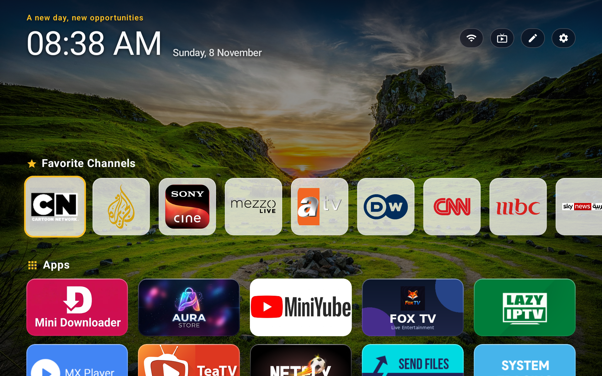

[English](README.md) | [العربية](README_ar.md) | [Deutsch](README_de.md) | [Français](README_fr.md) | [Italiano](README_it.md) | [Русский](README_ru.md) | [Español](README_es.md) | **Português** | [Türkçe](README_tr.md) | [Polski](README_pl.md) | [Nederlands](README_nl.md) | [Ελληνικά](README_el.md) | [Bahasa Indonesia](README_id.md) | [Tiếng Việt](README_vi.md) | [ไทย](README_th.md) | [中文](README_zh.md) | [日本語](README_ja.md) | [한국어](README_ko.md) | [हिन्दी](README_hi.md) | [اردو](README_ur.md) | [فارسی](README_fa.md)

<div align="center">

# 🌌 Salsa TV Launcher

**Experimente o futuro do entretenimento doméstico com uma interface de TV moderna, ultrarrápida e cinematográfica.**

[](https://developer.android.com/tv)
[](https://github.com/OsamaSalsa/Salsa-TV-Launcher)
[](https://kotlinlang.org/)
[](https://developer.android.com/jetpack/compose)
[](https://github.com/OsamaSalsa/Salsa-TV-Launcher)
[](https://github.com/OsamaSalsa/Salsa-TV-Launcher/raw/refs/heads/main/salsa-tv-launcher.apk)

<br>

### 📥 [Clique aqui para baixar a versão mais recente do APK (Pronto para instalar)](https://github.com/OsamaSalsa/Salsa-TV-Launcher/raw/refs/heads/main/salsa-tv-launcher.apk)

<br>


</div>

---

## ✨ Visão Geral

O **Salsa TV Launcher** não é apenas mais uma tela inicial; é um ecossistema completo de entretenimento criado do zero para **Android TV e Smart Boxes**. Construído 100% com **Kotlin** e **Jetpack Compose**, o Salsa combina uma estética fluida e cinematográfica em estilo "Glassmorphism" com ferramentas poderosas integradas, como um reprodutor **IPTV / TV ao Vivo** nativo, um **Hub de Jogos na Nuvem**, a **Loja de Aplicativos Salsa** e um **Mini Downloader** para instalação direta de pacotes APK.

Projetado especificamente para controles remotos de TV (navegação D-Pad), cada animação, estado de foco e transição é ajustado para oferecer uma experiência suave a 60 FPS sem travamentos.

---

## 🚀 Principais Recursos

### 🆕 Novidades na Versão 3.01
* **🔐 Sistema de PIN por Perfil, Confirmação Dupla Oculta, Bloqueio de Entrada e `Master PIN` Admin**: Removido qualquer PIN padrão (`1234` não existe mais). Antes de bloquear aplicativos, seções ou categorias IPTV, é necessário criar um PIN de 4 dígitos **digitando-o duas vezes para confirmar**. O PIN fica sempre oculto (`••••`), alterar ou remover exige o PIN atual, cada perfil possui **Bloqueio de entrada com PIN**, e o perfil **`Main` é o Administrador (`Admin`)** (não pode ser excluído), cujo PIN funciona como **`Master PIN Code`** para acessar ou editar qualquer perfil caso o código seja esquecido.
* **🎙️ Maior Confiabilidade na Pesquisa por Voz no Android TV**: Conexão direta ao serviço de voz do Android TV (`katniss`) com maior tolerância para microfones de controle Bluetooth e nova tentativa automática.
* **🏠 `Launcher Manager` Integrado (HOME Padrão via ADB Local — Sem PC ou Celular Externo)**: Defina o Salsa TV Launcher como seu launcher HOME padrão permanente diretamente de dentro do aplicativo via ADB local (`127.0.0.1:5555`) com autenticação de chave RSA persistente, assistente em 3 passos (`cmd package set-home-activity` com fallback `pm`), verificação imediata, restauração do launcher original em 1 clique e seletor do sistema como alternativa (**Configurações > Sistema e Atalhos da TV > Launcher Manager**).
* **👤 Perfis Multiusuário, Cor de Destaque Dinâmica por Usuário e Isolamento (`Profiles / Users`)**: Crie vários perfis independentes para a família — cada um com sua própria **Cor de Destaque Dinâmica do Tema** (8 tons de alto contraste calibrados para TV que substituem dinamicamente a cor amarela/dourada na saudação, ícones da Tela Inicial [Apps, Jogos, Web, IPTV], Configurações, IPTV e bordas de foco), sua própria **Aparência e Papel de Parede**, **Protetor de Tela**, **Idioma**, **Favoritos e Ordem de Canais IPTV**, **Ordem de Apps / Web / Jogos**, **PIN opcional de 4 dígitos** e **controle por seção** (Mostrar, Bloquear com PIN ou Ocultar **IPTV**, **Apps**, **Web** ou **Jogos**).
* **🔢 Troca Rápida de Canal por Números (`0–9`) e Emblemas de Alto Contraste**: Digite o número de qualquer canal no controle remoto a partir da Tela Inicial, lista IPTV ou player ao vivo para saltar instantaneamente — com emblemas numéricos nítidos de alto contraste (dígitos pretos sobre fundo branco translúcido).
* **🎞️ Protetor de Tela de Vídeo Local do Dispositivo / USB (`Media3 / ExoPlayer`)**: Além das transmissões limpas em tela cheia via `m.youtube.com` sem sobreposições, selecione qualquer arquivo de vídeo local na TV ou pendrive USB via seletor seguro sem permissões (`SAF`) para reprodução contínua em tela cheia.
* **📡 Protetor de Tela de Texto Broadcast (12 Temas Animados, Fundos Escuros Dinâmicos e Leitor de Voz)**: 12 temas estilo estúdio — 6 clássicos mais 6 novos temas criativos (**Aurora Silk**, **Synthwave 80s**, **Cosmic Orbit**, **Royal Arabesque**, **Audio Studio Equalizer**, **Crystal Prism Hologram**) — com animações, layouts e **fundos escuros dinâmicos exclusivos para cada tema** com sombras coloridas contrastantes + pré-visualizações ao vivo nas Configurações, linhas editáveis (`3–15s`), **Leitor de Voz (TTS)** que aguarda o fim da narração antes de avançar e música ambiente ou MP3 local opcional.
* **📺 Recuperação Inteligente de Erro IPTV (`Próximo Canal` + 15s) e Presente Secreto 3× OK**: Quando um canal IPTV falha, exibe um aviso limpo com apenas uma opção focada (**Próximo Canal**) e uma **contagem regressiva de 15 segundos** que tenta novamente o mesmo canal. Além disso, pressionar `OK` 3 vezes no cartão IPTV vazio desbloqueia listas integradas com uma animação comemorativa de presente.
* **🛒 Categorias Topo na Salsa Store e Vídeo Limpo `m.youtube.com`**: A **Salsa Store** prioriza **Navegadores Web** e **Redes Sociais** no topo do catálogo de 9 categorias de utilitários e players verificados para Android TV (com fallback offline); o protetor de tela em vídeo reproduz sempre em tela cheia via `m.youtube.com` sem textos ou sobreposições na tela.
* **🎨 Ajustes Visuais ao Vivo (`Live UI Settings`) — Formato de Hora Direto**: Barra flutuante na Tela Inicial agora com seletor direto de **Formato de Hora** (**`24h • 22:00`** vs **`12h • AM/PM`**) ao lado do tamanho do relógio e formato da data, além de prévia em tempo real de papéis de parede 4K, brilho, altura dos apps, grade, transparência, saudações, clima, filtro noturno, Material You e modo leve.
* **🖥️ Protetor de Tela com Painéis, Leitor de Voz e Música Unificada Cristalina**: Exiba **Clima**, **Notícias**, **Economia**, **Futebol** ou **Alternar Tudo**; o modo Notícias conta com **Leitor de Voz (TTS)** que conclui a leitura dos 6 itens antes de trocar de tela, e todos os painéis compartilham as mesmas faixas musicais nítidas (**Bossa Nova**, **Smooth Jazz**, **Calm Ocean Waves**, **Classic Chillout**, ambientes e MP3) com redução automática durante a fala.
* **🌙 Tempo Padrão do Protetor de Tela de 10 Minutos**: Tempo padrão de inatividade atualizado para **10 minutos** (ajustável: 2, 5, 10, 15, 30 min ou Desativado).
* **🖱️ Mouse Virtual de Borda a Borda, Botão Menu Contextual (`☰`) e Versão na Tela Inicial**: O cursor virtual em portais web e jogos HTML5 alcança perfeitamente as bordas superior e inferior; o botão **Menu (`☰` Três Linhas)** abre **Configurações** na Tela Inicial, **Configurações IPTV** no IPTV e alterna o **Mouse Virtual** em portais web/jogos; toque longo confiável no `OK`; novo ícone compacto da **Salsa Store**; indicador `v3.0` e **atualizações OTA via GitHub**.
* **🌐 Central com 4 Painéis ao Vivo, Portais Web & Motor v3.0 em 21 Idiomas**: Acesso direto a **Clima**, **Notícias** (21 idiomas, 5 seções), **Economia e Mercados** e **Futebol (365Scores)**, portais padrão (**YouTube TV**, **Google**, **CrazyGames**, **Poki**, **Playhop**, **EasyGames**), barra superior responsiva e motor v3.0 a 60 FPS.

### 🖥️ 1. Tela Inicial Cinematográfica e Dinâmica
* **Foco Inteligente com Zoom:** Os cartões ganham vida ao receber foco com bordas iluminadas, elevação suave e escalonamento dinâmico.
* **Cabeçalho Contextual e Clima ao Vivo:** Exibe saudações poéticas de acordo com o horário do dia, relógio em tempo real (12h/24h), status de rede (Wi-Fi / Ethernet) e condições meteorológicas locais ao vivo.
* **Favoritos e Fixação Rápida:** Fixe seus aplicativos favoritos na barra de acesso rápido ou reorganize-os instantaneamente.
* **Suporte a 21 Idiomas (LTR e RTL):** Totalmente localizado em **21 idiomas**, incluindo Português, Inglês, Árabe, Alemão, Francês, Italiano, Russo, Espanhol, Turco, Polonês, Holandês, Grego, Indonésio, Vietnamita, Tailandês, Chinês, Japonês, Coreano, Hindi, Urdu e Persa.

<div align="center">
  
  
</div>

---

### 📺 2. Reprodutor IPTV e TV ao Vivo Integrado
* **Suporte a Listas M3U / M3U8:** Adicione suas próprias listas de reprodução ou explore os canais globais pré-carregados.
* **Reprodução Nativa com ExoPlayer (Media3):** Troca rápida de canais com suporte a streams HLS e DASH.
* **Filtro por Categorias e Busca:** Filtre canais por Esportes, Notícias, Filmes, Infantil ou pesquise instantaneamente.
* **Favoritos de Canais:** Salve seus canais mais assistidos para acesso com um único clique na tela inicial.

<div align="center">
  
</div>

---

### 🛍️ 3. Salsa Store (Loja de Aplicativos para TV)
* **Catálogo Curado para Android TV:** Baixe e instale os melhores aplicativos de streaming, players de mídia, navegadores e utilitários otimizados para TV sem precisar de uma conta do Google.
* **Download e Instalação Direta:** Barras de progresso em tempo real com acionamento automático do instalador de pacotes do sistema.

<div align="center">
  
</div>

---

### 🎮 4. Portais de Jogos na Nuvem e Web Apps
* **Jogue Sem Console:** Acesso direto com um clique ao **Xbox Cloud Gaming**, **NVIDIA GeForce NOW**, **Amazon Luna** e portais de jogos retrô/web.
* **Otimizado para Gamepads:** Conecte seu controle Bluetooth e transforme sua TV em uma central de jogos completa.

<div align="center">
  
</div>

---

### 📥 5. Mini Downloader e Sideloader por Código/URL
* **Download por URL ou Código Curto:** Digite qualquer link direto de arquivo `.apk` ou código numérico curto usando o teclado na tela amigável ao controle remoto.
* **Histórico de Downloads:** Gerencie, reinstale ou exclua arquivos APK baixados anteriormente com facilidade.

<div align="center">
  
</div>

---

### 🎨 6. Personalização Profunda e Controle Parental
* **Papéis de Parede 4K e Temas:** Escolha entre dezenas de papéis de parede de alta definição (Natureza, Espaço, Abstrato, Cyberpunk, Minimalista) ou defina uma imagem personalizada da memória interna/USB.
* **Modo do Ícone da Barra Superior:** Escolha exibir o ícone da **Central de Controle Rápido**, pular a Central de Controle e mostrar o ícone de **Configurações Diretas**, ou **Mostrar Ambos Juntos** na Tela Inicial.
* **Formatos de Data dos EUA e Internacionais:** Suporte para formato americano (`MM/dd/yyyy`, `MMMM d, yyyy`, `EEEE, MMMM d, yyyy`, `EEE, MMM d`), Internacional (`dd/MM/yyyy`), ISO (`yyyy-MM-dd`), Europeu (`dd.MM.yyyy`) ou oculto.
* **Escala de Interface, Cores Dinâmicas (Material You) e Apps Sideloaded:** Ajuste o número de colunas, transparência dos cartões (10%–100%), ative **Cores Dinâmicas Material You**, e alterne entre mostrar apenas apps de TV ou **todos os apps Android instalados (incluindo APKs de celular)**.
* **Protetor de Tela Cinematográfico (`m.youtube.com`), Vídeos Personalizados e Apresentação de Fotos (`Slideshow`):** Reproduz vídeos em tela cheia de forma limpa via `m.youtube.com` sem texto ou sobreposições, permite adicionar vídeos do YouTube com **pré-visualização imediata**, ou exibir fotos de uma pasta (Memória/USB) ou galerias 4K com tempo ajustável (`5s`–`5m`), movimento **Ken Burns / Zoom Suave / Estático**, 6 transições, 7 efeitos de partículas (**Neve ❄️**, **Vaga-lumes ✨**, **Chuva 🌧️**, **Folhas de Outono 🍂**, **Sakura 🌸**, **Estrelas ⭐**, **Bokeh 🔮**), relógio de canto e faixas musicais nítidas (**Bossa Nova**, **Smooth Jazz**, **Calm Ocean Waves**, **Classic Chillout**) ou MP3 personalizado.
* **Gerenciador de Armazenamento de Apps e 10 Atalhos do Sistema (com `Launcher Manager`):** Visualize todos os aplicativos instalados ordenados pelo tamanho (`MB`), abra informações do sistema ou **desinstale aplicativos diretamente** para liberar espaço, além de 10 atalhos rápidos (**Launcher Manager**, **Opções do Desenvolvedor**, Wi-Fi, Ethernet, Tela, Som, Data/Hora, Configurações, Info do App e Armazenamento).
* **Escudo DNS de Modo Duplo (AdBlock + Proteção Familiar com PIN) e Bloqueio por PIN:** Escolha entre bloqueio de anúncios/rastreadores ou **Modo Família** (**sair do Modo Família exige estritamente o PIN de 4 dígitos**) e proteja aplicativos ou categorias IPTV com PIN.
* **Pesquisa por Voz Universal (`🎤`), Favoritos Web Inteligentes e Multi-Lista IPTV:** Busca por voz integrada, **múltiplas listas M3U** com barra de informações IPTV interativa (`OK` com carrossel de canais `◀ / ▶` e EPG), favoritos web com ícones HD automáticos e **YouTube TV Leanback**, fila de apps recentes e atualizador OTA verificado via GitHub.

> ⚠️ **Nota Importante sobre o Modo Infantil / Proteção Familiar:** A saída dentro do launcher é protegida por PIN. Contudo, **um launcher sozinho não pode impedir que uma criança saia por outro app ou pelo botão `Home`**, a menos que você defina o **Salsa TV Launcher** como **Launcher Padrão** e também bloqueie as **Configurações do Sistema** com PIN.

---

## 🛡️ Segurança e Transparência de Permissões

* **HTTPS por Padrão (`network_security_config.xml`)**: O tráfego HTTP sem criptografia é desativado globalmente (`cleartextTrafficPermitted="false"`), com exceções restritas apenas onde necessário.
* **Navegação Segura WebView Ativa**: Google Safe Browsing ativado (`EnableSafeBrowsing=true`) sem coleta de telemetria (`MetricsOptOut=true`).
* **Atualizações OTA Verificadas**: Antes de instalar qualquer atualização do GitHub, o `AppUpdateManager` valida o hash **SHA-256** (`version.json`), o **nome do pacote** e o **certificado de assinatura do APK**.
* **Sem Permissões Amplas de Armazenamento (`Sem MANAGE_EXTERNAL_STORAGE`)**: Todos os arquivos locais utilizam o seletor seguro **Storage Access Framework (SAF)**.
* **Motivo de Cada Permissão**: `INTERNET`/`ACCESS_NETWORK_STATE` (IPTV, painéis, loja, OTA), `ACCESS_COARSE_LOCATION` opcional (clima aproximado da cidade), `RECORD_AUDIO` opcional (somente na Busca por Voz `🎤`), `REQUEST_INSTALL_PACKAGES`/`REQUEST_DELETE_PACKAGES` (somente por ação direta do usuário), `BIND_VPN_SERVICE` (escudo local AdGuard DNS) e `RECEIVE_BOOT_COMPLETED`.

---

## 🎮 Guia de Atalhos do Controle Remoto

O Salsa TV Launcher foi projetado para ser controlado sem esforço com qualquer controle remoto padrão de Android TV:

| Botão no Controle | Onde Usar | Ação Executada |
| :--- | :--- | :--- |
| **Botão OK / Selecionar (Toque Curto)** | Qualquer aplicativo ou cartão | Abre o aplicativo, canal ou portal selecionado. |
| **Botão OK / Selecionar (Pressão Longa)** | Sobre um aplicativo ou canal | Abre o **Menu de Opções Rápidas** (Mover, Ocultar, Bloquear com PIN, Categoria de Jogos, Info do App, Desinstalar). |
| **Teclas Numéricas (`0–9`)** | Tela Inicial • Lista IPTV • Player | **Troca Rápida de Canal**: digite o número do canal para ir diretamente a ele (`OK` confirma, `Voltar` corrige). |
| **Botão Menu (☰ Três Linhas)** | Conforme a tela atual | Na **Tela Inicial** abre **Configurações**, no **IPTV** (lista e player) abre **Configurações de IPTV** (`INFO`/`GUIDE` alterna a barra do canal) e em **Portais Web / Jogos** alterna o **Mouse Virtual**. |
| **Botão de Voz / Google Assistant (🎤)** | Em qualquer lugar do Launcher | Abre a **Busca Universal por Voz** do Salsa para pesquisar aplicativos, canais IPTV ou executar comandos de voz. |
| **Botões Direcionais (D-Pad)** | Em todo o aplicativo | Navega suavemente entre categorias, aplicativos, canais e controles de reprodução. |
| **Botão Voltar (Back)** | Dentro de janelas/players | Fecha menus abertos, sai do player em tela cheia ou retorna ao topo da tela inicial. |

> 💡 **Dica:** Você também pode consultar este guia completo de botões diretamente dentro do aplicativo em **Configurações > Guia do Controle Remoto**.

---

## 🛠️ Arquitetura e Tecnologias

* **Linguagem:** 100% [Kotlin](https://kotlinlang.org/) com Coroutines e StateFlow.
* **Interface (UI):** 100% [Jetpack Compose](https://developer.android.com/jetpack/compose) + Material Design 3 adaptativo para TV.
* **Arquitetura:** MVVM (Model-View-ViewModel) com separação limpa de estado (`UiState`).
* **Reprodução de Mídia:** [AndroidX Media3 / ExoPlayer](https://developer.android.com/guide/topics/media/media3) para streams HLS/M3U8.
* **Carregamento de Imagens:** [Coil](https://coil-kt.github.io/coil/) com cache em disco e memória otimizado.
* **Rede e Clima:** OkHttp + API Open-Meteo para dados meteorológicos precisos sem necessidade de chave de API.

---

## 📦 Instalação

> ℹ️ **Nota de Plataforma**: O Salsa TV Launcher foi projetado principalmente para **Android TV, Google TV e TV Boxes** controlados por controle remoto (`D-Pad`). *(O suporte para telas pequenas móveis/toque está atualmente em fase **experimental / em desenvolvimento**).*

### Método 1: Download Direto do APK (Recomendado)
1. Baixe o arquivo [`salsa-tv-launcher.apk`](https://github.com/OsamaSalsa/Salsa-TV-Launcher/raw/refs/heads/main/salsa-tv-launcher.apk).
   👉 **[Código Curto Downloader / Link Direto: aftv.news/5157967](http://aftv.news/5157967)**
2. Transfira para sua Android TV via pendrive USB, aplicativo *Send Files to TV* ou *Downloader*.
3. Instale o APK e conceda as permissões solicitadas.
4. Pressione o botão **Home** no seu controle remoto e selecione **Salsa TV Launcher** como seu aplicativo inicial padrão (**"Sempre"**).

### Método 2: Instalação via ADB
```bash
adb connect <IP_DA_SUA_TV>:5555
adb install -r salsa-tv-launcher.apk
```

---

## 📄 Licença e Direitos Autorais

Projetado e desenvolvido por **© Osama Salsa**.  
Este repositório hospeda o APK oficial compilado, documentação multilíngue, capturas de tela e manifestos de atualização OTA verificados (`version.json`).
