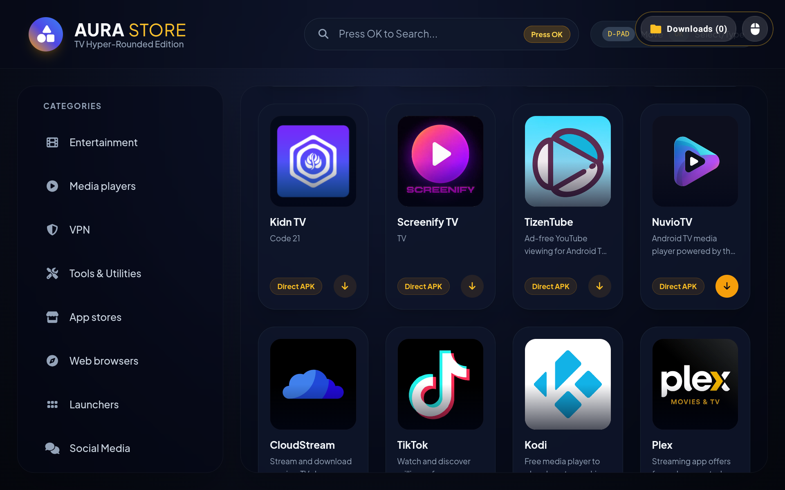

[English](README.md) | [العربية](README_ar.md) | [Deutsch](README_de.md) | [Français](README_fr.md) | [Italiano](README_it.md) | [Русский](README_ru.md) | [Español](README_es.md) | [Português](README_pt.md) | [Türkçe](README_tr.md) | [Polski](README_pl.md) | [Nederlands](README_nl.md) | [Ελληνικά](README_el.md) | [Bahasa Indonesia](README_id.md) | [Tiếng Việt](README_vi.md) | **ไทย** | [中文](README_zh.md) | [日本語](README_ja.md) | [한국어](README_ko.md) | [हिन्दी](README_hi.md) | [اردو](README_ur.md) | [فارسی](README_fa.md)

<div align="center">

# 🌌 Salsa TV Launcher

**สัมผัสอนาคตแห่งความบันเทิงภายในบ้านด้วยอินเทอร์เฟซทีวีที่ทันสมัย รวดเร็วเป็นพิเศษ และงดงามระดับภาพยนตร์**

[](https://developer.android.com/tv)
[](https://github.com/OsamaSalsa/Salsa-TV-Launcher)
[](https://kotlinlang.org/)
[](https://developer.android.com/jetpack/compose)
[](https://opensource.org/licenses/MIT)
[](https://github.com/OsamaSalsa/Salsa-TV-Launcher/raw/refs/heads/main/salsa-tv-launcher.apk)

<br>

### 📥 [คลิกที่นี่เพื่อดาวน์โหลดไฟล์ APK เวอร์ชันล่าสุด (พร้อมติดตั้งทันที)](https://github.com/OsamaSalsa/Salsa-TV-Launcher/raw/refs/heads/main/salsa-tv-launcher.apk)

<br>


</div>

---

## ✨ ภาพรวม

**Salsa TV Launcher** ไม่ใช่แค่หน้าจอโฮมธรรมดา แต่เป็นระบบนิเวศความบันเทิงครบวงจรที่ออกแบบมาตั้งแต่ต้นสำหรับ **Android TV และกล่องสมาร์ททีวี (TV Box)** พัฒนาขึ้นด้วย **Kotlin** และ **Jetpack Compose** 100% ผสานความสวยงามระดับภาพยนตร์แบบ "Glassmorphism" เข้ากับเครื่องมือทรงพลังในตัว เช่น เครื่องเล่น **IPTV / ทีวีสด**, **ศูนย์รวมเกมคลาวด์ (Cloud Gaming Hub)**, **ร้านค้าแอป Salsa Store** และ **Mini Downloader** สำหรับดาวน์โหลดและติดตั้งไฟล์ APK โดยตรง

ออกแบบมาเพื่อรีโมททีวีโดยเฉพาะ (การนำทางด้วยปุ่มทิศทาง D-Pad) ทุกแอนิเมชัน การซูมเมื่อโฟกัส และการเปลี่ยนหน้าจอได้รับการปรับแต่งให้ทำงานได้อย่างลื่นไหลระดับ 60 FPS โดยไม่มีอาการกระตุก

---

## 🚀 คุณสมบัติหลัก

### 🆕 มีอะไรใหม่ในเวอร์ชัน 3.0
* **📡 สกรีนเซฟเวอร์ข้อความข่าว (12 ธีมเคลื่อนไหว, พื้นหลังสีเข้มแบบไดนามิก & เสียงอ่านข่าว)**: 12 ธีมสตูดิโอ — 6 ธีมคลาสสิก + 6 ธีมสร้างสรรค์ใหม่ (**Aurora Silk**, **Synthwave 80s**, **Cosmic Orbit**, **Royal Arabesque**, **Audio Studio Equalizer**, **Crystal Prism Hologram**) — ที่แตกต่างทั้งการเคลื่อนไหว รูปแบบ และ **พื้นหลังสีเข้มไดนามิกเฉพาะแต่ละธีม** พร้อมเงาสีตัดกันที่เคลื่อนไหวได้ + ภาพตัวอย่างสดในการตั้งค่า แก้ไขบรรทัดได้ (`3–15วิ`) มี **เสียงอ่านข้อความ (TTS)** ที่รอให้อ่านจบก่อนเปลี่ยนบรรทัด พร้อมเพลงบรรเลงนุ่มนวลหรือไฟล์ MP3 ในเครื่อง
* **📺 ระบบกู้คืนข้อผิดพลาด IPTV อัจฉริยะ (`ช่องถัดไป` + 15 วิ) & ของขวัญลับ 3× OK**: เมื่อช่อง IPTV เล่นไม่ได้ จะแสดงหน้าต่างเรียบง่ายที่มีปุ่มเดียวคือ **ช่องถัดไป** พร้อม **เวลานับถอยหลัง 15 วินาที** เพื่อลองใหม่อัตโนมัติ นอกจากนี้ การกด `OK` 3 ครั้งบนการ์ด IPTV ที่ว่างเปล่าจะปลดล็อกเพลย์ลิสต์ในตัวพร้อมแอนิเมชันกล่องของขวัญ
* **🛒 หมวดหมู่แนะนำ Salsa Store & วิดีโอสกรีนเซฟเวอร์สะอาดตา `m.youtube.com`**: **Salsa Store** จัดอันดับ **เว็บเบราว์เซอร์** และ **โซเชียลมีเดีย** ไว้ด้านบนสุดของแค็ตตาล็อก 9 หมวดหมู่ (240+ แอปทีวีพร้อมโหมดออฟไลน์) และสกรีนเซฟเวอร์วิดีโอเล่นเต็มจอผ่าน `m.youtube.com` อย่างสะอาดตาโดยไม่มีข้อความหรือแถบใดๆ บนหน้าจอ
* **🎨 การตั้งค่า UI แบบเรียลไทม์ (`Live UI Settings`) — สลับรูปแบบนาฬิกาโดยตรง**: แถบลอยบนหน้าจอหลักเพิ่มตัวเลือก **รูปแบบนาฬิกา** (**`24 ชม. • 22:00`** / **`12 ชม. • AM/PM`**) ข้างขนาดนาฬิกาและรูปแบบวันที่ พร้อมดูตัวอย่างสดของวอลเปเปอร์ 4K ความสว่าง ตำแหน่งแอป จำนวนแถว ความโปร่งใส คำทักทาย สภาพอากาศ โหมดถนอมสายตา Material You และโหมดประหยัดแรม
* **🖥️ สกรีนเซฟเวอร์แดชบอร์ด, เสียงอ่านข่าว & เพลงพื้นหลังคมชัดชุดเดียวกัน**: แสดง **สภาพอากาศ**, **ข่าว**, **เศรษฐกิจ**, **ฟุตบอล** หรือ **สลับแสดงทั้งหมด** โดยโหมดข่าวรองรับ **เสียงอ่านข่าว (TTS)** ที่อ่านครบทั้ง 6 ข่าวก่อนสลับหน้า และแดชบอร์ดข้อมูลทั้งหมดใช้แทร็กเพลงพื้นหลังที่ชัดเจนชุดเดียวกับสไลด์โชว์และข้อความ (**Bossa Nova**, **Smooth Jazz**, **Calm Ocean Waves**, **Classic Chillout**, เสียงบรรยากาศ & MP3) พร้อมลดเสียงอัตโนมัติขณะอ่านข่าว
* **🌙 เวลาพักหน้าจอเริ่มต้นเป็น 10 นาที**: ปรับเวลาพักหน้าจอเริ่มต้นเป็น **10 นาที** (ปรับได้ 2, 5, 10, 15, 30 นาที หรือปิดใช้งาน)
* **🖱️ เมาส์เสมือนเต็มขอบจอ, ปุ่มเมนูตามบริบท (`☰`) & เลขเวอร์ชันหน้าเริ่มต้น**: เคอร์เซอร์เมาส์ในเว็บและเกม HTML5 เลื่อนถึงขอบบนและล่างสุดได้ครบถ้วน ปุ่ม **เมนู (`☰` ขีดสามขีด)** เปิด **การตั้งค่า** บนหน้าจอหลัก เปิด **การตั้งค่า IPTV** ใน IPTV และสลับ **เมาส์เสมือน** ในเว็บพอร์ทัล/เกม แก้ไขการกด `OK` ค้างไม่ให้เปิดพลาด ไอคอน **Salsa Store** ใหม่ แสดง `v3.0` และ **อัปเดตอัตโนมัติผ่าน GitHub OTA**
* **🌐 ศูนย์รวม 4 แดชบอร์ดสด, พอร์ทัลเว็บ & เอ็นจิน v3.0 ครบ 21 ภาษา**: **สภาพอากาศ**, **ข่าวสาร** (21 ภาษา 5 หมวด), **เศรษฐกิจและตลาด**, **ฟุตบอล (365Scores)**, พอร์ทัลเริ่มต้น (**YouTube TV**, **Google**, **CrazyGames**, **Poki**, **Playhop**, **EasyGames**), แถบด้านบนไม่ตัดขอบ และเอ็นจิน v3.0 ลื่น 60 FPS

### 🖥️ 1. หน้าจอหลักระดับภาพยนตร์และมีชีวิตชีวา
* **เอฟเฟกต์โฟกัสอัจฉริยะพร้อมการซูม:** การ์ดแอปจะโดดเด่นขึ้นมาเมื่อเลื่อนไปเลือก พร้อมขอบเรืองแสง เงานุ่มนวล และการขยายขนาดอย่างลื่นไหล
* **ส่วนหัวอัจฉริยะและสภาพอากาศสด:** แสดงคำทักทายตามช่วงเวลาของวัน นาฬิกาแบบเรียลไทม์ (12 ชม. / 24 ชม.) สถานะเครือข่าย (Wi-Fi / Ethernet) และสภาพอากาศในพื้นที่แบบสดๆ
* **รายการโปรดและการปักหมุดด่วน:** ปักหมุดแอปโปรดของคุณไว้ที่แถบเข้าถึงด่วน หรือจัดเรียงลำดับใหม่ได้ทันที
* **รองรับ 21 ภาษา (LTR และ RTL):** แปลภาษาอย่างสมบูรณ์ถึง **21 ภาษา** ได้แก่ ไทย อังกฤษ อาหรับ เยอรมัน ฝรั่งเศส อิตาลี รัสเซีย สเปน โปรตุเกส ตุรกี โปแลนด์ ดัตช์ กรีก อินโดนีเซีย เวียดนาม จีน ญี่ปุ่น เกาหลี ฮินดี อูรดู และเปอร์เซีย

<div align="center">
  
  
</div>

---

### 📺 2. เครื่องเล่น IPTV และทีวีสดในตัว
* **รองรับเพลย์ลิสต์ M3U / M3U8:** เพิ่มเพลย์ลิสต์ IPTV ของคุณเอง หรือรับชมช่องทีวีทั่วโลกที่ติดตั้งมาให้พร้อมใช้งาน
* **ขับเคลื่อนด้วย ExoPlayer (Media3):** เปลี่ยนช่องได้อย่างรวดเร็วทันใจ รองรับสตรีมแบบ HLS และ DASH
* **กรองหมวดหมู่และค้นหา:** กรองช่องตามหมวดหมู่ กีฬา ข่าว ภาพยนตร์ เด็ก หรือพิมพ์ค้นหาชื่อช่องได้ทันที
* **ช่องรายการโปรด:** บันทึกช่องที่คุณรับชมบ่อยที่สุดเพื่อเปิดดูได้ในคลิกเดียวจากหน้าจอหลัก

<div align="center">
  
</div>

---

### 🛍️ 3. Salsa Store (ร้านค้าแอปสำหรับทีวี)
* **คัดสรรแอปคุณภาพสำหรับ Android TV:** ดาวน์โหลดและติดตั้งแอปสตรีมมิง เครื่องเล่นมีเดีย เบราว์เซอร์ และเครื่องมือที่ปรับแต่งมาเพื่อหน้าจอทีวีโดยไม่ต้องใช้บัญชี Google
* **ดาวน์โหลดและติดตั้งโดยตรง:** แสดงแถบความคืบหน้าแบบเรียลไทม์พร้อมเปิดหน้าต่างติดตั้งแพ็กเกจอัตโนมัติ

<div align="center">
  
</div>

---

### 🎮 4. พอร์ทัลเกมคลาวด์และเว็บแอป
* **เล่นเกมระดับโลกโดยไม่ต้องมีคอนโซล:** เข้าถึง **Xbox Cloud Gaming**, **NVIDIA GeForce NOW**, **Amazon Luna** และพอร์ทัลเกมเรโทรได้ในคลิกเดียว
* **รองรับจอยเกม (Gamepad):** เชื่อมต่อจอยเกมบลูทูธแล้วเปลี่ยนทีวีของคุณให้กลายเป็นเครื่องเล่นเกมเต็มรูปแบบ

<div align="center">
  
</div>

---

### 📥 5. Mini Downloader และตัวติดตั้ง APK ผ่านลิงก์/รหัสย่อ
* **ดาวน์โหลดผ่าน URL หรือรหัสตัวเลขสั้นๆ:** ป้อนลิงก์ตรงของไฟล์ `.apk` หรือรหัสตัวเลขสั้นๆ ด้วยแป้นพิมพ์บนหน้าจอที่ใช้งานง่ายด้วยรีโมท
* **ประวัติการดาวน์โหลด:** จัดการ ติดตั้งซ้ำ หรือลบไฟล์ APK ที่ดาวน์โหลดไว้ก่อนหน้าได้อย่างง่ายดาย

<div align="center">
  
</div>

---

### 🎨 6. การปรับแต่งขั้นสูงและการควบคุมโดยผู้ปกครอง
* **วอลเปเปอร์ 4K และธีมสี:** เลือกจากวอลเปเปอร์ความละเอียดสูงกว่าหลายสิบแบบ (ธรรมชาติ อวกาศ นามธรรม ไซเบอร์พังก์ มินิมอล) หรือเลือกรูปภาพของคุณเองจากความจำเครื่อง/USB
* **โหมดไอคอนแถบด้านบน:** เลือกแสดงไอคอน **ศูนย์ควบคุมด่วน**, ข้ามศูนย์ควบคุมเพื่อแสดงไอคอน **การตั้งค่าโดยตรง**, หรือ **แสดงทั้งสองไอคอนคู่กัน** บนหน้าจอหลัก
* **รูปแบบวันที่แบบอเมริกันและสากล:** รูปแบบสหรัฐฯ (`MM/dd/yyyy`, `MMMM d, yyyy`, `EEEE, MMMM d, yyyy`, `EEE, MMM d`), สากล (`dd/MM/yyyy`), ISO (`yyyy-MM-dd`), ยุโรป (`dd.MM.yyyy`) หรือซ่อน
* **ปรับขนาด UI, สีไดนามิก (Material You) และแสดงแอป Android ทั้งหมด (Sideloaded APKs):** ปรับจำนวนคอลัมน์ ความโปร่งใสของการ์ด (10%–100%), เปิดใช้งาน **สีไดนามิก Material You**, และสลับระหว่างแสดงเฉพาะแอปทีวีหรือ **แอป Android ที่ติดตั้งทั้งหมด (รวมถึงไฟล์ APK มือถือ)**
* **สกรีนเซฟเวอร์ระดับภาพยนตร์ (`m.youtube.com`), วิดีโอ YouTube กำหนดเอง และสไลด์โชว์รูปภาพ (`Slideshow`):** เล่นวิดีโอเต็มจอผ่าน `m.youtube.com` โดยไม่มีข้อความหรือแบนเนอร์ เพิ่มวิดีโอ YouTube ของคุณเองพร้อมปุ่ม **ดูตัวอย่างทันที**, หรือแสดงสไลด์โชว์จากโฟลเดอร์ (เครื่อง/USB) หรือแกลเลอรี 4K ตั้งเวลา (`5 วิ`–`5 นาที`), การเคลื่อนไหว **Ken Burns / ซูมนุ่มนวล / ภาพนิ่ง**, 6 เอฟเฟกต์เปลี่ยนภาพ, 7 เอฟเฟกต์บรรยากาศ (**หิมะตก ❄️**, **หิ่งห้อย ✨**, **สายฝน 🌧️**, **ใบไม้ร่วง 🍂**, **ซากุระ 🌸**, **ดวงดาว ⭐**, **โบเก้ 🔮**), นาฬิกามุมจอ และเพลงบรรเลงคมชัด (**Bossa Nova**, **Smooth Jazz**, **Calm Ocean Waves**, **Classic Chillout**) หรือ MP3 ของคุณเอง
* **ตัวจัดการพื้นที่เก็บข้อมูลแอปและ 8 ทางลัดระบบด่วน:** ดูแอปที่ติดตั้งทั้งหมดเรียงตามขนาด (`MB`), เปิดข้อมูลระบบ หรือ **ถอนการติดตั้งแอปโดยตรง** เพื่อคืนพื้นที่ว่าง พร้อม 8 ทางลัดด่วน (Wi-Fi, Ethernet, จอภาพ, เสียง, วันที่/เวลา, การตั้งค่าทั้งหมด, ข้อมูลแอป, จัดการพื้นที่)
* **เกราะป้องกัน DNS สองโหมด (AdBlock + โหมดครอบครัว) และล็อกด้วย PIN:** เลือกระหว่าง **บล็อกโฆษณาและตัวติดตาม** หรือ **โหมดปกป้องครอบครัว** (บล็อกเว็บไซต์สำหรับผู้ใหญ่ทั้งระบบ) และปกป้องแอปหรือหมวดหมู่ IPTV ด้วยรหัส PIN 4 หลัก
* **การค้นหาด้วยเสียง (`🎤`), ผู้ช่วยเสียงเริ่มต้นของระบบ, บุ๊กมาร์กเว็บอัจฉริยะ และจัดการหลายเพลย์ลิสต์ IPTV:** ตั้งค่า **Salsa TV** เป็นผู้ช่วยเสียงเริ่มต้นของทีวีเพื่อให้ปุ่มไมโครโฟนบนรีโมททำงานได้ทันที, จัดการ **เพลย์ลิสต์ M3U หลายรายการ**, บุ๊กมาร์กเว็บดึงไอคอน HD อัตโนมัติพร้อมเปิด YouTube ในโหมด **YouTube TV Leanback**, แถวแอปล่าสุด และตัวอัปเดต OTA ผ่าน GitHub

---

## 🎮 คู่มือการใช้งานปุ่มลัดบนรีโมท

Salsa TV Launcher ออกแบบมาให้ควบคุมได้อย่างง่ายดายด้วยรีโมท Android TV มาตรฐานทุกรุ่น:

| ปุ่มบนรีโมท | ตำแหน่งที่ใช้งาน | การทำงาน |
| :--- | :--- | :--- |
| **ปุ่ม OK / เลือก (กดสั้น)** | บนแอปหรือการ์ดใดก็ได้ | เปิดแอป ช่องทีวี หรือพอร์ทัลที่เลือกไว้ |
| **ปุ่ม OK / เลือก (กดค้าง)** | บนไอคอนแอปหรือช่อง | เปิด **เมนูตัวเลือกด่วน** (ย้าย, ซ่อน, ล็อกด้วย PIN, หมวดเกม, ข้อมูลแอป, ถอนการติดตั้ง) |
| **ปุ่มเมนู (☰ ขีดสามขีด)** | ตามหน้าจอที่ใช้งาน | บน **หน้าจอหลัก** เปิด **การตั้งค่า**, ใน **IPTV** (รายการช่องและตัวเล่น) เปิด **การตั้งค่า IPTV** (`INFO`/`GUIDE` เพื่อเปิดแถบช่อง), และใน **เว็บพอร์ทัล / เกม** สลับโหมด **เมาส์เสมือน** |
| **ปุ่มสั่งงานด้วยเสียง / Google Assistant (🎤)** | ทุกที่ในลอนเชอร์ | เปิด **การค้นหาด้วยเสียงอัจฉริยะ** ของ Salsa เพื่อค้นหาแอป ช่อง IPTV หรือสั่งงานด้วยเสียง |
| **ปุ่มทิศทาง (D-Pad)** | ทั่วทั้งแอปพลิเคชัน | เลื่อนนำทางระหว่างหมวดหมู่ แอป ช่องทีวี และปุ่มควบคุมการเล่นอย่างลื่นไหล |
| **ปุ่มย้อนกลับ (Back)** | ในหน้าต่างเมนู / เครื่องเล่น | ปิดเมนูที่เปิดอยู่ ออกจากโหมดเต็มจอ หรือกลับไปยังด้านบนสุดของหน้าจอหลัก |

> 💡 **เคล็ดลับ:** คุณสามารถเปิดดูคู่มือปุ่มรีโมทฉบับเต็มได้ภายในแอปที่เมนู **การตั้งค่า > คู่มือการใช้รีโมท**

---

## 🛠️ สถาปัตยกรรมและเทคโนโลยีที่ใช้

* **ภาษาโปรแกรม:** 100% [Kotlin](https://kotlinlang.org/) พร้อม Coroutines และ StateFlow
* **ส่วนติดต่อผู้ใช้ (UI):** 100% [Jetpack Compose](https://developer.android.com/jetpack/compose) + Material Design 3 สำหรับทีวี
* **สถาปัตยกรรม:** MVVM (Model-View-ViewModel) พร้อมการจัดการสถานะ (`UiState`) ที่ชัดเจน
* **ระบบเล่นมีเดีย:** [AndroidX Media3 / ExoPlayer](https://developer.android.com/guide/topics/media/media3) สำหรับสตรีม HLS/M3U8
* **ระบบโหลดภาพ:** [Coil](https://coil-kt.github.io/coil/) พร้อมระบบแคชในดิสก์และหน่วยความจำประสิทธิภาพสูง
* **เครือข่ายและสภาพอากาศ:** OkHttp + Open-Meteo API ดึงข้อมูลสภาพอากาศแม่นยำโดยไม่ต้องใช้ API Key

---

## 📦 วิธีการติดตั้ง

### วิธีที่ 1: ดาวน์โหลดไฟล์ APK โดยตรง (แนะนำ)
1. ดาวน์โหลดไฟล์ [`salsa-tv-launcher.apk`](https://github.com/OsamaSalsa/Salsa-TV-Launcher/raw/refs/heads/main/salsa-tv-launcher.apk) จากหน้า Releases
   👉 **[รหัสย่อแอป Downloader / ลิงก์ตรง: aftv.news/5157967](http://aftv.news/5157967)**
2. ส่งไฟล์ไปยัง Android TV ของคุณผ่านแฟลชไดรฟ์ USB, แอป *Send Files to TV* หรือ *Downloader*
3. ติดตั้งไฟล์ APK และอนุญาตสิทธิ์ที่จำเป็น
4. กดปุ่ม **Home (โฮม)** บนรีโมท แล้วเลือก **Salsa TV Launcher** เป็นหน้าจอหลักเริ่มต้น (**"ตลอดไป"**)

### วิธีที่ 2: คอมไพล์จากซอร์สโค้ด
```bash
git clone https://github.com/OsamaSalsa/Salsa-TV-Launcher.git
cd Salsa-TV-Launcher
./gradlew assembleDebug
```
ไฟล์ APK ที่คอมไพล์เสร็จแล้วจะอยู่ที่ `app/build/outputs/apk/debug/app-debug.apk`

---

## 🤝 การมีส่วนร่วมและสัญญาอนุญาต

เรายินดีต้อนรับทุกการมีส่วนร่วม การแจ้งบั๊ก และข้อเสนอแนะฟีเจอร์ใหม่ๆ! คุณสามารถเปิด *Issue* หรือส่ง *Pull Request* ได้ตลอดเวลา

เผยแพร่ภายใต้สัญญาอนุญาต **MIT** ดูรายละเอียดเพิ่มเติมได้ในไฟล์ `LICENSE`
