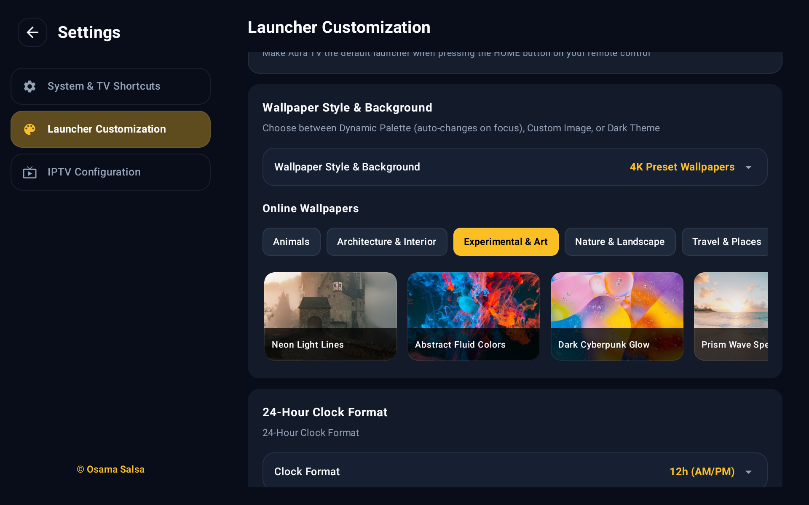

[English](README.md) | [العربية](README_ar.md) | [Deutsch](README_de.md) | [Français](README_fr.md) | [Italiano](README_it.md) | [Русский](README_ru.md) | [Español](README_es.md) | [Português](README_pt.md) | **Türkçe** | [Polski](README_pl.md) | [Nederlands](README_nl.md) | [Ελληνικά](README_el.md) | [Bahasa Indonesia](README_id.md) | [Tiếng Việt](README_vi.md) | [ไทย](README_th.md) | [中文](README_zh.md) | [日本語](README_ja.md) | [한국어](README_ko.md) | [हिन्दी](README_hi.md) | [اردو](README_ur.md) | [فارسی](README_fa.md)

<div align="center">

# 🌌 Salsa TV Launcher

**Modern, ultra hızlı ve sinematik bir TV arayüzü ile ev eğlencesinin geleceğini deneyimleyin.**

[](https://developer.android.com/tv)
[](https://github.com/OsamaSalsa/Salsa-TV-Launcher)
[](https://kotlinlang.org/)
[](https://developer.android.com/jetpack/compose)
[](https://github.com/OsamaSalsa/Salsa-TV-Launcher/raw/refs/heads/main/salsa-tv-launcher.apk)

<br>

### 📥 [En Son APK Sürümünü İndirmek İçin Buraya Tıklayın (Kuruluma Hazır)](https://github.com/OsamaSalsa/Salsa-TV-Launcher/raw/refs/heads/main/salsa-tv-launcher.apk)

<br>


</div>

---

## ✨ Genel Bakış

**Salsa TV Launcher** sıradan bir ana ekran değildir; **Android TV ve Akıllı TV Kutuları (TV Box)** için sıfırdan tasarlanmış eksiksiz bir eğlence ekosistemidir. Tamamen **Kotlin** ve **Jetpack Compose** ile geliştirilen Salsa, akıcı ve sinematik "Glassmorphism" tasarımını yerleşik **IPTV / Canlı TV** oynatıcısı, **Bulut Oyun Merkezi**, **Salsa Uygulama Mağazası** ve doğrudan APK kurulumu sağlayan **Mini İndirici (Downloader)** gibi güçlü araçlarla birleştirir.

TV uzaktan kumandaları (D-Pad navigasyonu) için özel olarak optimize edilmiş her animasyon, odak efekti ve geçiş, takılma olmadan pürüzsüz bir 60 FPS deneyimi sunmak üzere ayarlanmıştır.

---

## 🚀 Temel Özellikler

### 🆕 Sürüm 3.0 Yenilikleri
* **🏠 Dahili `Launcher Manager` (Yerel ADB ile Varsayılan HOME Kurulumu — Harici PC veya Telefon Gerekmez)**: Kalıcı RSA anahtar doğrulaması, 3 adımlı sihirbaz (`cmd package set-home-activity` ve `pm` yedeği), anlık doğrulama, tek tıkla orijinal başlatıcıyı geri yükleme ve sistem seçici yedeğiyle yerel ADB (`127.0.0.1:5555`) üzerinden doğrudan uygulama içinden Salsa TV Launcher'ı kalıcı varsayılan HOME başlatıcınız yapın (**Ayarlar > Sistem ve TV Kısayolları > Launcher Manager**).
* **👤 Çoklu Kullanıcı Profilleri, Kullanıcıya Özel Dinamik Tema Vurgu Rengi ve Kişisel İzolasyon (`Profiller / Kullanıcılar`)**: Her aile üyesi için ayrı profiller oluşturun — her profilin kendine özel **Dinamik Tema Vurgu Rengi** (karşılama mesajı, Ana Ekran bölüm simgeleri [Uygulamalar, Oyunlar, Web, IPTV], Ayarlar, IPTV ve tüm odak çerçevelerinde sarı/altın rengin yerini dinamik olarak alan TV uyumlu 8 yüksek kontrastlı renk tonu), **Görünüm ve Duvar Kağıdı**, **Ekran Koruyucu**, **Dil**, **IPTV Favorileri ve Kanal Sırası**, **Uygulamalar / Web / Oyunlar Sırası**, isteğe bağlı **4 haneli Profil PIN'i** ve bölüm başına **Göster / PIN Kilidi / Gizle** kontrolü bulunur.
* **🔢 Hızlı Sayısal Kanal Geçişi (`0–9`) ve Yüksek Kontrastlı Kanal Numara Rozetleri**: IPTV ekranında ve tam ekran oynatıcıda kumandadaki `0–9` rakam tuşlarına basarak doğrudan herhangi bir kanal numarasına atlayın; yarı saydam beyaz rozet üzerinde siyah rakamlarla her arka planda anında okunabilirlik sağlar.
* **🎬 Yerel Cihaz / USB Video Ekran Koruyucusu (`Media3 / ExoPlayer`) ve Saf `m.youtube.com` Yayınları**: Sıfır depolama izni gerektiren Android SAF seçicisiyle cihazınızdan veya USB bellekten yerel video dosyalarını tam ekran koruyucu olarak oynatın ya da ekranda hiçbir yazı, HUD veya katman olmadan saf `m.youtube.com` tam ekran yayınlarını kullanın.
* **📡 Canlı Metin Yayın Ekran Koruyucusu (12 Animasyonlu Tema, Koyu Dinamik Arka Planlar & Sesli Okuyucu)**: 6 klasik artı 6 yaratıcı yeni animasyonlu tema (**Aurora Silk**, **Synthwave 80s**, **Cosmic Orbit**, **Royal Arabesque**, **Audio Studio Equalizer**, **Crystal Prism Hologram**) olmak üzere 12 stüdyo teması; her birinde zıt renkli hareketli gölgelere sahip **temaya özel koyu dinamik arka plan** + Ayarlarda canlı önizleme, düzenlenebilir satırlar (`3–15sn`), anlatım bitene kadar bekleyen **Sesli Okuyucu (TTS)** ve arka plan müziği veya yerel MP3 desteği.
* **📺 IPTV Akıllı Hata Kurtarma (`Sonraki Kanal` + 15sn) & Gizli 3× OK Hediye Kilidi**: Bir IPTV kanalı açılamadığında yalnızca **Sonraki Kanal** düğmesine odaklanan sade bir ekran ve otomatik yeniden deneme için **15 saniyelik geri sayım** gösterir. Ayrıca boş IPTV kartında `OK` tuşuna 3 kez basmak kutlama hediye animasyonuyla yerleşik listeleri açar.
* **🛒 Seçilmiş Salsa Store Kataloğu**: **Salsa Store**, 9 kategorilik kataloğunun en üstünde **Web Tarayıcıları** ve **Sosyal Medya** kategorilerini önceliklendirerek meşru Android TV araçlarını ve medya oynatıcılarını düzenli bir arayüzde sunar.
* **🎨 Canlı Arayüz Ayarları (`Live UI Settings`) — Doğrudan Saat Formatı Değiştirici**: Ana ekrandaki şeffaf panel artık Saat Boyutu ve Tarih Formatının hemen yanında doğrudan **Saat Formatı** (**`24s • 22:00`** / **`12s • AM/PM`**) seçicisi sunar; 4K duvar kağıtları, parlaklık, uygulama konumu, ızgara, cam saydamlığı, karşılama, hava durumu, gece filtresi, Material You ve hafif mod değişiklikleri anında canlı görünür.
* **🖥️ Panel Ekran Koruyucuları, Haber Sesli Okuyucusu & Birleştirilmiş Net Müzikler**: **Hava Durumu**, **Haberler**, **Ekonomi**, **Futbol** veya **Hepsini Sırayla Göster**; Haberler ekran koruyucusu geçiş yapmadan önce 6 haberi de okuyan **Sesli Okuyucu (TTS)** sunar ve tüm bilgi panelleri Slayt Gösterisi ile aynı kristal netliğindeki müzikleri (**Bossa Nova**, **Smooth Jazz**, **Calm Ocean Waves**, **Classic Chillout**, ortam sesleri & MP3) paylaşır (konuşma sırasında otomatik ses kısma ile).
* **🌙 Varsayılan Ekran Koruyucu Süresi 10 Dakika**: Varsayılan hareketsizlik süresi **10 dakika** olarak güncellendi (2, 5, 10, 15, 30 dk veya Devre Dışı olarak ayarlanabilir).
* **🖱️ Kenardan Kenara Sanal Fare, Bağlama Duyarlı Menü Tuşu (`☰`) & Doğrulanmış OTA Güncellemeleri**: Web portalları ve HTML5 oyunlarındaki sanal imleç ekranın en üst ve en alt kenarlarına ulaşır; **Menü (`☰` Üç Çizgi)** tuşu Ana Ekranda **Ayarlar**'ı, IPTV'de **IPTV Ayarları**'nı açar ve Web Portalları/Oyunlarda **Sanal Fare**yi değiştirir; güvenilir uzun `OK` basışı; yeni **Salsa Store** simgesi; `v3.0` etiketi ve SHA-256 + imza doğrulamalı **GitHub OTA otomatik güncellemeleri**.
* **🌐 4 Canlı Bilgi Paneli, Web Portalları & 21 Dilde v3.0 Motoru**: **Hava Durumu**, **Haberler** (21 dil, 5 kategori), **Ekonomi ve Piyasalar** ve **Futbol (365Scores)** panelleri, varsayılan web portalları (**YouTube TV**, **Google**, **CrazyGames**, **Poki**, **Playhop**, **EasyGames**), kırpılmayan üst çubuk ve 60 FPS v3.0 motoru.

### 🖥️ 1. Sinematik ve Dinamik Ana Ekran
* **Akıllı Odaklama ve Yakınlaştırma:** Kartlar üzerine gelindiğinde parlayan kenarlıklar, yumuşak gölgeler ve dinamik büyütme efektleriyle canlanır.
* **Akıllı Üst Bilgi ve Canlı Hava Durumu:** Günün saatine göre şiirsel karşılama mesajları, gerçek zamanlı saat (12s/24s), ağ durumu (Wi-Fi / Ethernet) ve anlık yerel hava durumu bilgilerini gösterir.
* **Favoriler ve Hızlı Sabitleme:** En sevdiğiniz uygulamaları hızlı erişim çubuğuna sabitleyin veya sıralamasını anında değiştirin.
* **21 Dil Desteği (LTR ve RTL):** Türkçe, İngilizce, Arapça, Almanca, Fransızca, İtalyanca, Rusça, İspanyolca, Portekizce, Lehçe, Felemenkçe, Yunanca, Endonezce, Vietnamca, Tayca, Çince, Japonca, Korece, Hintçe, Urduca ve Farsça dahil **21 dilde** tam yerelleştirme.

<div align="center">
  
  
</div>

---

### 📺 2. Dahili IPTV ve Canlı TV Oynatıcısı
* **M3U / M3U8 Çalma Listesi Desteği:** Kendi IPTV listelerinizi ekleyin veya önceden yüklenmiş küresel kanalları keşfedin.
* **Yerleşik ExoPlayer (Media3) Motoru:** HLS ve DASH yayın desteği ile hızlı kanal geçişi.
* **Kategori Filtreleme ve Arama:** Kanalları Spor, Haber, Film, Çocuk kategorilerine göre filtreleyin veya anında arayın.
* **Favori Kanallar:** En çok izlediğiniz kanalları ana ekrandan tek tıkla açmak için favorilere kaydedin.

<div align="center">
  
</div>

---

### 🛍️ 3. Salsa Store (TV Uygulama Mağazası)
* **TV İçin Seçilmiş Katalog:** Google hesabına ihtiyaç duymadan TV için optimize edilmiş en iyi yayın uygulamalarını, medya oynatıcılarını, tarayıcıları ve araçları indirin.
* **Doğrudan İndirme ve Kurulum:** Gerçek zamanlı indirme çubuğu ve otomatik paket yükleyici başlatma.

<div align="center">
  
</div>

---

### 🎮 4. Bulut Oyun Portalları ve Web Uygulamaları
* **Konsolsuz Oyun Deneyimi:** **Xbox Cloud Gaming**, **NVIDIA GeForce NOW**, **Amazon Luna** ve retro/web oyun portallarına tek tıkla doğrudan erişim.
* **Oyun Kolu (Gamepad) Uyumlu:** Bluetooth oyun kolunuzu bağlayın ve televizyonunuzu eksiksiz bir oyun merkezine dönüştürün.

<div align="center">
  
</div>

---

### 📥 5. Mini İndirici (Downloader) ve APK Yükleyici
* **URL veya Kısa Kod ile İndirme:** Kumanda dostu ekran klavyesini kullanarak herhangi bir doğrudan `.apk` bağlantısını veya kısa sayısal kodu girin.
* **İndirme Geçmişi:** Daha önce indirilen APK dosyalarını kolayca yeniden kurun veya silin.

<div align="center">
  
</div>

---

### 🎨 6. Gelişmiş Özelleştirme ve Ebeveyn Kontrolü
* **4K Duvar Kağıtları ve Temalar:** Onlarca yüksek çözünürlüklü duvar kağıdı (Doğa, Uzay, Soyut, Cyberpunk, Minimal) arasından seçim yapın veya dahili depolama/USB'den özel bir resim belirleyin.
* **Üst Çubuk Simge Modu:** Ana ekranda **Hızlı Kontrol Merkezi** simgesini göstermeyi, Kontrol Merkezini atlayıp **Doğrudan Ayarlar** simgesini göstermeyi veya **Her İki Simgeyi Birlikte** göstermeyi seçin.
* **ABD ve Uluslararası Tarih Biçimleri:** ABD sayısal (`MM/dd/yyyy`), ABD uzun (`MMMM d, yyyy`), ABD tam (`EEEE, MMMM d, yyyy`), kısa (`EEE, MMM d`), Uluslararası (`dd/MM/yyyy`), ISO (`yyyy-MM-dd`), Avrupa (`dd.MM.yyyy`) veya gizli.
* **Arayüz Ölçekleme, Dinamik Renkler (Material You) ve Tüm Android Uygulamaları (Sideloaded APKs):** Sütun sayısını, kart şeffaflığını (%10–%100), **Material You Dinamik Renklerini** ayarlayın ve yalnızca TV uygulamalarını veya **tüm yüklü Android uygulamalarını (mobil APK'lar dahil)** gösterme arasında geçiş yapın.
* **Sinematik Ekran Koruyucu (`m.youtube.com`), Özel YouTube Videoları ve Fotoğraf Slayt Gösterisi (`Slideshow`):** Ekranda hiç yazı olmadan `m.youtube.com` üzerinden tam ekran videolar oynatır, kendi YouTube videolarınızı ekleyip **anında canlı önizleme** başlatabilirsiniz; veya cihaz/USB klasöründen ya da 4K galerilerden slayt gösterisi (`5sn`–`5dk`), **Ken Burns / Yumuşak Yakınlaştırma / Sabit** hareket, 6 geçiş, 7 atmosferik efekt (**Kar ❄️**, **Ateşböcekleri ✨**, **Yağmur 🌧️**, **Sonbahar Yaprakları 🍂**, **Sakura 🌸**, **Yıldızlar ⭐**, **Bokeh 🔮**), köşe saati ve net arka plan müzikleri (**Bossa Nova**, **Smooth Jazz**, **Calm Ocean Waves**, **Classic Chillout**) veya özel MP3 çalabilirsiniz.
* **Dahili Uygulama Depolama Yöneticisi ve 10 Hızlı Sistem Kısayolu (`Launcher Manager` dahil):** Yüklü tüm uygulamaları boyutlarına (`MB`) göre görüntüleyin, sistem bilgilerini açın veya yer açmak için **uygulamaları doğrudan kaldırın**; ayrıca 10 hızlı sistem kısayoluna (**Launcher Manager**, **Geliştirici Seçenekleri**, Wi-Fi, Ethernet, Ekran, Ses, Tarih/Saat, Tüm Ayarlar, Uygulama Bilgisi, Depolama Yöneticisi) tek tıkla erişin.
* **Çift Modlu DNS Kalkanı (AdBlock + Aile Koruması) ve PIN Kilidi:** **Reklam ve İzleyici Engelleme** veya **Aile Koruma Modu** (yetişkin sitelerini sistem genelinde engeller) arasında seçim yapın; uygulamaları ve IPTV kategorilerini 4 haneli PIN koduyla koruyun.
* **Evrensel Sesli Arama (`🎤`), Sistem Varsayılan Sesli Asistanı, Akıllı Web Yer İmleri ve Çoklu IPTV Listesi:** Kumandanın mikrofon tuşunu doğrudan kullanmak için **Salsa TV**'yi varsayılan sistem sesli asistanı yapın; **birden fazla M3U çalma listesi** yönetin; web yer imlerinde otomatik HD simge çekme ve **YouTube TV Leanback** modunu kullanın; son uygulamalar satırı ve GitHub OTA güncelleyici.

---

## 🎮 Uzaktan Kumanda Kısayol Kılavuzu

Salsa TV Launcher, standart herhangi bir Android TV kumandasıyla zahmetsizce kontrol edilecek şekilde tasarlanmıştır:

| Kumanda Tuşu | Nerede Kullanılır | Yapılan İşlem |
| :--- | :--- | :--- |
| **OK / Seçim Tuşu (Kısa Basış)** | Herhangi bir uygulama veya kart | Seçili uygulamayı, kanalı veya portalı açar. |
| **OK / Seçim Tuşu (Uzun Basış)** | Bir uygulamanın veya kanalın üzerinde | **Hızlı Seçenekler Menüsünü** açar (Taşı, Gizle, PIN ile Kilitle, Oyun Kategorisi, Uygulama Bilgisi, Kaldır). |
| **Menü Tuşu (☰ Üç Çizgi)** | Ekrana göre değişir | **Ana Ekranda** **Ayarlar**'ı açar, **IPTV**'de (liste ve oynatıcı) **IPTV Ayarları**'nı açar (`INFO`/`GUIDE` bilgi çubuğunu açar/kapatır), **Web Portalları / Oyunlarda** ise **Sanal Fare**yi açıp kapatır. |
| **Ses / Google Asistan Tuşu (🎤)** | Başlatıcının herhangi bir yerinde | Uygulamaları, IPTV kanallarını aramak veya sesli komut çalıştırmak için **Evrensel Sesli Aramayı** açar. |
| **Yön Tuşları (D-Pad)** | Tüm uygulama genelinde | Kategoriler, uygulamalar, kanallar ve oynatıcı kontrolleri arasında akıcı geçiş yapar. |
| **0–9 Rakam Tuşları** | IPTV Kanal Listesi / Oynatıcı | Herhangi bir kanal numarasına anında atlamak için **Hızlı Sayısal Geçiş (Quick Zap)** özelliğini kullanır. |
| **Geri Tuşu (Back)** | Pencereler / oynatıcı içinde | Açık menüleri kapatır, tam ekran oynatıcıdan çıkar veya ana ekranın en üstüne döner. |

> 💡 **İpucu:** Bu kılavuzun tamamına uygulama içinden **Ayarlar > Kumanda Kılavuzu** bölümünden de istediğiniz zaman ulaşabilirsiniz.

---

## 🔒 Güvenlik, Gizlilik ve İzin Şeffaflığı

* **Varsayılan HTTPS & WebView Güvenli Tarama:** Tüm ağ bağlantıları `network_security_config.xml` (`cleartextTrafficPermitted="false"`) üzerinden HTTPS öncelikli çalışır; dahili WebView'de **Safe Browsing** (`EnableSafeBrowsing=true`) etkinleştirilmiş ve telemetri (`MetricsOptOut=true`) devre dışı bırakılmıştır.
* **Doğrulanmış OTA Otomatik Güncellemeleri:** Kurulum başlatılmadan önce indirilen her APK; `version.json` içindeki **SHA-256 özeti**, paket adı ve **APK imza sertifikası** kontrol edilerek doğrulanır.
* **Geniş Depolama İzni Yok (`MANAGE_EXTERNAL_STORAGE` Kullanılmaz):** Tüm duvar kağıdı, fotoğraf slayt gösterisi, yerel MP3 ve yerel video seçimleri sıfır izinli Android **Depolama Erişim Çerçevesi (SAF)** ile gerçekleştirilir.
* **İzinlerin Açıklaması:**
  * `INTERNET` & `ACCESS_NETWORK_STATE`: Hava durumu, canlı bilgi panelleri, IPTV yayınları, web portalları ve OTA güncellemeleri için gereklidir.
  * `ACCESS_COARSE_LOCATION` *(İsteğe bağlı)*: Yalnızca otomatik yerel hava durumu konumu için kullanılır (manuel şehir seçimi de desteklenir).
  * `RECORD_AUDIO` *(İsteğe bağlı)*: Yalnızca kullanıcı Evrensel Sesli Arama özelliğini başlattığında kullanılır.
  * `REQUEST_INSTALL_PACKAGES` & `REQUEST_DELETE_PACKAGES`: Salsa Store, Mini İndirici, OTA güncellemeleri ve Uygulama Depolama Yöneticisi için gereklidir.
  * `BIND_VPN_SERVICE`: Yalnızca yerel DNS Kalkanı (AdBlock / Aile Koruması) için cihaz içi VPN tüneli oluşturur; hiçbir trafik harici sunucuya yönlendirilmez.
  * `RECEIVE_BOOT_COMPLETED`: Cihaz açıldığında seçilen DNS Kalkanını otomatik olarak geri yükler.
* **PIN Korumalı Aile Modu ve Başlatıcı Sınırlaması:** Aile Koruma Modundan veya Çocuk Profilinden çıkış **4 haneli PIN** gerektirir. *Not:* Tek başına bir Android başlatıcısı, çocukların başka bir uygulama veya sistemin **Home** tuşu üzerinden çıkmasını engelleyemez; en güçlü koruma için Salsa TV'yi **Varsayılan Ana Ekran Başlatıcısı** olarak ayarlayın ve **Sistem Ayarları**'nı PIN ile kilitleyin.
* **Platform Notu (Mobil / Küçük Dokunmatik Ekranlar):** Salsa TV Launcher öncelikle **Android TV ve Akıllı TV Kutuları** için tasarlanmıştır. Küçük telefon/dokunmatik ekran düzenleri şu anda **deneysel / aktif geliştirme aşamasındadır**.

---

## 🛠️ Mimari ve Teknolojiler

* **Dil:** %100 [Kotlin](https://kotlinlang.org/) (Coroutines ve StateFlow).
* **Arayüz (UI):** %100 [Jetpack Compose](https://developer.android.com/jetpack/compose) + TV uyumlu Material Design 3.
* **Mimari:** Temiz durum yönetimi (`UiState`) ile MVVM (Model-View-ViewModel).
* **Medya Oynatma:** HLS/M3U8 yayınları için [AndroidX Media3 / ExoPlayer](https://developer.android.com/guide/topics/media/media3).
* **Görsel Yükleme:** Optimize edilmiş disk ve bellek önbelleklemesi ile [Coil](https://coil-kt.github.io/coil/).
* **Ağ ve Hava Durumu:** API anahtarı gerektirmeyen doğru hava durumu verileri için OkHttp + Open-Meteo API.

---

## 📦 Kurulum

### Yöntem 1: Doğrudan APK İndirme (Önerilen)
1. Releases bölümünden [`salsa-tv-launcher.apk`](https://github.com/OsamaSalsa/Salsa-TV-Launcher/raw/refs/heads/main/salsa-tv-launcher.apk) dosyasını indirin.
   👉 **[Downloader Kısa Kodu / Doğrudan Bağlantı: aftv.news/5157967](http://aftv.news/5157967)**
2. USB bellek, *Send Files to TV* veya *Downloader* uygulaması aracılığıyla Android TV'nize aktarın.
3. APK dosyasını kurun ve istenen izinleri onaylayın.
4. Kumandanızdaki **Home (Ana Ekran)** tuşuna basın ve varsayılan başlatıcı olarak **Salsa TV Launcher**'ı (**"Her Zaman"**) seçin.

### Yöntem 2: ADB Üzerinden Kurulum
```bash
# Android TV IP adresinize bağlanın
adb connect <TV_IP_ADRESINIZ>:5555

# APK dosyasını kurun
adb install -r salsa-tv-launcher.apk
```

---

## 📄 Lisans ve Telif Hakkı

Bu depo yalnızca derlenmiş kurulum paketlerini (`salsa-tv-launcher.apk`), sürüm doğrulama meta verilerini (`version.json`) ve belgeleri dağıtır; kaynak kodu kamuya açık değildir.

**© Osama Salsa** tarafından tasarlandı ve geliştirildi. Tüm hakları saklıdır.
