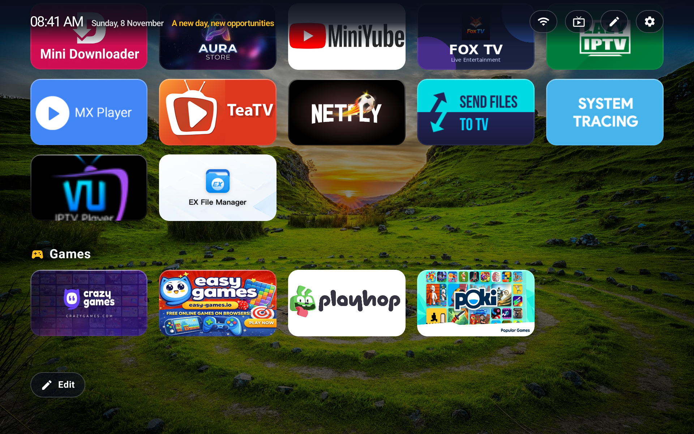

[English](README.md) | [العربية](README_ar.md) | [Deutsch](README_de.md) | [Français](README_fr.md) | [Italiano](README_it.md) | [Русский](README_ru.md) | [Español](README_es.md) | [Português](README_pt.md) | [Türkçe](README_tr.md) | [Polski](README_pl.md) | [Nederlands](README_nl.md) | [Ελληνικά](README_el.md) | [Bahasa Indonesia](README_id.md) | **Tiếng Việt** | [ไทย](README_th.md) | [中文](README_zh.md) | [日本語](README_ja.md) | [한국어](README_ko.md) | [हिन्दी](README_hi.md) | [اردو](README_ur.md) | [فارسی](README_fa.md)

<div align="center">

# 🌌 Salsa TV Launcher

**Trải nghiệm tương lai của giải trí gia đình với giao diện TV hiện đại, siêu mượt và đậm chất điện ảnh.**

[](https://developer.android.com/tv)
[](https://github.com/OsamaSalsa/Salsa-TV-Launcher)
[](https://kotlinlang.org/)
[](https://developer.android.com/jetpack/compose)
[](https://github.com/OsamaSalsa/Salsa-TV-Launcher/raw/refs/heads/main/salsa-tv-launcher.apk)

<br>

### 📥 [Nhấn vào đây để tải xuống phiên bản APK mới nhất (Sẵn sàng cài đặt)](https://github.com/OsamaSalsa/Salsa-TV-Launcher/raw/refs/heads/main/salsa-tv-launcher.apk)

<br>


</div>

---

## ✨ Tổng Quan

**Salsa TV Launcher** không chỉ là một màn hình chính thông thường; đây là một hệ sinh thái giải trí toàn diện được thiết kế riêng cho **Android TV và Smart TV Box**. Được xây dựng 100% bằng **Kotlin** và **Jetpack Compose**, Salsa kết hợp phong cách thiết kế "Glassmorphism" mượt mà, đậm chất điện ảnh với các công cụ mạnh mẽ tích hợp sẵn như trình phát **IPTV / Truyền hình trực tiếp**, **Trung tâm Cloud Gaming**, **Kho ứng dụng Salsa Store** và **Mini Downloader** để tải và cài đặt trực tiếp các gói APK.

Được tối ưu hóa chuyên biệt cho điều khiển từ xa của TV (điều hướng D-Pad), mọi hiệu ứng chuyển động, trạng thái tiêu điểm và chuyển cảnh đều đạt tốc độ 60 FPS mượt mà không giật lag.

---

## 🚀 Tính Năng Nổi Bật

### 🆕 Tính Năng Mới ở Phiên Bản 3.1
* **🛒 Salsa Store Trực Tuyến 100% Từ `auratv.freedev.app` (Không Lưu Sẵn Tên Ứng Dụng Trong Máy)**: Đã xóa toàn bộ danh sách ứng dụng lưu cục bộ — mỗi lần mở **Salsa Store**, ứng dụng sẽ tải trực tiếp tên, biểu tượng, mô tả và liên kết tải về từ `https://auratv.freedev.app/index.html` và hiển thị theo giao diện phân loại TV gốc: mục đầu tiên là **Trình duyệt Internet**, tiếp theo là **Mạng xã hội**, sau đó là các danh mục còn lại.
* **⌨️ Tự Động Hiện Bàn Phím Ảo Mặc Định Khi Nhấn Vào Ô Tìm Kiếm / Nhập Chữ Trên Web (Trừ YouTube)**: Khi nhấn vào bất kỳ ô nhập văn bản hoặc ô tìm kiếm nào (`<input>`, `<textarea>`, `contenteditable` hoặc hộp tìm kiếm) trong các trang web và ứng dụng web, hệ thống sẽ mở thanh nhập liệu gốc cùng bàn phím ảo mặc định của Android TV và điền trực tiếp văn bản vào trang web (ngoại trừ **YouTube** vì đã có bàn phím riêng).
* **🔐 Mã PIN Độc Lập Cho Từng Hồ Sơ (Không Có Mã Mặc Định `1234`), Xác Nhận 2 Lần, Khóa Vào Hồ Sơ & `Master PIN` Quản Trị Viên (`Main`)**: Loại bỏ hoàn toàn mã PIN mặc định `1234` — người dùng phải tạo mã PIN 4 chữ số mới và nhập hai lần để xác nhận trước khi dùng tính năng khóa. Mã PIN luôn được ẩn (`••••`) trong Cài đặt, yêu cầu nhập mã PIN cũ khi đổi hoặc xóa mã PIN; mỗi hồ sơ có mã PIN riêng cùng tùy chọn **Khóa chuyển đổi/đăng nhập hồ sơ bằng mã PIN**. Hồ sơ **`Main` (Admin)** không thể bị xóa và mã PIN của `Main` đóng vai trò là **Master PIN** giúp mở khóa, chỉnh sửa hoặc đặt lại mã PIN cho bất kỳ hồ sơ nào khi quên mã.
* **🎙️ Tăng Cường Độ Ổn Định Tìm Kiếm Giọng Nói Trên Android TV**: Kết nối trực tiếp với dịch vụ nhận diện giọng nói Android TV (`katniss` / Google Speech Services), kéo dài thời gian chờ micro điều khiển Bluetooth và tự động thử lại khi gặp lỗi tạm thời.
* **🛠️ Launcher Manager (`Cài đặt > Phím tắt hệ thống > Launcher Manager` — Đặt làm Màn Hình Chính Mặc Định qua ADB Cục Bộ)**: Trình hướng dẫn 3 bước tích hợp ngay trong ứng dụng giúp đặt **Salsa TV Launcher** làm màn hình chính `HOME` vĩnh viễn (giữ nguyên sau khi khởi động lại) thông qua kết nối ADB cục bộ của chính TV (`127.0.0.1:5555`) mà không cần máy tính hay điện thoại bên ngoài (`cmd package set-home-activity --user 0`), kèm tùy chọn tắt launcher gốc và khôi phục bằng một chạm.
* **🎨 Màu Nhấn Chủ Đề Động Theo Từng Hồ Sơ Người Dùng**: Màu nhấn đã chọn của mỗi hồ sơ người dùng sẽ tự động thay thế màu vàng/kim mặc định trên toàn bộ ứng dụng — bao gồm lời chào mừng, chữ nổi bật, tiêu đề mục Ứng dụng/Trò chơi/Web, Cài đặt, IPTV, Salsa Store và viền tiêu điểm.
* **👤 Hệ Thống Đa Hồ Sơ Người Dùng & Cách Ly Cài Đặt (`Hồ sơ / Người dùng`)**: Tạo hồ sơ riêng cho từng thành viên gia đình với **Giao diện, Màu nhấn & Hình nền**, **Bảo vệ màn hình**, **Ngôn ngữ**, **Kênh IPTV Yêu thích & Thứ tự kênh**, và **Thứ tự Ứng dụng / Web / Trò chơi** hoàn toàn độc lập; hỗ trợ **Mã PIN Hồ sơ 4 chữ số** tùy chọn cùng tùy chọn **Hiển thị / Khóa PIN / Ẩn** cho từng mục (IPTV, Ứng dụng, Web, Trò chơi). Ảnh đại diện tròn phẳng không viền trên màn hình chính được neo ở mép ngoài cùng thanh trên (**ngoài cùng bên phải với ngôn ngữ LTR, ngoài cùng bên trái với ngôn ngữ RTL**).
* **🔢 Chuyển Kênh Nhanh Bằng Phím Số (`0–9`) & Huy Hiệu Số Kênh Tương Phản Cao**: Nhấn các phím số `0–9` trên điều khiển trong danh sách IPTV hoặc trình phát toàn màn hình để nhảy thẳng đến số kênh mong muốn; huy hiệu chữ đen trên nền trắng bán trong suốt giúp đọc rõ trên mọi nền.
* **🎬 Video Bảo Vệ Màn Hình Cục Bộ / USB (`Media3 / ExoPlayer`) & Luồng `m.youtube.com` Thuần Khiết**: Phát tệp video từ bộ nhớ thiết bị hoặc USB qua trình chọn SAF không cần cấp quyền bộ nhớ rộng, bên cạnh luồng `m.youtube.com` toàn màn hình sạch sẽ không chữ hay lớp phủ.
* **📡 Bảo Vệ Màn Hình Tin Chữ Broadcast (12 Chủ Đề Động, Nền Tối Động & Đọc Giọng Nói)**: 12 chủ đề trường quay riêng biệt — 6 chủ đề cổ điển cùng 6 chủ đề sáng tạo mới (**Aurora Silk**, **Synthwave 80s**, **Cosmic Orbit**, **Royal Arabesque**, **Audio Studio Equalizer**, **Crystal Prism Hologram**) — mỗi chủ đề có chuyển động, bố cục và **nền tối động riêng** kèm đổ bóng đổi màu tương phản + ảnh xem trước trực tiếp trong Cài đặt, dòng chữ tùy chỉnh (`3–15s`), **Đọc Giọng Nói (TTS)** chờ đọc xong mới chuyển câu, cùng nhạc nền êm dịu hoặc MP3 cục bộ tùy chọn.
* **📺 Khôi Phục Lỗi IPTV Thông Minh (`Kênh Tiếp Theo` + Tự Thử Lại Sau 15s) & Mở Khóa Quà Bí Mật (`3× OK`)**: Khi kênh IPTV không phát được, hiển thị giao diện gọn gàng chỉ có nút **Kênh Tiếp Theo** kèm **đếm ngược 15 giây** tự động thử phát lại cùng kênh đó nếu người dùng không chọn. Ngoài ra, nhấn `OK` 3 lần trên thẻ IPTV khi chưa có danh sách phát sẽ mở khóa bộ kênh IPTV tuyển chọn tích hợp kèm hiệu ứng hộp quà mừng.
* **🛒 Danh Mục Salsa Store Tuyển Chọn**: **Salsa Store** ưu tiên **Trình Duyệt Web** và **Mạng Xã Hội** ở đầu danh mục 9 nhóm gồm các tiện ích và trình phát đa phương tiện hợp pháp cho Android TV.
* **🎨 Cài Đặt Giao Diện Trực Tiếp (`Live UI Settings`) — Chuyển Định Dạng Giờ Trực Tiếp**: Thanh nổi ngay trên màn hình chính bổ sung nút chọn **Định Dạng Giờ** (**`24h • 22:00`** / **`12h • AM/PM`**) ngay cạnh kích thước đồng hồ và định dạng ngày, cùng xem trước thời gian thực hình nền 4K, độ sáng, vị trí ứng dụng, số cột, độ mờ kính, lời chào, thời tiết, lọc ban đêm, Material You và chế độ nhẹ.
* **🖥️ Bảo Vệ Màn Hình Bảng Trực Tiếp, Đọc Tin Tức & Nhạc Nền Đồng Nhất Siêu Rõ**: Hiển thị **Thời tiết**, **Tin tức**, **Kinh tế**, **Bóng đá** hoặc **Luân phiên tất cả** (**Tin tức 60s → Thời tiết 10s → Kinh tế 10s → Bóng đá 10s → quay lại Tin tức tự chuyển sang chuyên mục tiếp theo**); chế độ Tin tức hỗ trợ **Đọc Giọng Nói (TTS)** đọc xong cả 6 tin rồi mới chuyển bảng, và tất cả bảng thông tin dùng chung bộ nhạc nền trong trẻo (**Bossa Nova**, **Smooth Jazz**, **Calm Ocean Waves**, **Classic Chillout**, âm thanh thiên nhiên và MP3 tùy chọn) tự động giảm âm lượng khi TTS đọc.
* **🌙 Thời Gian Chờ Bảo Vệ Màn Hình Mặc Định 10 Phút**: Thời gian chờ mặc định được nâng lên **10 phút** (tùy chỉnh: 2, 5, 10, 15, 30 phút hoặc Tắt).
* **🖱️ Chuột Ảo Tràn Viền, Phím Menu 3 Gạch (`☰`) Theo Ngữ Cảnh & Cập Nhật OTA Xác Thực**: Con trỏ chuột ảo trong cổng web và game HTML5 chạm tới trọn vẹn mép trên và mép dưới; phím **Menu (`☰` Ba Gạch)** tự động thích ứng theo màn hình (Màn hình chính → **Cài đặt**, trong IPTV → **Cài đặt IPTV**, trong Cổng Web/Game → bật tắt **Chuột Ảo**); nhấn giữ `OK` chính xác không mở nhầm ứng dụng khi thả tay; biểu tượng **Salsa Store** gọn đẹp mới; dòng phiên bản `v3.0` tinh tế ở màn hình khởi động và **tự động cập nhật GitHub OTA** kèm xác thực SHA-256 & chữ ký APK.
* **🌐 Trung Tâm 4 Bảng Trực Tiếp, Cổng Web & Động Cơ v3.0 21 Ngôn Ngữ**: **Thời tiết**, **Tin tức** (21 ngôn ngữ, 5 chuyên mục), **Kinh tế & Thị trường**, **Bóng đá (365Scores)**, cổng mặc định (**YouTube TV**, **Google**, **CrazyGames**, **Poki**, **Playhop**, **EasyGames**), thanh trên không cắt mép và động cơ v3.0 60 FPS.

### 🖥️ 1. Màn Hình Chính Điện Ảnh & Sống Động
* **Hiệu Ứng Tiêu Điểm Thông Minh:** Các thẻ ứng dụng trở nên sống động khi được chọn với viền phát sáng, đổ bóng mềm mại và phóng to mượt mà.
* **Thanh Tiêu Đề Ngữ Cảnh & Thời Tiết Trực Tiếp:** Hiển thị lời chào giàu cảm xúc theo từng khung giờ trong ngày, đồng hồ thời gian thực (12h/24h), trạng thái mạng (Wi-Fi / Ethernet) và thời tiết địa phương trực tiếp.
* **Yêu Thích & Ghim Nhanh:** Ghim các ứng dụng yêu thích lên thanh truy cập nhanh hoặc sắp xếp lại thứ tự ngay lập tức.
* **Hỗ Trợ 21 Ngôn Ngữ (LTR & RTL):** Bản địa hóa hoàn chỉnh sang **21 ngôn ngữ**, bao gồm Tiếng Việt, Tiếng Anh, Tiếng Ả Rập, Tiếng Đức, Tiếng Pháp, Tiếng Ý, Tiếng Nga, Tiếng Tây Ban Nha, Tiếng Bồ Đào Nha, Tiếng Thổ Nhĩ Kỳ, Tiếng Ba Lan, Tiếng Hà Lan, Tiếng Hy Lạp, Tiếng Indonesia, Tiếng Thái, Tiếng Trung, Tiếng Nhật, Tiếng Hàn, Tiếng Hindi, Tiếng Urdu và Tiếng Ba Tư.

<div align="center">
  
  
</div>

---

### 📺 2. Trình Phát IPTV & Truyền Hình Trực Tiếp Tích Hợp
* **Hỗ Trợ Danh Sách Phát M3U / M3U8:** Thêm danh sách phát IPTV của riêng bạn hoặc khám phá các kênh truyền hình quốc tế có sẵn.
* **Nhân ExoPlayer (Media3) Nguyên Bản:** Chuyển kênh cực nhanh với sự hỗ trợ cho các luồng HLS và DASH.
* **Lọc Danh Mục & Tìm Kiếm:** Lọc kênh theo Thể thao, Tin tức, Phim ảnh, Thiếu nhi hoặc tìm kiếm tức thì.
* **Kênh Yêu Thích:** Lưu lại các kênh bạn xem nhiều nhất để mở chỉ với một cú nhấp từ màn hình chính.

<div align="center">
  
</div>

---

### 🛍️ 3. Salsa Store (Kho Ứng Dụng Cho TV)
* **Danh Mục Tuyển Chọn Cho Android TV:** Tải xuống và cài đặt các ứng dụng xem phim, trình phát đa phương tiện, trình duyệt và tiện ích tốt nhất được tối ưu hóa cho TV mà không cần tài khoản Google.
* **Tải Xuống & Cài Đặt Trực Tiếp:** Thanh tiến trình thời gian thực tự động kích hoạt trình cài đặt gói của hệ thống.

<div align="center">
  
</div>

---

### 🎮 4. Cổng Cloud Gaming & Ứng Dụng Web
* **Chơi Game Không Cần Console:** Truy cập trực tiếp chỉ với một cú nhấp vào **Xbox Cloud Gaming**, **NVIDIA GeForce NOW**, **Amazon Luna** và các cổng game retro/web.
* **Tối Ưu Hóa Cho Tay Cầm (Gamepad):** Kết nối tay cầm Bluetooth và biến chiếc TV của bạn thành trung tâm chơi game thực thụ.

<div align="center">
  
</div>

---

### 📥 5. Mini Downloader & Cài Đặt APK Qua URL/Mã Số
* **Tải Qua URL Hoặc Mã Ngắn:** Nhập bất kỳ liên kết `.apk` trực tiếp nào hoặc mã số ngắn bằng bàn phím ảo thân thiện với điều khiển TV.
* **Lịch Sử Tải Xuống:** Quản lý, cài đặt lại hoặc xóa các tệp APK đã tải xuống trước đó một cách dễ dàng.

<div align="center">
  
</div>

---

### 🎨 6. Tùy Biến Sâu & Kiểm Soát Của Phụ Huynh
* **Hình Nền 4K & Chủ Đề:** Chọn từ hàng chục hình nền độ phân giải cao (Thiên nhiên, Vũ trụ, Trừu tượng, Cyberpunk, Tối giản) hoặc đặt ảnh tùy chỉnh từ bộ nhớ trong/USB.
* **Chế Độ Biểu Tượng Thanh Trên Cùng:** Chọn hiển thị biểu tượng **Trung Tâm Điều Khiển**, bỏ qua Trung tâm điều khiển để hiển thị **Cài Đặt Trực Tiếp**, hoặc **Hiển Thị Cả Hai Cùng Nhau** trên Màn hình chính.
* **Định Dạng Ngày Kiểu Mỹ & Quốc Tế:** Kiểu Mỹ (`MM/dd/yyyy`, `MMMM d, yyyy`, `EEEE, MMMM d, yyyy`, `EEE, MMM d`), Quốc tế (`dd/MM/yyyy`), ISO (`yyyy-MM-dd`), Châu Âu (`dd.MM.yyyy`) hoặc ẩn.
* **Tỷ Lệ Giao Diện, Màu Sắc Động (Material You) & Tất Cả Ứng Dụng Android (Sideloaded APKs):** Tùy chỉnh số cột, độ trong suốt của thẻ (10%–100%), bật **Màu Sắc Động Material You**, và chuyển đổi giữa chỉ hiển thị ứng dụng TV hoặc **tất cả ứng dụng Android đã cài đặt (bao gồm APK di động)**.
* **Trình Bảo Vệ Màn Hình Điện Ảnh (`m.youtube.com`), Video YouTube Tùy Chỉnh & Trình Chiếu Ảnh (`Slideshow`):** Thêm video YouTube tùy chỉnh vào màn hình chờ phát toàn màn hình sạch sẽ qua `m.youtube.com` không có chữ hay lớp phủ màn hình, kèm nút **xem trước trực tiếp**; hoặc trình chiếu ảnh từ thư mục (Bộ nhớ/USB), ảnh đã chọn hoặc bộ sưu tập 4K với thời gian mỗi ảnh (`5s`–`5m`), chuyển động **Ken Burns / Thu Phóng Nhẹ / Tĩnh**, 6 hiệu ứng chuyển cảnh, 7 hiệu ứng hạt (**Tuyết rơi ❄️**, **Đom đóm ✨**, **Mưa 🌧️**, **Lá mùa thu 🍂**, **Hoa anh đào 🌸**, **Ngôi sao ⭐**, **Bokeh 🔮**), đồng hồ góc và các bản nhạc nền trong trẻo (**Bossa Nova**, **Smooth Jazz**, **Calm Ocean Waves**, **Classic Chillout**, âm thanh thiên nhiên) hoặc MP3 tùy chỉnh.
* **Trình Quản Lý Dung Lượng Ứng Dụng & 10 Phím Tắt Hệ Thống (Bao Gồm `Launcher Manager`):** Xem tất cả ứng dụng đã cài đặt theo dung lượng (`MB`), mở thông tin hệ thống hoặc **gỡ cài đặt ứng dụng trực tiếp** để giải phóng bộ nhớ TV, cùng 10 phím tắt nhanh (**Wi-Fi, Ethernet, Màn hình, Âm thanh, Ngày/Giờ, Cài đặt, Thông tin ứng dụng, Quản lý bộ nhớ, Launcher Manager (ADB Default Home) và Tùy chọn nhà phát triển**).
* **Lá Chắn DNS Hai Chế Độ (AdBlock + Bảo Vệ Gia Đình) & Khóa PIN:** Chọn giữa **Chặn Quảng Cáo & Theo Dõi** hoặc **Chế Độ Bảo Vệ Gia Đình** (chặn trang web người lớn trên toàn hệ thống), và bảo vệ ứng dụng hoặc danh mục IPTV bằng mã PIN 4 chữ số.
* **Tìm Kiếm Giọng Nói (`🎤`), Trợ Lý Giọng Nói Mặc Định Hệ Thống, Dấu Trang Web Thông Minh & Đa Danh Sách IPTV:** Đặt **Salsa TV** làm trợ lý giọng nói mặc định của TV để nút micro trên điều khiển hoạt động trực tiếp; quản lý **nhiều danh sách phát M3U**; dấu trang web tự động tải biểu tượng HD và mở YouTube ở chế độ **YouTube TV Leanback**; hàng ứng dụng gần đây và cập nhật OTA từ GitHub.

---

## 🎮 Hướng Dẫn Phím Tắt Trên Điều Khiển Từ Xa

Salsa TV Launcher được thiết kế để điều khiển dễ dàng bằng bất kỳ điều khiển Android TV tiêu chuẩn nào:

| Nút Trên Điều Khiển | Nơi Sử Dụng | Chức Năng Thực Hiện |
| :--- | :--- | :--- |
| **Nút OK / Chọn (Nhấn nhanh)** | Bất kỳ ứng dụng hoặc thẻ nào | Mở ứng dụng, kênh hoặc cổng thông tin đã chọn. |
| **Nút OK / Chọn (Nhấn giữ)** | Trên ứng dụng hoặc kênh | Mở **Menu Quản Lý** (Sắp xếp, Khóa PIN, Ẩn, Phân loại Game, Thông tin ứng dụng / Gỡ cài đặt). |
| **Nút Menu (☰ Ba Gạch)** | Theo ngữ cảnh màn hình | Mở **Cài đặt** khi ở Màn hình chính, mở **Cài đặt IPTV** khi ở trong IPTV (trình duyệt kênh & trình phát; phím `INFO`/`GUIDE` bật tắt thanh kênh), và bật tắt **Chế độ Chuột Ảo** trong Cổng Web & Trò chơi. |
| **Nút Giọng Nói / Google Assistant (🎤)** | Bất kỳ đâu trong Launcher | Mở **Tìm Kiếm Giọng Nói Toàn Diện** của Salsa để tìm ứng dụng, kênh IPTV hoặc thực hiện lệnh thoại. |
| **Phím Điều Hướng (D-Pad)** | Trên toàn bộ ứng dụng | Di chuyển mượt mà giữa các danh mục, ứng dụng, kênh và nút điều khiển phát. |
| **Phím Số (`0–9`)** | Danh sách kênh / Trình phát IPTV | **Chuyển Kênh Nhanh (Quick Zap)** nhảy trực tiếp tới bất kỳ số kênh nào. |
| **Nút Quay Lại (Back)** | Trong cửa sổ / trình phát | Đóng các menu đang mở, thoát toàn màn hình hoặc quay lại đầu màn hình chính. |

> 💡 **Mẹo:** Bạn cũng có thể xem toàn bộ hướng dẫn nút bấm này ngay trong ứng dụng tại mục **Cài đặt > Hướng dẫn điều khiển**.

---

## 🔒 Bảo Mật, Quyền Riêng Tư & Minh Bạch Quyền Hệ Thống

* **HTTPS Mặc Định & WebView Duyệt Web An Toàn:** Toàn bộ kết nối mạng áp dụng HTTPS qua `network_security_config.xml` (`cleartextTrafficPermitted="false"`); WebView tích hợp bật **Safe Browsing** (`EnableSafeBrowsing=true`) và tắt đo lường (`MetricsOptOut=true`).
* **Cập Nhật OTA Có Xác Thực:** Trước khi cài đặt bản cập nhật, ứng dụng luôn kiểm tra mã băm **SHA-256** trong `version.json`, tên gói và **chứng chỉ ký số APK**.
* **Không Yêu Cầu Quyền Bộ Nhớ Rộng (`Không dùng MANAGE_EXTERNAL_STORAGE`):** Mọi thao tác chọn hình nền, trình chiếu ảnh, tệp MP3 hoặc video cục bộ đều sử dụng **Storage Access Framework (SAF)** không cần quyền truy cập toàn bộ bộ nhớ.
* **Giải Thích Từng Quyền:**
  * `INTERNET` & `ACCESS_NETWORK_STATE`: Dùng cho thời tiết, bảng thông tin trực tiếp, phát IPTV, cổng web và cập nhật OTA.
  * `ACCESS_COARSE_LOCATION` *(Tùy chọn)*: Chỉ dùng để tự động xác định thời tiết địa phương (có thể chọn thành phố thủ công).
  * `RECORD_AUDIO` *(Tùy chọn)*: Chỉ kích hoạt khi người dùng chủ động mở Tìm kiếm bằng giọng nói.
  * `REQUEST_INSTALL_PACKAGES` & `REQUEST_DELETE_PACKAGES`: Dùng cho Salsa Store, Mini Downloader, cập nhật OTA và Trình quản lý dung lượng ứng dụng.
  * `BIND_VPN_SERVICE`: Chỉ tạo đường hầm VPN cục bộ trên thiết bị cho Lá chắn DNS (AdBlock / Bảo vệ Gia đình), không gửi lưu lượng ra máy chủ ngoài.
  * `RECEIVE_BOOT_COMPLETED`: Tự động khôi phục Lá chắn DNS đã chọn sau khi khởi động lại TV.
* **Chế Độ Bảo Vệ Gia Đình Khóa PIN & Giới Hạn Của Launcher:** Thoát khỏi Chế độ Bảo vệ Gia Đình hoặc Hồ sơ Trẻ em yêu cầu **mã PIN 4 chữ số**. *Lưu ý:* Riêng một ứng dụng Launcher không thể ngăn trẻ thoát ra qua ứng dụng khác hoặc nút **Home** hệ thống; để bảo vệ tốt nhất, hãy đặt Salsa TV làm **Launcher Màn Hình Chính Mặc Định** và khóa PIN đối với **Cài đặt Hệ thống**.
* **Ghi Chú Nền Tảng (Điện Thoại / Màn Hình Cảm Ứng Nhỏ):** Salsa TV Launcher được tối ưu hóa cho **Android TV và Smart TV Box**. Bố cục cho điện thoại/màn hình cảm ứng nhỏ hiện đang ở giai đoạn **thử nghiệm / đang phát triển tích cực**.

---

## 🛠️ Kiến Trúc & Công Nghệ

* **Ngôn ngữ:** 100% [Kotlin](https://kotlinlang.org/) với Coroutines và StateFlow.
* **Giao diện (UI):** 100% [Jetpack Compose](https://developer.android.com/jetpack/compose) + Material Design 3 thích ứng cho TV.
* **Kiến trúc:** MVVM (Model-View-ViewModel) với quản lý trạng thái rõ ràng (`UiState`).
* **Phát đa phương tiện:** [AndroidX Media3 / ExoPlayer](https://developer.android.com/guide/topics/media/media3) cho các luồng HLS/M3U8.
* **Tải hình ảnh:** [Coil](https://coil-kt.github.io/coil/) với bộ nhớ đệm đĩa và RAM được tối ưu hóa.
* **Mạng & Thời tiết:** OkHttp + Open-Meteo API cung cấp dữ liệu thời tiết chính xác không cần khóa API.

---

## 📦 Cài Đặt

### Cách 1: Tải Trực Tiếp Tệp APK (Khuyên dùng)
1. Tải xuống tệp [`salsa-tv-launcher.apk`](https://github.com/OsamaSalsa/Salsa-TV-Launcher/raw/refs/heads/main/salsa-tv-launcher.apk) từ mục Releases.
   👉 **[Mã rút gọn ứng dụng Downloader / Liên kết trực tiếp: aftv.news/5157967](http://aftv.news/5157967)**
2. Chuyển tệp sang Android TV của bạn qua USB, ứng dụng *Send Files to TV* hoặc *Downloader*.
3. Cài đặt APK và cấp các quyền được yêu cầu.
4. Nhấn nút **Home** trên điều khiển và chọn **Salsa TV Launcher** làm màn hình chính mặc định (**"Luôn luôn"**).

### Cách 2: Cài Đặt Qua ADB
```bash
# Kết nối tới địa chỉ IP của Android TV
adb connect <DIA_CHI_IP_TV>:5555

# Cài đặt tệp APK
adb install -r salsa-tv-launcher.apk
```

---

## 📄 Giấy Phép & Bản Quyền

Kho lưu trữ này chỉ phân phối bản phát hành APK đã biên dịch (`salsa-tv-launcher.apk`), siêu dữ liệu cập nhật (`version.json`) và tài liệu hướng dẫn; mã nguồn không được công khai.

Thiết kế và phát triển bởi **© Osama Salsa**. Bảo lưu mọi quyền.
